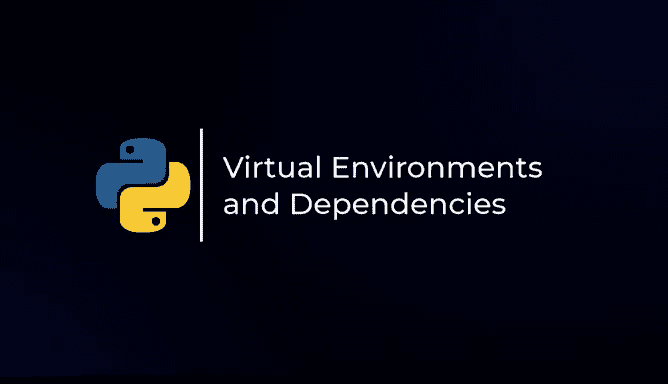
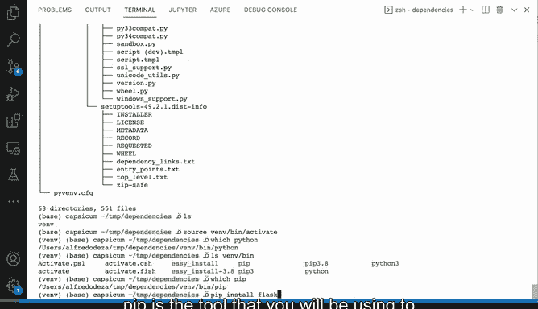

# 35：虚拟环境与依赖管理 🐍📦



在本节课中，我们将要学习Python开发中一个至关重要的概念：虚拟环境。我们将了解为什么需要它，以及如何使用它来安全地管理项目依赖。

---

在深入其他主题之前，理解Python在包管理方面普遍存在的问题非常重要。Python的打包、安装依赖以及相关操作有时会带来麻烦。

因此，接下来我将向你展示如何在终端中操作虚拟环境。你必须使用某种虚拟环境来安装依赖。

## 创建虚拟环境

我们使用Python3来创建虚拟环境。首先，你需要确认系统中Python可执行文件的位置。

创建虚拟环境的命令如下：
```bash
python3 -m venv vm
```
其中，`-m venv` 表示调用Python3内置的`venv`模块。`vm`是你为虚拟环境目录指定的名称，你可以使用任何名称。为了清晰起见，这里没有使用隐藏目录（以点开头）。

运行命令后，表面上似乎没有变化，但实际上已经创建了一个新目录。使用`ls`命令可以查看其内容：
```bash
ls vm
```
你会看到目录里包含许多文件。你只需要知道，它让你能够以一种自包含的方式在该目录内安装包。即使安装了错误的内容，也不会影响系统。

如果出现问题，你唯一需要做的就是删除这个目录，然后创建一个新的并从头开始。

## 激活虚拟环境

现在，我已经创建了目录，但还没有激活环境。

要激活它，在Linux或Mac上，请运行：
```bash
source vm/bin/activate
```
在Windows系统上操作略有不同，你可以使用PowerShell脚本。

激活后，你会注意到命令行提示符发生了变化，现在显示为`(vm)`，这表示虚拟环境的名称。

## 验证环境



如果我现在运行`which python`，系统会告诉我Python来自哪里。它来自这个`vm`目录中的Python。

同样，运行`which pip`也会显示Pip工具来自虚拟环境目录。这意味着，如果我使用Pip安装包，例如Flask：
```bash
pip install flask
```
Pip是你用来安装和卸载依赖的工具。这个命令会将Flask安装到虚拟环境的目录中。如果进入`vm/lib`目录下的`site-packages`文件夹，就能看到已安装的包，例如因为安装Flask而连带安装的Jinja2和Click。

## 使用依赖清单文件

如果你有许多依赖项，使用一个`requirements.txt`文件会非常有用。

以下是创建和使用该文件的方法：
首先，将依赖（如flask）写入文件：
```bash
echo "flask" > requirements.txt
```
然后，你可以使用单个命令安装文件中的所有依赖，而无需逐个安装：
```bash
pip install -r requirements.txt
```

## 停用与删除环境

要停用当前激活的虚拟环境，只需运行：
```bash
deactivate
```
你会看到命令行提示符恢复原样。再次运行`which python`，它将指向系统Python或Conda环境，而不再是虚拟环境中的Python。

你可以随时创建新的虚拟环境，例如：
```bash
python3 -m venv other_vm
```
然后使用`source other_vm/bin/activate`激活它。

---

本节课中，我们一起学习了虚拟环境的使用。请务必在安装、卸载、管理包和依赖时使用虚拟环境。它能确保一切安全且隔离。如果遇到问题，你只需要停用并删除环境，然后重新创建一个即可。