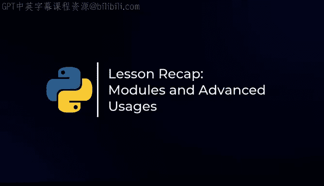

# 36：课程回顾-模块与高级用法 📚

在本节课中，我们将对Python模块、虚拟环境及依赖管理等核心概念进行回顾与总结，帮助你巩固项目设置的基础知识。

---

上一节我们介绍了Python编程的基础，本节中我们来看看如何组织代码和管理项目环境。

So that concludes the introduction to Python， you should now feel comfortable working with different imports。

至此，Python的介绍部分已经结束。你现在应该能熟练地处理不同的导入操作。

understanding what the virtual environment is， installing dependencies。

理解什么是虚拟环境，以及如何安装依赖项。

not only the ones that I showed， but whenever new dependencies for new projects get started。

不仅限于我演示过的那些，还包括每当启动新项目时需要的新依赖项。

以下是关于项目设置的核心要点：

*   你现在已经掌握了如何设置项目的基础。
*   你学会了如何让项目中的各项功能正常运行。
*   这种设置方式对你个人是安全且有用的。
*   这种设置方式对你的项目协作者同样安全且有用。

---

本节课中我们一起学习了Python模块化编程和项目环境管理。你掌握了使用`import`语句、理解虚拟环境的概念、以及使用`pip`安装和管理项目依赖。这些技能是构建可维护、可协作的Python项目，特别是机器学习运维项目的坚实基础。