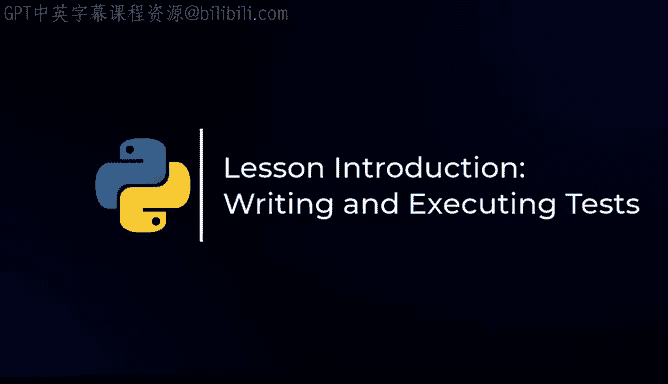

# 37：编写与执行测试 🧪

在本节课中，我们将学习测试的重要性以及如何熟练地进行测试。我们将介绍一些Python的约定和工具，并重点讲解一个我非常喜欢的外部库——PyTest。这个库能帮助你编写非常直观的测试，从而验证你的代码是否健壮、运行正确且没有错误。

---



## 为什么测试很重要？🤔

上一节我们明确了本课的目标，现在让我们首先探讨测试为何如此关键。测试是软件开发中不可或缺的一环，它能确保你的代码按预期工作，并在修改后依然保持正确性。通过编写测试，你可以提前发现并修复错误，提高代码质量，并增强对代码变更的信心。

## Python测试约定与工具 🛠️

了解了测试的重要性后，本节中我们来看看Python社区中常用的一些测试约定和内置工具。Python提供了`unittest`模块作为标准测试框架，它遵循xUnit风格。然而，许多开发者更倾向于使用更简洁、功能更强大的第三方库。

以下是Python中常见的测试方法：
*   **单元测试**：针对代码中最小的可测试单元（通常是函数或方法）进行测试。
*   **集成测试**：测试多个模块或组件协同工作的情况。
*   **功能测试**：从用户角度验证整个软件功能是否符合需求。

## 使用PyTest编写测试 ✨

Python内置的`unittest`模块功能完备，但语法有时略显繁琐。因此，本节我们将重点介绍**PyTest**，这是一个广受欢迎的外部测试框架，它让编写测试变得异常简单和直观。

PyTest的核心优势在于其简洁的语法。你只需要编写普通的函数，并使用`assert`语句进行断言。例如，测试一个加法函数：

```python
# 被测试的函数
def add(a, b):
    return a + b

# 使用PyTest编写的测试函数
def test_add():
    assert add(2, 3) == 5
    assert add(-1, 1) == 0
```

以下是使用PyTest的主要步骤：
1.  安装PyTest：`pip install pytest`
2.  创建测试文件，文件名需以`test_`开头（如`test_calculator.py`）。
3.  在文件中编写以`test_`开头的测试函数。
4.  在终端运行`pytest`命令，它会自动发现并运行所有测试。

PyTest还支持丰富的插件和高级功能，如**夹具（fixtures）**用于测试前的设置和清理，**参数化测试**用于用多组数据运行同一测试逻辑，这能极大地提升测试效率和覆盖率。

---

## 总结 📝


本节课中，我们一起学习了软件测试的基础知识。我们首先探讨了测试对于保证代码质量和可靠性的重要性。接着，我们回顾了Python标准的测试约定。最后，我们深入介绍了**PyTest**这个强大的测试框架，学习了如何使用它简洁的语法来编写和运行测试，从而确保我们的机器学习项目代码健壮无误。

通过掌握这些测试技能，你可以更自信地开发和维护代码，为构建可靠的机器学习运维管道打下坚实基础。