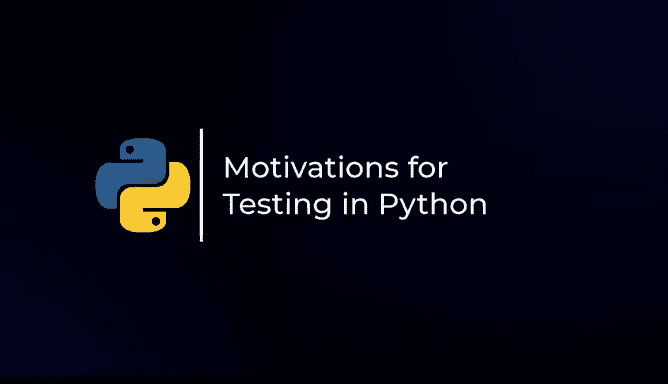
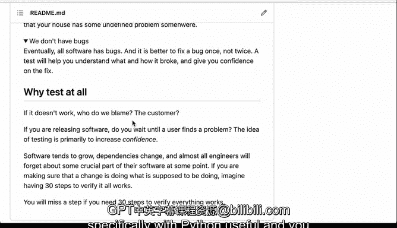

# 38：Python测试的动机 🧪

在本节课中，我们将要学习为什么在软件开发，特别是Python项目中，编写测试是至关重要的。我们将探讨关于测试的常见误解，并理解自动化测试如何帮助我们构建更健壮、更可维护的软件。

## 概述

在开始学习测试的基础知识以及如何在Python中应用之前，理解一些测试的核心概念非常重要。很多人初次接触测试时，可能并不理解它的重要性。然而，随着在Python和软件开发领域的深入，你会发现自动化测试对于验证工作、确保发布质量以及在生产环境中进行更改前进行双重检查，具有巨大的价值。

## 测试的常见误解与动机

在实践测试或建议工程团队应该进行更多测试时，通常会遇到三种常见的借口。下面我们来逐一分析这些观点。

### 1. 测试太耗时 ⏳

首先，让我们看看“测试太耗时”这个观点背后的实际原因。

在软件开发中，任何有价值的事情都需要前期投入，测试也不例外。你确实需要预先做一些工作。然而，从长远来看，测试验证了你的工作成果。虽然它需要时间，但测试带来的回报远超其投入成本。

你可以根据自己的节奏来设定预期，按需添加测试，不必过度测试，并观察它们的实际效用。随着项目规模的增长，如果你需要调试问题或查明某些功能为何失效，缺乏测试将耗费你更多的时间。

### 2. 测试太难了 🧗

另一个常见的观点是认为测试太难。和几乎所有技能一样，测试也需要通过练习来取得进步并达到熟练。

你需要花时间去理解什么是一个好的测试。例如，一个运行缓慢或不能真实反映业务场景的测试就不是好测试。一个好的测试，尤其是单元测试，应该具备以下特点：
*   **快速**：执行速度快。
*   **明确**：能清晰地告诉你失败的原因、预期的结果以及问题所在。
*   **有指导性**：为你提供修复问题的良好基础。

### 3. 我的代码很完美，没有Bug 🦸

最后一个观点可能令人惊讶，但确实有工程师曾对我说：“我写的代码很完美，从来没有Bug。”然而，**所有软件都有Bug**。这是软件讨论中一个不争的事实。

无论你是谁，拥有多少年经验，都会遇到Bug。而如果你拥有测试，它就有能力在你发布软件之前，准确地告诉你Bug在哪里。这样你就能理解问题的根源，进行修复，并在修复完成后验证发布或补丁的有效性。这本身就是一个强大的验证循环：如果你认为修复了一个Bug，什么能证明你真的修复了它？你已经下意识地进行了测试，那么为什么不将这个测试自动化，用代码来实现呢？

## 测试的核心价值：自动化与责任

几年前我做了一个关于测试的演讲，其核心前提是：**如果软件出了问题，我们该责怪谁？**

当你发布软件却不进行测试时，实际上你只是在等待用户抱怨软件无法工作或以何种方式无法工作。测试自动化是任何项目自动化的基石之一。试想，如果你有30个步骤来验证一切是否正常，作为人类，我们很可能会忘记其中一步，或是在某处打错字，从而导致结果与预期不符。

软件通常会不断增长，复杂性也会持续增加。软件测试将帮助你构建一个**非常健壮**、**高度可维护**的软件产品。

## 总结

本节课我们一起学习了在Python项目中实施测试的核心动机。我们分析了关于测试“太耗时”、“太难”和“代码完美无需测试”的三种常见误解，并阐述了测试在**自动化验证**、**提前发现Bug**和**构建可维护软件**方面的不可替代价值。希望这些关于测试，特别是Python测试的经验，能对你的项目有所帮助。