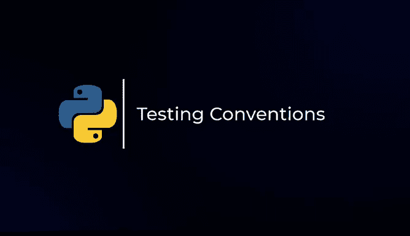
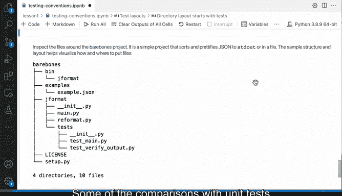

# 39：Python 测试规范与 PyTest 入门 🧪



在本节课中，我们将学习 Python 中的测试规范，了解标准库 `unittest` 的基本用法及其局限性，并重点介绍更受推荐的测试框架 `PyTest` 的优势和基本使用规范。

---

## Python 标准库：unittest

Python 自带 `unittest` 测试库，无需额外安装。然而，在多数情况下，它可能并非首选。我们先来看看它的基本用法。

以下是一个简单的 `unittest` 示例代码：

```python
import unittest

class TestStringMethods(unittest.TestCase):
    def test_upper(self):
        self.assertEqual('foo'.upper(), 'FOO')
```

在这段代码中，我们需要导入 `unittest` 模块，创建一个继承自 `unittest.TestCase` 的类，并在其中定义以 `test_` 开头的方法。断言需要使用 `self.assert` 系列辅助方法，例如 `self.assertEqual`。

`unittest` 提供了多种断言方法，如 `assertEqual`、`assertTrue`、`assertFalse`、`assertIs`、`assertIsNot` 等。然而，其测试报告在失败时提供的信息不够丰富和直观。例如，使用 `assertNotAlmostEqual` 比较两个整数时，错误信息可能包含“within 7 places”这类对调试帮助不大的描述。

此外，使用 `unittest` 必须采用面向对象的方式，要求创建测试类并使用继承，这增加了入门复杂度。

---

## 更优选择：PyTest 框架

鉴于 `unittest` 的上述特点，我们引入 `PyTest` 框架。`PyTest` 是一个功能强大且易用的命令行工具和测试框架。

`PyTest` 的核心优势在于它增强了原生的 `assert` 语句。在 Python 中，通常不鼓励在生产代码中使用原生 `assert`，一方面是因为可以通过 `-O` 选项移除它们，另一方面是其失败信息不够描述性。但 `PyTest` 解决了后者的问题。

在 `PyTest` 中，你可以直接使用原生 `assert` 进行断言，框架会为其生成非常详细和易读的失败报告。这使得测试代码更加简洁直观。

以下是 `PyTest` 的一个简单测试函数示例：

```python
def test_addition():
    assert 1 + 1 == 2

def test_string():
    assert 'hello'.upper() == 'HELLO'
```

测试可以是简单的函数，也可以是类。如果使用类，类名需要以 `Test` 开头，但无需继承任何基类，这提供了极大的灵活性。

---

## 测试文件与代码的组织规范

上一节我们介绍了 `PyTest` 的基本写法，本节中我们来看看如何组织测试文件和代码。`PyTest`（以及 `unittest` 等工具）依赖一些命名约定来自动发现和运行测试。

以下是需要遵循的关键约定：

*   **测试目录命名**：通常使用复数形式的 `tests` 作为目录名。避免使用单数 `test`，以免与 Python 内置的 `test` 模块冲突。
*   **测试文件命名**：包含测试代码的文件名需要以 `test_` 开头。
*   **测试项目结构示例**：
    ```
    my_project/
    │
    ├── my_project/          # 项目主代码包
    │   └── __init__.py
    │
    └── tests/               # 测试目录
        ├── __init__.py
        ├── test_main.py     # 测试文件，以 test_ 开头
        └── test_verify_output.py
    ```
*   **测试代码单元命名**：
    *   测试函数需要以 `test_` 开头。
    *   测试类需要以 `Test` 开头（首字母大写）。

遵循这些约定后，在项目根目录下简单地运行 `pytest` 命令，工具就能自动发现并运行所有测试。

关于测试代码的位置，既可以放在项目内部的 `tests` 目录中，也可以放在项目外部，这取决于个人或团队的偏好。

---

## 课程总结



本节课中我们一起学习了 Python 的测试规范。我们首先了解了标准库 `unittest` 的基本用法和它在报告友好性、代码简洁性方面的不足。接着，我们重点介绍了 `PyTest` 框架，它通过增强原生 `assert` 语句提供了出色的失败报告，并且允许以更简单的函数形式编写测试，降低了使用门槛。最后，我们明确了组织测试代码时需要遵循的目录和文件命名约定，这些约定是测试工具自动发现测试的基础。掌握这些内容，是构建可靠 Python 项目的重要一步。