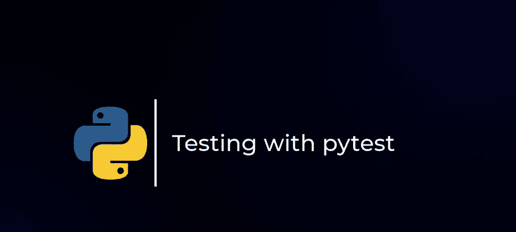
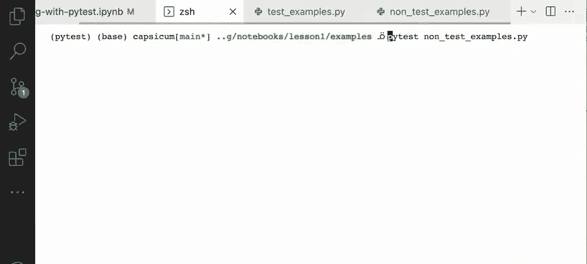

# 40：使用pytest进行测试 🧪



在本节课中，我们将学习如何安装和运行 `pytest` 测试框架，并理解其自动发现测试文件的命名约定。

---

## 创建虚拟环境

首先，建议为项目创建一个独立的虚拟环境。你可以使用以下命令创建，其中 `venv` 是虚拟环境的名称，你可以自定义。

```bash
python -m venv venv
```

创建完成后，需要激活这个虚拟环境。

---

## 安装pytest

激活虚拟环境后，使用 `pip` 安装 `pytest`。

```bash
pip install pytest
```

为了便于项目依赖管理，**强烈建议**将 `pytest` 添加到 `requirements.txt` 文件中。这样能确保项目在任何时候都能明确其运行依赖。

---

## 测试文件命名约定

上一节我们介绍了环境的搭建，本节中我们来看看 `pytest` 如何发现和运行测试文件。

`pytest` 遵循特定的命名约定来自动发现测试文件。它会自动收集所有以 `test_` 开头的文件或目录，以及文件中以 `test_` 开头的函数或方法。

以下是两个示例文件：
*   `test_examples.py`：符合命名约定，会被自动发现。
*   `non_test_examples.py`：不符合命名约定，默认情况下不会被自动发现。

---

## 运行测试

在包含测试文件的目录下，直接运行 `pytest` 命令即可。

```bash
pytest
```

运行后，`pytest` 会输出测试结果摘要，包括测试平台、Python版本、收集到的测试项数量以及每个测试的通过或失败状态。

如果只想运行某个特定的文件，可以明确指定文件名。

```bash
pytest non_test_examples.py
```

即使文件不符合 `test_` 前缀的命名约定，通过显式指定，`pytest` 也会执行其中的测试。

---

## 理解测试收集

如果我们将 `test_examples.py` 重命名为不符合约定的名字（例如 `rtest_examples.py`），再次运行 `pytest` 命令（不指定文件）将收集不到任何测试。

```bash
pytest
# 输出可能包含：collected 0 items
```

这体现了命名约定的重要性。遵循约定可以让测试运行变得简单高效。当然，`pytest` 的配置非常灵活，你可以修改默认的发现规则，但遵循约定是最佳实践。

你可能会问，为什么要在测试文件中放置非测试内容？有时，测试需要一些辅助函数或工具（例如生成测试数据、模拟文件操作），这些辅助代码可以放在同一个文件中，只要它们不以 `test_` 开头，就不会被当作测试执行。

---

## 在项目结构中运行

`pytest` 的自动发现功能在项目子目录中同样有效。即使在项目根目录下运行 `pytest`，它也会递归地搜索所有子目录，找到并运行所有符合命名约定的测试文件。



---

本节课中我们一起学习了 `pytest` 测试框架的基本使用方法：从创建虚拟环境、安装 `pytest`，到理解其基于文件命名的自动测试发现机制，最后掌握了运行测试的几种方式。遵循 `test_` 前缀的命名约定是高效使用 `pytest` 的关键。