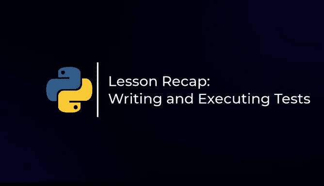

# 41：编写与执行测试 🧪

在本节课中，我们将回顾并学习编写与执行测试的核心概念。测试是软件开发中至关重要的一环，它能确保代码的可靠性、健壮性和可维护性。我们将了解测试的重要性，并学习如何使用 `pytest` 工具来编写高质量的测试。

## 测试的重要性与基础

上一节我们介绍了测试的基本概念，本节中我们来看看为什么测试如此关键。

测试非常重要，不仅限于Python领域。你现在已经具备了理解测试重要性的基础。

你理解了为什么应该进行测试，以及测试如何使你的代码变得更好、更健壮、更易于维护。这些都是良好的基础。

## 使用 `pytest` 工具

除了理论基础，你现在还了解了一个名为 `pytest` 的工具。这个工具允许你编写非常出色的测试，并提供极其详尽的测试报告。

以下是 `pytest` 的核心优势：

*   能够编写高质量的测试用例。
*   生成非常清晰、详细的测试报告。
*   使你成为更优秀的数据科学家、数据工程师或软件工程师。

## 总结

本节课中我们一起学习了测试在代码开发中的核心价值。我们明确了测试的目的是为了提升代码质量、健壮性和可维护性。同时，我们介绍了 `pytest` 这一强大工具，它通过提供简洁的语法和丰富的报告功能，能有效帮助我们编写和执行测试，从而提升我们的开发能力。