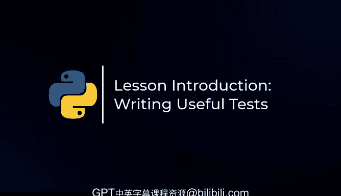

# 42：编写实用测试 🧪

在本节课中，我们将学习如何编写实用的Python测试。我们将从基础的断言开始，探讨如何组织测试代码，并介绍一个强大的高级功能，以帮助你编写更高效、更简洁的测试。

---

## 课程概述 📋



测试是确保代码质量的关键环节。本节课将涵盖以下核心内容：使用简单的`assert`语句、编写测试类和测试函数，以及如何根据情况选择最合适的测试组织形式。最后，我们将深入了解一个名为“参数化”的高级功能，它能在输出不同但断言逻辑相同时，显著提升测试的编写效率。

---

## 使用简单的断言（assert）

上一节我们介绍了测试的重要性，本节中我们来看看最基础的测试工具——`assert`语句。断言是测试的基石，用于验证代码行为是否符合预期。

`assert`语句的基本语法如下：
```python
assert 条件表达式, "可选的错误信息"
```
如果条件表达式为`False`，程序将抛出`AssertionError`并停止执行。

以下是使用`assert`进行测试的几个要点：
*   `assert`简单直接，无需引入额外测试框架即可进行快速验证。
*   它适用于简单的脚本或快速原型开发中的即时检查。
*   在正式的测试套件中，通常使用更专业的测试框架（如`pytest`或`unittest`），它们能提供更丰富的断言方法和更好的测试报告。

---

## 组织测试代码：类与函数

在编写了基础断言后，我们需要考虑如何组织测试代码。主要有两种方式：将测试编写在类中，或者编写为独立的函数。

以下是选择测试组织形式的一些指导原则：
*   **使用测试类**：当你有许多相关的测试方法，并且它们可以共享通用的设置（`setUp`）和清理（`tearDown`）代码时，将测试组织在类中是很好的选择。这符合面向对象的思想，便于管理。
*   **使用测试函数**：对于简单、独立的测试场景，使用函数更加轻量和直观。它没有类的结构开销，写起来更快速。

两种方式没有绝对的优劣，关键在于根据测试的逻辑复杂度和关联性做出合适的选择。

---

## 高级功能：参数化测试（parametrize）

上一节我们讨论了测试的组织形式，本节中我们来看看一个能极大提升测试效率的高级功能——参数化。

参数化测试允许你使用不同的输入数据运行同一个测试逻辑。当测试模式相同，只是输入和预期输出发生变化时，这能避免编写大量重复的测试代码。

例如，使用`pytest`的`@pytest.mark.parametrize`装饰器：
```python
import pytest

@pytest.mark.parametrize("input, expected", [
    (1, 2),
    (5, 10),
    (-3, -6),
])
def test_double(input, expected):
    assert input * 2 == expected
```
上面的代码会运行三次`test_double`函数，分别使用三组不同的`(input, expected)`数据。这样，我们就用一个测试函数覆盖了多种情况。

---

## 课程总结 🎯


本节课中我们一起学习了编写实用Python测试的核心知识。我们从最简单的`assert`语句开始，了解了其在快速验证中的作用。接着，我们探讨了如何通过类或函数来组织测试代码，并分析了各自的适用场景。最后，我们介绍了参数化测试这一强大工具，它能够帮助我们用更简洁的代码测试多种输入输出组合，是编写高效测试套件的关键。

掌握这些测试编写方法，将为你的机器学习运维（MLOps）工作打下坚实的基础，确保模型代码的可靠性和可维护性。