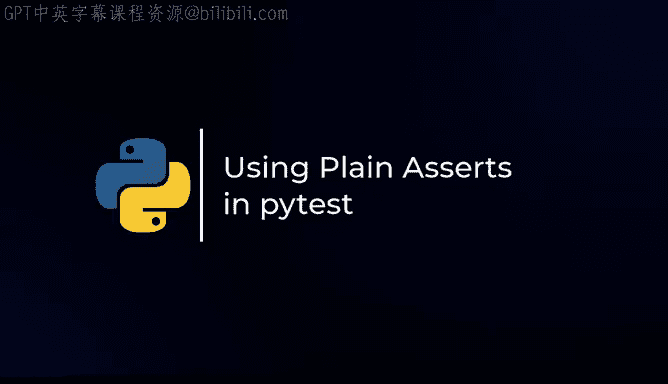
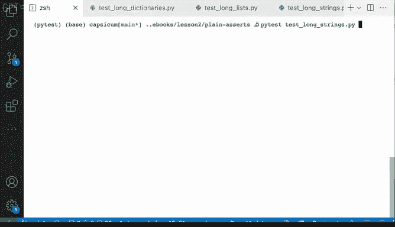

# 43：在 pytest 中使用断言 🔍



在本节课中，我们将学习如何在 `pytest` 框架中使用普通的 `assert` 语句来测试和比较复杂的数据结构。我们将通过三个具体的例子——长字典、长列表和长字符串——来展示 `pytest` 如何清晰地定位并报告测试失败的原因，从而帮助你高效地调试代码。

---

之前我们提到，在 `pytest` 中直接使用普通的 `assert` 语句是非常好的做法，你无需为此担心。

现在，我打开了一个终端，激活了 `pytest` 虚拟环境，`pytest` 已经安装完毕，可以开始使用了。我有三个示例文件，将向你展示它是如何工作的。

## 测试长字典 📚

首先，我们来看一个测试长字典的例子。有时在测试中，你需要比较非常大、非常密集、完全填充的对象或数据结构，比如字典。使用 `pytest` 的普通 `assert` 会非常棒，因为它能清晰地指出差异所在，无论差异在哪里。

以下是一个测试函数，其中包含一个结果和一个期望值：

```python
def test_long_dictionaries():
    result = {"first_name": "John", "last_name": "Doe", "age": 30}
    expectation = {"first_name": "John", "last_aim": "Doe", "age": 30}
    assert result == expectation
```

运行这个测试，我们预期它会失败，因为 `result` 中的键是 `"last_name"`，而 `expectation` 中是 `"last_aim"`。

让我们在终端中运行这个测试：

```bash
pytest test_long_dictionaries.py -v
```

`pytest` 会报告失败，并指出：“左边包含一个额外的项 `‘last_name’: ‘Doe’`，右边包含一个额外的项 `‘last_aim’: ‘Doe’`”。这有点难以分辨，因为只是键名不同。

如果我们想看到更详细的差异对比，可以加上 `-vv` 标志：

```bash
pytest test_long_dictionaries.py -vv
```

现在，`pytest` 会运行完整的差异引擎，将两个字典并排显示，并用 `+` 号标出 `result` 中有而 `expectation` 中没有的项（即 `‘last_name’: ‘Doe’`）。这就是使用普通 `assert` 的强大之处。

## 测试长列表 📋

上一节我们看到了 `pytest` 如何处理字典的差异。本节中，我们来看看它如何处理长列表。列表是一种有序的数据结构，通过索引访问。

假设我们有以下测试：

```python
def test_long_lists():
    result = [1, 2, 3, 4, 5]
    expectation = [1, 2, 99, 4, 5]
    assert result == expectation
```

运行这个测试：

```bash
pytest test_long_lists.py -v
```

`pytest` 会报告：“在索引 2 处不匹配”。列表索引从 0 开始，所以索引 2 指的是第三个元素。它准确地告诉你问题出在哪里。

同样，使用 `-vv` 标志可以获得更详细的输出，显示列表中之前被省略的其他相同元素。

## 测试长字符串 📝

最后，我们来看长字符串的比较。这对于 Python 中的所有数据结构都适用，尽管对于自定义数据结构，你可能需要做一些额外的工作，但 `pytest` 的基础功能已经非常有用。

考虑以下测试：

```python
def test_long_strings():
    result = "This is a very long string with a typo."
    expectation = "This is a very long string with a typo."
    assert result == expectation
```

运行测试：

```bash
pytest test_long_strings.py -v
```

如果字符串很长且存在差异（例如大小写问题），`pytest` 会毫无困难地找出不同之处。它还会创建你所测试数据的子集，比较两者，并精确地显示你需要修复的内容。

---




本节课中，我们一起学习了如何在 `pytest` 中使用普通的 `assert` 语句来测试三种常见的数据结构：字典、列表和字符串。`pytest` 能够精确地指出测试失败的位置和原因，并提供了详细的差异对比，使你能够快速定位并修复问题。这是一个非常强大且实用的功能，适用于所有 Python 数据结构。