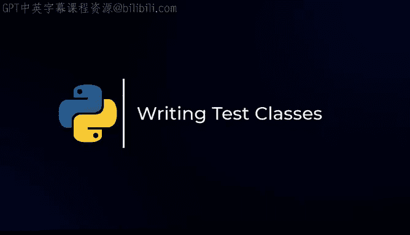
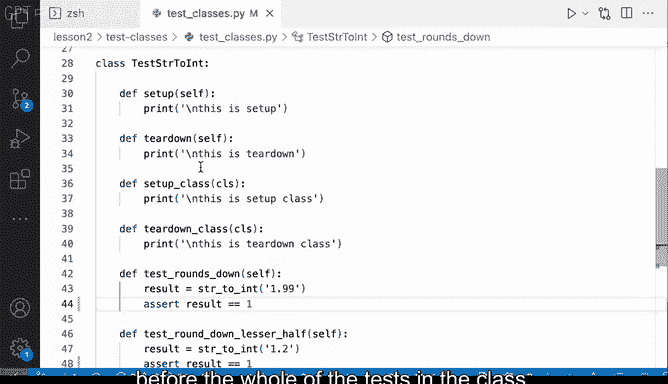

# 44：编写测试类 🧪



在本节课中，我们将学习如何在 Python 中使用 `pytest` 编写测试类。我们将了解测试类与测试函数的区别，并探索如何利用 `setup` 和 `teardown` 方法来组织和管理测试代码。

---

## 概述

之前我们已经学习了测试函数，但尚未涉及测试类。测试类同样有用，它允许你将相关的测试分组在一起。我们将探讨决定使用测试函数还是测试类的因素，并通过一个实际示例来演示测试类的用法。

## 测试类简介

测试类提供了一种将多个测试组织在一起的方式。与测试函数相比，测试类允许你在每个测试运行前后执行一些预备和清理工作，这通过 `setup` 和 `teardown` 方法实现。

## 示例：字符串转整数函数

我们有一个将字符串转换为整数的函数 `string_to_int`。例如，输入字符串 `"1.1"` 将返回整数 `1`。我们将为此函数编写测试。

以下是使用测试类的示例代码：

```python
class TestStringToInt:
    @classmethod
    def setup_class(cls):
        print("运行类级别的 setup_class")

    @classmethod
    def teardown_class(cls):
        print("运行类级别的 teardown_class")

    def setup(self):
        print("运行测试前的 setup")

    def teardown(self):
        print("运行测试后的 teardown")

    def test_round_down(self):
        assert string_to_int("1.99") == 2

    def test_round_down_lesser_half(self):
        assert string_to_int("1.2") == 2
```

## 测试类中的方法解析

以下是测试类中各个方法的作用：

*   **`setup`**：在每个测试方法运行前执行。
*   **`teardown`**：在每个测试方法运行后执行，无论测试通过、失败还是抛出异常。
*   **`setup_class`**：在所有测试方法运行前执行一次。注意，它使用 `cls` 参数而非 `self`。
*   **`teardown_class`**：在所有测试方法运行后执行一次。

## 运行测试并分析输出

在终端中运行测试命令：

```bash
pytest test_classes.py
```

当测试失败时，`pytest` 会显示详细的输出，包括 `setup` 和 `teardown` 方法打印的信息。这有助于调试失败的原因。

测试执行顺序如下：

1.  执行 `setup_class`（一次）。
2.  对于每个测试方法：
    *   执行 `setup`。
    *   执行测试方法。
    *   执行 `teardown`。
3.  执行 `teardown_class`（一次）。

## 使测试通过

为了演示测试通过的情况，我们将测试中的预期结果修改为正确的值：

```python
def test_round_down(self):
    assert string_to_int("1.99") == 1

def test_round_down_lesser_half(self):
    assert string_to_int("1.2") == 1
```

再次运行测试，所有测试通过。此时，`pytest` 默认不会显示 `setup` 和 `teardown` 的输出，以避免在一切正常时产生大量文本信息。

## 总结



本节课中，我们一起学习了如何使用 `pytest` 编写测试类。测试类允许你将相关测试分组，并通过 `setup`、`teardown`、`setup_class` 和 `teardown_class` 方法灵活地管理测试环境。当测试失败时，详细的输出有助于快速定位问题；而当所有测试通过时，简洁的输出则提供了清晰的反馈。