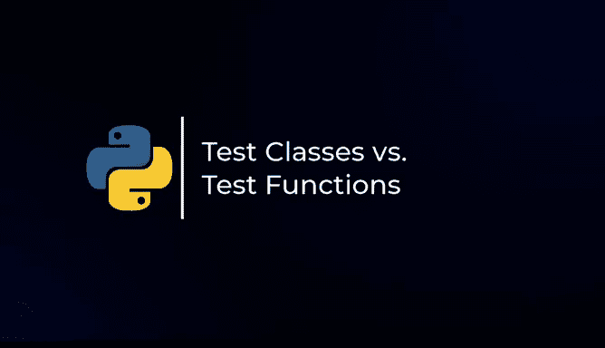
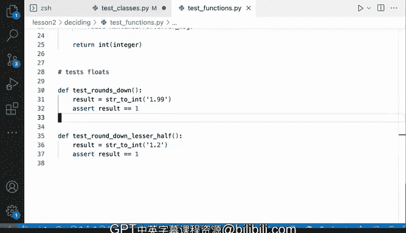

# 45：测试类与测试函数对比 🧪



在本节课中，我们将探讨在编写测试时，如何选择使用测试函数还是测试类。我们将分析两者的适用场景、优缺点，并通过具体示例帮助你理解如何根据实际需求做出选择。

---

## 概述

在之前的课程中，我们学习了使用 PyTest 编写测试的两种主要方式：**测试函数**和**测试类**。你可能想知道，在实际项目中应该何时使用函数，何时使用类。本节将对比这两种方式，帮助你根据测试的组织结构、共享设置需求和个人偏好做出决策。

## 测试函数与测试类的对比

上一节我们介绍了测试函数和测试类的基本写法，本节中我们来看看如何在实际中选择使用它们。

### 测试函数的优势

测试函数通常更简单、更直接。对于大多数测试场景，尤其是独立的、不需要复杂设置或清理操作的测试，使用函数是推荐的做法。

以下是测试函数的一些特点：
*   **简单直接**：函数定义清晰，易于编写和理解。
*   **无需样板代码**：不需要像类那样定义 `self` 参数或继承特定类。
*   **适合独立测试**：每个测试函数都是自包含的，适合测试单一功能。

例如，一个测试浮点数操作的函数可能如下所示：
```python
def test_string_to_int_floats():
    result = int(float("1.99"))
    assert result == 1
```

### 测试类的优势

当需要将多个相关的测试分组，并且这些测试需要共享相同的设置或清理步骤时，使用测试类更为合适。

以下是测试类的一些适用场景：
*   **测试分组**：可以将测试相同模块、功能或数据类型的测试组织在一起。
*   **共享设置**：通过 `setup_class`、`teardown_class`、`setup_method`、`teardown_method` 等方法，可以一次性为类中的所有测试执行准备和清理工作，避免代码重复。

例如，一个包含共享设置的测试类可能结构如下：
```python
class TestFloatOperations:
    @classmethod
    def setup_class(cls):
        # 为整个测试类执行一次初始化，例如建立数据库连接
        cls.shared_resource = initialize_resource()

    def test_string_to_int_for_floats(self):
        result = int(float("1.99"))
        assert result == 1

    def test_another_float_operation(self):
        # 可以使用 cls.shared_resource
        assert self.shared_resource.is_valid()
```

### 如何选择：灵活性在于你

选择使用函数还是类，并没有强制规定，这完全取决于你如何组织代码以及项目的具体需求。

*   如果你觉得函数更直观，并且测试用例之间相对独立，那么就坚持使用函数。
*   如果你发现有一组测试都需要相同的数据库连接、临时文件或模拟对象，那么将它们放入一个测试类中，并利用类级别的设置方法，会是更高效、更清晰的做法。

此外，类的命名本身可以作为测试内容的一种提示。例如，一个名为 `TestStringToIntFloats` 的类，明确指出了它专注于测试“看起来像浮点数的字符串转换为整数”的行为。

## 总结

本节课中我们一起学习了测试函数与测试类的对比。核心要点如下：
*   **测试函数** 简单直接，是大多数情况下的首选。
*   **测试类** 适合需要**分组**和**共享设置/清理逻辑**的测试场景。
*   最终选择取决于你的**组织需求**和**个人偏好**。PyTest 同时支持两者，提供了充分的灵活性。



对于初学者，可以从测试函数开始，随着测试套件变得复杂，再自然地引入测试类来更好地组织代码。关键在于编写出清晰、可维护的测试。