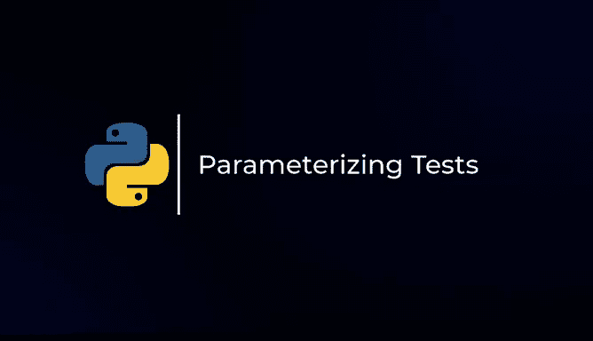
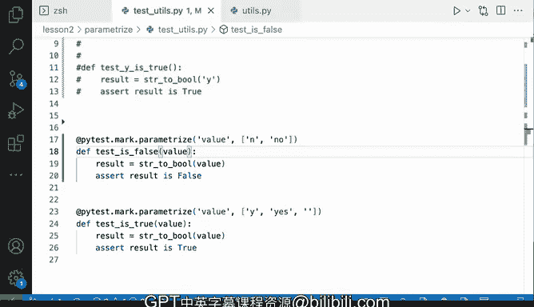

# 46：参数化测试 🧪



## 概述

在本节课中，我们将要学习 PyTest 框架中一个非常强大的功能——参数化测试。参数化测试听起来可能有些复杂，但它能极大地简化我们的测试代码，让测试用例的组织和执行更加清晰高效。我们将通过一个具体的例子，了解参数化测试的用途、优势以及如何实现它。

---

## 什么是参数化测试？

上一节我们介绍了单元测试的基本概念。本节中我们来看看一种更高效的测试编写方式。

参数化测试允许我们为同一个测试函数提供多组不同的输入数据和预期结果。这样，我们无需为每个相似的测试场景重复编写几乎相同的测试函数，只需编写一个测试函数，然后通过装饰器为其提供多组参数即可。

## 一个具体的例子

为了更好地理解，我们来看一个实际的工具函数。这个函数叫做 `string_to_bool`，它的功能是将特定的字符串转换为布尔值。

以下是该函数的核心逻辑，用代码描述：

```python
def string_to_bool(value):
    if value in ('yes', 'y', ''):
        return True
    elif value in ('no', 'n'):
        return False
```

简单来说，当输入是 `'yes'`、`'y'` 或空字符串 `''` 时，函数返回 `True`；当输入是 `'no'` 或 `'n'` 时，函数返回 `False`。

## 传统测试方法的问题

现在，我们需要为返回 `True` 的几种情况编写测试。一种直观但不推荐的做法是使用 `for` 循环。

以下是传统测试方法的一个示例：

```python
def test_string_to_bool():
    true_values = ['yes', 'y', '']
    for value in true_values:
        result = string_to_bool(value)
        assert result is True
```

这种方法存在一个主要问题：**当测试失败时，信息不完整**。如果循环中的第一个值 `'yes'` 就导致测试失败，PyTest 会立即停止执行这个测试函数。我们无法知道后面的 `'y'` 和 `''` 是否也能通过测试。这不利于我们全面定位问题。

因此，在单元测试中应避免使用循环来测试多组数据。

## 参数化测试的解决方案

为了解决上述问题，我们可以使用 PyTest 的 `@pytest.mark.parametrize` 装饰器。它能让 PyTest 将一组参数视为多个独立的测试用例来执行。

以下是使用参数化测试的步骤：

首先，我们需要从 `pytest` 中导入必要的模块。

```python
import pytest
from utils import string_to_bool
```

接着，我们使用 `@pytest.mark.parametrize` 装饰器来定义测试。装饰器接收两个主要参数：第一个是字符串，代表要传递给测试函数的参数名；第二个是一个列表，包含所有要测试的输入值。

```python
@pytest.mark.parametrize("value", ['y', 'yes', ''])
def test_string_to_bool_is_true(value):
    result = string_to_bool(value)
    assert result is True
```

在这个例子中，`"value"` 是参数名，`['y', 'yes', '']` 是三个要测试的输入值。PyTest 会为列表中的每个值**单独运行一次** `test_string_to_bool_is_true` 函数。

## 参数化测试的优势

当我们运行测试时，优势就体现出来了。

在终端执行 `pytest -v` 命令，你会看到类似下面的输出：

```
collected 3 items

test_utils.py::test_string_to_bool_is_true[y] PASSED
test_utils.py::test_string_to_bool_is_true[yes] PASSED
test_utils.py::test_string_to_bool_is_true[] PASSED
```

关键点在于：**PyTest 收集了3个测试项**。尽管我们只写了一个测试函数，但参数化装饰器让它变成了三个独立的测试。如果其中某一个测试失败（例如输入 `'n'` 被意外加入了 `True` 值的列表），PyTest 会明确报告是哪个参数值导致了失败，而其他测试仍会继续执行并报告结果。

这样，我们就能获得完整、清晰的测试反馈。

## 编写完整的测试套件

利用参数化测试，我们可以快速为返回 `False` 的情况也编写测试。

以下是完整的测试用例示例：

```python
# 测试返回 True 的情况
@pytest.mark.parametrize("value", ['y', 'yes', ''])
def test_string_to_bool_is_true(value):
    result = string_to_bool(value)
    assert result is True

# 测试返回 False 的情况
@pytest.mark.parametrize("value", ['n', 'no'])
def test_string_to_bool_is_false(value):
    result = string_to_bool(value)
    assert result is False
```

最终，我们只编写了两个测试函数，但 PyTest 会将其执行为五个独立的测试用例（3个 `True` + 2个 `False`），覆盖了所有输入情况。代码简洁，且测试报告详尽。

---

## 总结

本节课中我们一起学习了 PyTest 的参数化测试。

*   **核心概念**：使用 `@pytest.mark.parametrize` 装饰器为单个测试函数提供多组输入参数，使每组参数都作为独立的测试用例运行。
*   **主要优势**：
    1.  **避免代码重复**：无需为相似逻辑编写多个几乎相同的测试函数。
    2.  **获得完整反馈**：某个参数测试失败不会影响其他参数的测试执行，测试报告会清晰指出每个参数的结果。
    3.  **提升可读性**：测试意图明确，输入和预期的对应关系一目了然。

参数化测试是编写高效、清晰单元测试的强大工具，强烈建议你在合适的场景中使用它。

---



