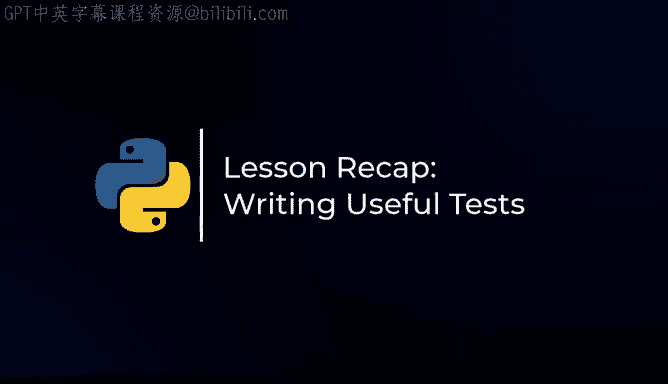

# 47：编写实用测试 🧪

在本节课中，我们将回顾并总结关于编写实用测试的核心知识。我们将学习如何选择使用类还是函数来组织测试，以及如何利用 Pytest 的高级特性，如参数化测试。同时，我们也会巩固使用 `assert` 语句进行断言的方法，它能提供详尽的错误报告。

---

## 测试的组织：类 vs. 函数



上一节我们介绍了测试的基本概念，本节中我们来看看如何组织测试代码。在 Pytest 中，你可以选择使用函数或类来编写测试。

使用函数编写测试通常更简单直接，适合小型或独立的测试场景。而使用类（特别是遵循 `unittest` 模块风格的类）则有助于将相关的测试方法分组，便于管理。

以下是两种风格的简单示例：

**函数形式测试：**
```python
def test_addition():
    assert 1 + 2 == 3

def test_string_concatenation():
    assert "Hello" + " " + "World" == "Hello World"
```

**类形式测试：**
```python
class TestMathOperations:
    def test_addition(self):
        assert 1 + 2 == 3

    def test_multiplication(self):
        assert 2 * 3 == 6
```

选择哪种形式取决于你的项目结构和团队偏好。Pytest 对两者都支持良好。

---

## 利用 Pytest 高级特性：参数化测试

当你需要对同一段测试逻辑使用多组不同的输入数据进行验证时，手动编写多个测试函数会非常繁琐。这时，Pytest 的参数化测试功能就非常有用了。

参数化测试允许你使用一个装饰器来定义多组测试数据，Pytest 会自动为每组数据生成一个独立的测试用例。

以下是使用 `@pytest.mark.parametrize` 装饰器的示例：

```python
import pytest

@pytest.mark.parametrize("input_a, input_b, expected", [
    (1, 2, 3),
    (5, -1, 4),
    (0, 0, 0)
])
def test_addition_with_params(input_a, input_b, expected):
    assert input_a + input_b == expected
```

在这个例子中，Pytest 会运行 `test_addition_with_params` 三次，每次使用一组不同的 `(input_a, input_b, expected)` 数据。如果任何一次断言失败，报告会明确指出是哪一组数据导致了问题。

---

## 使用 Assert 进行断言与错误报告

在测试中，断言是验证代码行为是否符合预期的核心手段。Pytest 支持使用 Python 原生的 `assert` 语句，这比某些测试框架专用的断言方法更灵活。

当 `assert` 语句后的条件为 `False` 时，测试失败，Pytest 会捕获这个异常并生成详细的报告。这份报告会显示断言失败的位置、使用的变量值以及表达式本身，极大地帮助开发者定位问题根源。

例如，对于以下测试：
```python
def test_divide():
    result = 10 / 2
    assert result == 5
```
如果 `result` 意外地等于其他值（比如由于代码修改引入了 bug），Pytest 的报告会清晰地显示 `assert result == 5` 失败了，并且 `result` 的实际值是多少。

---

## 核心要点总结

本节课中我们一起学习了编写实用测试的几个关键方面：


1.  **测试组织**：了解了根据情况选择使用函数或类来组织测试用例。
2.  **参数化测试**：掌握了使用 `@pytest.mark.parametrize` 装饰器来高效测试多组数据，避免代码重复。
3.  **断言与调试**：巩固了使用 `assert` 语句进行断言的方法，并认识到其生成的详细错误报告对于快速定位和修复问题至关重要。

这些关于 Pytest 和测试的通用知识非常关键。现在，你能够编写测试、分析测试失败报告，并精准定位问题所在。这确保了你所做的修复能真正解决问题，而不会引入新的错误。