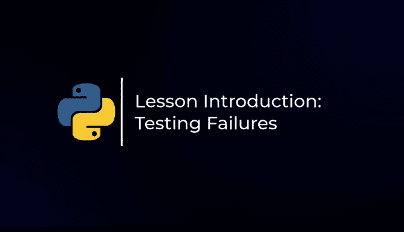

# 48：测试与故障处理 🐛🔧

在本节课中，我们将学习如何更有效地编写测试和进行调试。深入了解所使用的工具，能让你在遇到故障时更加熟练地应对。我们将涵盖多种内容，包括使用Python调试器PDB，以及像`fixtures`这样的工具，它能帮助你编写更健壮的测试，并自动处理一些底层问题，例如自动清理每次测试后不需要的文件。掌握这些知识，将为你在编写和调试测试时打下坚实的基础。

---

## 深入掌握工具 🛠️



上一节我们介绍了测试的重要性，本节中我们来看看如何通过掌握核心工具来提升测试与调试的效率。

更深入地了解你正在使用的工具，将使你在发生故障时更加熟练。

---

## 使用Python调试器（PDB） 🐞

当测试失败或代码出现异常时，我们需要定位问题根源。Python内置的调试器PDB是一个强大的交互式工具。

以下是使用PDB进行调试的基本步骤：

1.  **导入与设置断点**：在代码中你想开始调试的位置插入`import pdb; pdb.set_trace()`。
2.  **运行程序**：当程序执行到该行时，会自动暂停并进入PDB交互式命令行。
3.  **常用命令**：
    *   `n` (next): 执行下一行代码。
    *   `s` (step): 进入函数内部。
    *   `c` (continue): 继续执行，直到下一个断点或程序结束。
    *   `l` (list): 显示当前行附近的代码。
    *   `p <变量名>` (print): 打印变量的当前值。
    *   `q` (quit): 退出调试器。

通过PDB，你可以逐行检查代码执行状态，观察变量值的变化，从而精准定位逻辑错误。

---

## 利用Fixtures编写健壮测试 🧪

仅仅发现错误还不够，我们还需要能预防错误和简化测试环境的工具。`Fixtures`是pytest框架中的一个核心概念，它提供了一种优雅的方式来设置测试的初始状态和清理工作。

`Fixture`是一个函数，用`@pytest.fixture`装饰器标记。它可以在测试函数运行前提供所需的数据或状态，并在测试结束后执行清理。

以下是一个`fixture`的简单示例：

```python
import pytest
import tempfile
import os

@pytest.fixture
def temporary_file():
    # 测试前：创建一个临时文件
    temp = tempfile.NamedTemporaryFile(delete=False, mode='w')
    temp.write('Initial data')
    temp.close()
    file_path = temp.name

    yield file_path  # 将文件路径提供给测试函数使用

    # 测试后：清理临时文件
    os.unlink(file_path)

def test_file_operations(temporary_file):
    # 测试函数接收fixture返回的值作为参数
    with open(temporary_file, 'r') as f:
        content = f.read()
    assert content == 'Initial data'
    # 测试结束后，fixture会自动删除临时文件
```

使用`fixtures`的主要优势包括：

*   **代码复用**：多个测试可以共享同一个设置和清理逻辑。
*   **可靠性**：确保每次测试都在一个干净、一致的环境中开始。
*   **自动化清理**：自动处理诸如关闭数据库连接、删除临时文件等任务，避免资源泄漏或测试间相互干扰。

正如课程所述，`fixtures`能帮你处理所有因使用辅助工具可能带来的底层问题，例如自动移除每个单次测试中不需要的文件。

---

## 总结 📚

本节课中我们一起学习了提升测试与调试效率的两个关键技能。


我们首先介绍了如何使用Python调试器PDB来交互式地诊断代码中的问题。接着，我们探讨了如何利用pytest的`fixtures`来构建更清晰、更健壮且易于维护的测试，它能自动管理测试前后的状态，让开发者专注于测试逻辑本身。

掌握这些工具和方法，将使你能够更自信地应对开发过程中出现的故障，并编写出质量更高的代码。