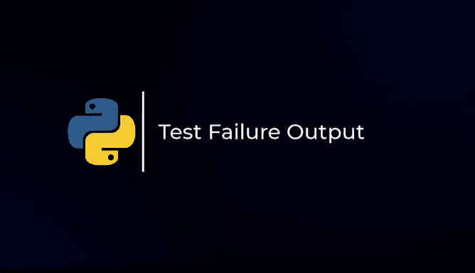
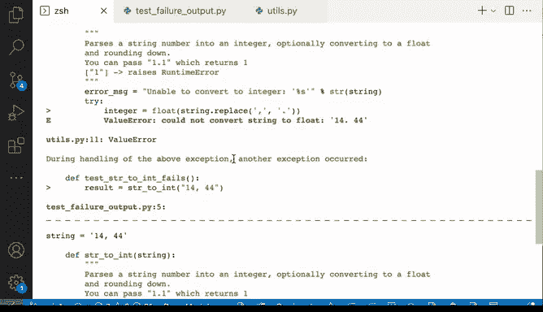

# 49：测试失败输出分析 🔍



在本节课中，我们将学习如何详细分析 `pytest` 测试框架输出的失败信息。理解这些输出对于快速定位和修复代码中的问题至关重要。

## 概述

我们已经初步了解了 `pytest` 的输出。现在，我们将深入细节，通过一个具体的例子来学习如何解读测试失败时的输出信息，从而高效地调试代码。

## 详细分析测试失败输出

我们以一个名为 `u_module.py` 的 Python 文件为例，其中包含一些工具函数。我们将测试其中的 `string_to_int` 函数，并故意制造一些失败案例来观察输出。

以下是三个测试函数，其中一些会引发问题：

```python
# test_failure_output.py
def test_string_to_int():
    # 一些会失败的测试用例
    pass

def test_another_case():
    # 另一个测试用例
    pass

def test_yet_another():
    # 又一个测试用例
    pass
```

在终端中运行以下命令来执行测试并查看失败输出：

```bash
pytest test_failure_output.py
```

运行后，我们会看到一个失败和两个通过的测试。让我们快速看一下这里发生了什么。

## 解读输出信息

输出首先会告诉你执行的路径、收集到的测试项数量，以及使用的 `pytest` 和 `Python` 版本（例如 Python 3.9）。

接着，它会总结在这个特定的测试文件中，有一个失败（`F`）和两个通过（`.`），完成度为100%。

然后，它会进入失败详情。其中一个关键点是，它会展示被测试代码的表示。例如，对于 `string_to_int` 函数，你可以看到它需要一个字符串参数，但同时也会显示导致测试失败的实际值。这非常有用，因为开发者经常需要查看引发失败的具体值。

例如，输出可能显示值为 `“14, 44”`，这显然是有问题的。

## 定位错误源头

输出会精确指出错误发生的行号，并用特殊字符标记出来。错误信息可能是 `ValueError: could not convert string to float`，表明转换完全无效。

需要注意的是，错误并非发生在测试文件本身，而是发生在另一个名为 `ut_sub.py` 的文件中（例如第11行）。异常类型是 `ValueError`。

Python 在处理上述异常时，可能会因为函数捕获并处理了该异常，然后抛出了另一个异常，最终导致整个测试在此失败。输出会明确指出，测试 `test_string_to_int` 在 `test_failure_output.py` 文件的第5行失败。

即使没有详细的值信息，我们也能根据行号（第5行）定位到问题。同时，它也会关联到 `ut_sub.py` 的第11行。如果我们查看 `ut_sub.py` 的第11行，可能会发现是 `int(float(string.replace(...)))` 这行代码出了问题。这些就是我们需要关注的问题区域。

## 错误处理与重新抛出

回到输出，我们可以看到类似的情况再次发生。最后，它抛出了一个 `RuntimeError`。这是因为代码捕获了 `TypeError` 和 `ValueError`，然后重新抛出了一个更有帮助的错误信息，例如“无法转换为整数”。

在输出的最后，会有一个简短的总结。这样设计的原因是，想象一下如果有1000个测试失败，你很可能需要查看这个简短总结来了解如何处理大量的失败测试输出。



## 增加输出详细程度

你可以通过增加 `-v` 参数来提高输出的详细程度（例如 `-vv` 或 `-vvv`）。这样有时能获得更多上下文信息，并且通过的测试也会被包含在输出中，而不仅仅是失败的测试。

例如，使用更详细的输出，你可以清楚地看到所有测试都来自 `test_failure_output.py` 文件，每个测试的名称以及它是通过还是失败。

以下是增加详细程度后可能看到的信息示例：

```bash
pytest test_failure_output.py -vv
```

## 总结

本节课中，我们一起学习了如何分析 `pytest` 的测试失败输出。我们了解了输出结构如何帮助定位问题代码和具体失败值，如何通过行号追踪错误源头到原始文件，以及如何利用简短总结和详细模式来高效处理大量测试结果。掌握这些技巧将极大提升你调试和修复代码的效率。