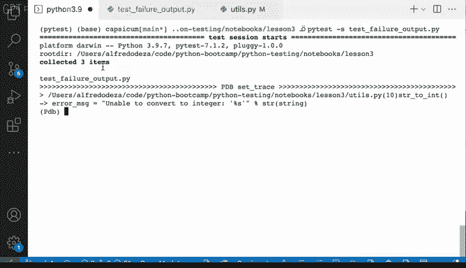

# 50：使用pdb进行Python调试 🐛


在本节课中，我们将学习如何使用Python内置的调试器——pdb，来动态地检查和调试代码中的问题。我们将通过一个具体的测试失败案例，演示如何启动pdb、查看上下文、检查变量，并定位错误的根源。

---

上一节我们介绍了测试失败的基本情况，本节中我们来看看如何使用pdb进行交互式调试。

我们将再次使用 `test_score_failure_output` 文件，并运行测试来查看失败信息，目标是调试这里出现的问题。

你可以使用pdb，它是Python调试器的简称。Python调试器允许你动态地进入代码内部，查看代码执行时的具体情况。除了你正在使用的编辑器（本例中使用VS Code，它本身具备调试测试和代码的功能）外，还有几种方法可以做到这一点。如果你使用pytest，你也可以设置调试器。

调试器可以通过一个特殊的标志来启动，我将向你展示这个特殊标志是什么。

因此，不是直接运行 `pytest`（我们知道它会导致一些测试失败输出），而是可以明确地输入：
```bash
pytest --pdb
```
这个命令将在第一个测试失败时暂停，并将你带入一个带有Python调试器的交互式终端。

我将运行这个命令。

然后它开始运行，并在第一个失败处提示“entering PDB”，即进入了Python调试器。你可以看到这里抛出了一个运行时错误。

以下是你可以尝试的一些操作。我认为 `h` 是帮助命令。没错，这是文档命令。你手头有所有这些命令可供使用。

我通常喜欢用 `l` 来列出我当前所在的位置。你可以看到我正好在发生运行时错误的地方，因此我可以访问所有这些变量。让我们看看 `integer` 是否存在。如果我回头看看我们的代码，看看我能访问什么，我会查看这里的函数，我有 `string` 变量。如果我在这里输入 `string`，你可以看到 `string` 的值是 `14,044`。

`l` 命令可以给我更好的上下文。如果我传入行号（这是pdb在任何地方都通用的工作方式，它只是给你提供了更好的调试能力），比如输入 `l 10`，它会给我第10行更好的上下文。

我可以看到这里它试图执行字符串替换。`integer` 失败了，它实际上没有正常工作。因为如果我查看 `integer`，它没有被定义，所以它甚至没有走到 `integer` 那一步就失败了。它试图再次设置，也失败了，并导致了运行时错误。

现在，我们想知道那个 `float(string.replace(...))` 操作可能发生了什么。让我看看是否可以执行 `float(string)`，其中 `string` 是输入。我们来调试一下。哦，明白了，`ValueError: could not convert string to float`。

现在我对问题可能出在哪里有了一个想法，因为它试图将字符串转换为浮点数。那么我将需要找出一种健壮的方法来转换这些数据。我认为即使我在这里处理，也可能遇到同样的问题。

因此，也许一种方法是去掉那个逗号，因为它被四舍五入了，这无关紧要，然后取第一个部分。这可能是一个解决方案。

让我试试看。所以 `solution = string.split(',')`，然后取第一个项。那么 `solution` 就会是 `14`，而 `14` 既可以用于 `float` 转换，也可以用于 `int` 转换。这样就可以了。

我对我想达到的目标有了一个想法。如果我想执行下一步，我可以输入 `n`，或者输入 `c` 来继续执行。

现在，如果我想精确地定位到这个失败发生的地方，我可以这样做：在代码中，我可以输入 `import pdb`，然后输入 `pdb.set_trace()`，这将在那里设置一个断点。

但这样做的一个特定问题是，它会为每一个测试都停在这里。我有三个测试，它会对每一个都这样做。现在我将移除我的 `--pdb` 标志，使用 `-s` 标志，因为我不想……我想告诉pytest，顺便说一句，我将以交互方式运行。它收集了三个测试项，这不是第一个失败的测试。



第一个测试失败了，第二个没有，第三个也没有。但你看到它把我带到了这三个测试中的每一个开始处。现在如果我输入 `l`，你可以看到它正好在第9行。现在它把我带到了测试代码的下一行。如果我输入 `string`，`string` 的值是 `14,044`。


以上就是两种可以使用pdb进行调试的方法，可以查看变量状态。你既可以在测试本身中设置断点，也可以在受测的代码中设置断点。

---

本节课中我们一起学习了如何使用pdb调试器。我们介绍了通过 `pytest --pdb` 在测试失败时进入调试模式，以及使用 `pdb.set_trace()` 在代码中设置断点。在调试会话中，我们使用了 `l` 查看代码上下文，检查了变量值，并定位了字符串转换错误的原因。这些技能对于诊断和修复代码中的问题至关重要。