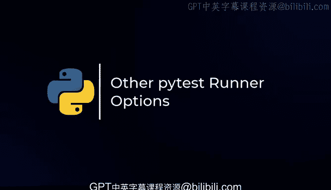
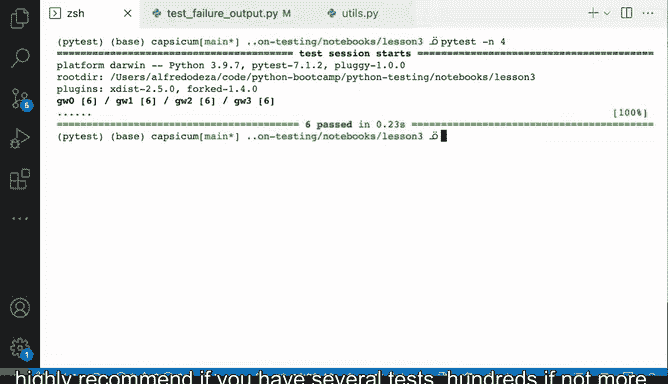

# 51：其他pytest运行器选项 🚀



在本节课中，我们将学习几个实用的 `pytest` 命令行工具标志，以及如何通过插件来增强测试功能。这些技巧能帮助你更高效地管理和运行测试套件。

上一节我们介绍了 `pytest` 的基础用法，本节中我们来看看一些进阶的运行选项。

---

除了查阅官方文档，查看帮助菜单也是一个好习惯。`pytest` 提供了许多不同的命令行选项。

以下是查看帮助菜单的方法：
```bash
pytest --help
```
帮助菜单中列出了大量选项。虽然快速滚动难以捕捉所有细节，但强烈建议你浏览一遍，寻找感兴趣的功能。

---

我经常使用 `--collect-only` 选项来排查测试收集阶段的问题。该命令只会显示收集到的测试列表，而不会执行任何测试。

以下是使用 `--collect-only` 的示例：
```bash
pytest --collect-only
```
执行后，它会列出所有收集到的测试。例如，它可能显示收集到了一个位于 `test_failure_output.py` 文件中的名为 `test_score_features` 的测试（我们将在下一节介绍它），以及其他测试。

目前，我们的测试套件包含多个文件，共有六个测试。如果直接运行 `pytest`，会看到一个测试失败，五个测试通过。

---

当测试套件非常庞大时，你可能希望在第一个失败出现时就停止运行，以便快速定位问题。这时可以使用 `-x` 标志。

以下是使用 `-x` 标志的示例：
```bash
pytest -x
```
使用该标志后，`pytest` 会在遇到第一个失败后立即停止。输出结果将只聚焦于首次失败发生的地方，使调试更加集中。在本例中，失败恰好发生在第一个测试，因此后续测试都没有运行。

---

`pytest` 另一个强大的特性是支持插件扩展。有一个插件特别适合在拥有大量测试时使用，它允许以分布式方式并行运行测试，从而显著缩短总执行时间。

以下是安装该插件的方法：
```bash
pip install pytest-xdist
```
安装后，你可以使用 `-n` 标志来指定并行运行的进程数量。

以下是使用该插件并行运行测试的示例：
```bash
pytest -n 4
```
这个命令会创建4个测试运行器实例来同时执行测试。虽然当前示例因为存在失败而输出不够清晰，但你可以看到它创建了网关并开始并行执行测试。

为了更直观地展示效果，让我快速修复之前的测试失败，然后重新运行。

修复后，再次运行并行测试命令。虽然我们只有六个测试，但你可以想象，如果有成百上千个测试，并行执行将极大地提升速度。

---




本节课中我们一起学习了几个有用的 `pytest` 命令行标志：用于检查测试收集的 `--collect-only`，用于遇到失败即停止的 `-x`，以及用于并行加速测试执行的 `pytest-xdist` 插件。掌握这些工具能帮助你更高效地管理和运行测试。