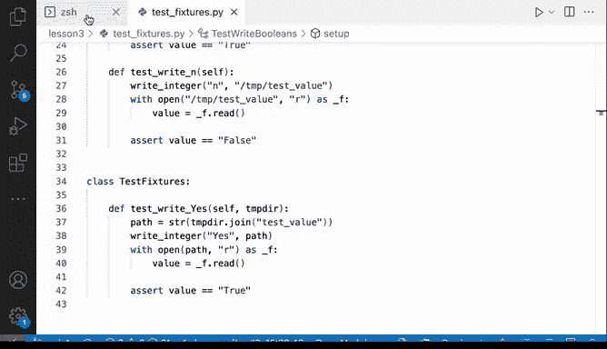

# 52：pytest夹具 🧪


在本节课中，我们将学习pytest框架中的一个强大功能——**夹具（fixtures）**。我们将了解什么是夹具，为什么它们比传统的测试设置方法更优越，以及如何在测试中简单地使用它们。

---

## 什么是pytest夹具？

上一节我们介绍了基本的测试结构。本节中我们来看看如何让测试代码更健壮、更可移植。pytest夹具可以看作是pytest提供的插件或工具。使用它们的唯一要求，就是在测试函数或方法中将其声明为一个参数。

夹具的核心思想是，由pytest框架来管理测试所需资源的生命周期（如创建、清理），而不是由测试代码自己手动处理。

## 一个传统测试的例子

首先，我们来看一个没有使用夹具的测试例子，并指出其潜在问题。

我们有一个简单的函数 `write_boolean`，它将一个字符串（“true”或“false”）转换为布尔值，并写入指定的文件路径。

```python
def write_boolean(a_string, a_path):
    value = strtobool(a_string)
    with open(a_path, 'w') as f:
        f.write(str(value))
```

以下是测试这个函数的类。它使用了 `setUp` 方法，该方法在每个测试方法运行前执行，用于清理可能存在的旧测试文件。

```python
import os
from unittest import TestCase

class TestWriteBooleans(TestCase):
    def setUp(self):
        # 每次测试前，如果文件存在就删除它
        if os.path.exists("/tmp/test_value"):
            os.remove("/tmp/test_value")

    def test_write_yes(self):
        write_boolean("yes", "/tmp/test_value")
        with open("/tmp/test_value") as f:
            contents = f.read()
        self.assertEqual(contents, "True")

    def test_write_n(self):
        write_boolean("n", "/tmp/test_value")
        with open("/tmp/test_value") as f:
            contents = f.read()
        self.assertEqual(contents, "False")
```

这个测试结构本身没有问题，但底层代码不够健壮：
1.  **路径硬编码**：它依赖 `/tmp` 目录，这个目录在Windows系统上不存在，可能导致测试失败。
2.  **并发问题**：如果多个测试并行运行（例如使用 `pytest -n auto`），它们可能会同时读写同一个文件，导致不可预知的失败。
3.  **手动清理**：我们需要在 `setUp` 中手动管理文件的清理工作。

## 使用pytest夹具改进测试

现在，我们使用pytest内置的 `tmpdir` 夹具来解决上述所有问题。使用夹具非常简单：只需在测试方法中将其作为参数名声明即可。

以下是使用 `tmpdir` 夹具重写的测试：

```python
def test_write_yes_with_fixture(tmpdir):
    # tmpdir 是一个夹具，pytest会自动注入一个唯一的临时目录对象
    file_path = tmpdir.join("test_value")
    write_boolean("yes", str(file_path))
    with open(file_path) as f:
        contents = f.read()
    assert contents == "True"
    # 为了演示，打印出临时路径
    print(f"The path from tmpdir fixture is: {file_path}")
    # 此行会失败，仅用于在pytest输出中展示路径
    assert False

def test_write_n_with_fixture(tmpdir):
    file_path = tmpdir.join("test_value")
    write_boolean("n", str(file_path))
    with open(file_path) as f:
        contents = f.read()
    assert contents == "False"
```

运行这个测试时，pytest会：
1.  自动创建一个**唯一的、临时的目录**供测试使用。路径类似于 `/private/var/folders/.../pytest-of-username/pytest-13/test_write_yes_with_fixture0/test_value`。这种唯一性完美避免了并发冲突。
2.  在测试**结束后**，自动清理这个临时目录及其所有内容。我们无需编写任何清理代码。
3.  在不同操作系统上提供一致的行为，因为路径是由pytest运行时环境管理的。

## pytest夹具的强大之处

`tmpdir` 只是pytest众多内置夹具中的一个。pytest夹具生态系统非常丰富。

以下是你可以探索的一些有用夹具：
*   `capsys`：用于捕获 `stdout` 和 `stderr` 的输出。
*   `monkeypatch`：用于在测试中动态设置/修改属性、字典项、环境变量等。
*   `caplog`：用于捕获和检查日志记录。
*   `request`：提供对当前测试请求的访问，可用于更高级的夹具编写。

你可以通过查阅 [pytest官方文档](https://docs.pytest.org/en/stable/reference/fixtures.html#built-in-fixtures) 来发现更多内置夹具并学习如何创建自定义夹具。

---



本节课中我们一起学习了pytest的**夹具（fixtures）**功能。我们看到了传统测试设置方法在路径硬编码和并发安全方面的局限性，并通过 `tmpdir` 夹具演示了如何更优雅、更健壮地管理测试资源。关键在于，夹具由pytest框架自动管理其生命周期，你只需在测试函数中声明所需的夹具参数即可使用。这极大地提高了测试代码的可移植性、安全性和简洁性。