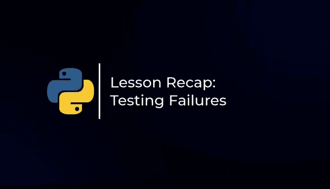

# 53：课程回顾-测试故障处理 🐛

在本节课中，我们将回顾并学习如何调试和修复失败的测试。我们将探讨如何使用 `pytest` 的高级功能来定位问题，并理解测试失败的根本原因。

---



调试测试有时会变得棘手，但我们能够看到 `pytest` 如何帮助我们，以及如何在终端中使用 `pytest` 的一些更高级的标志。

所有这些都将帮助您更熟练地修复可能失败的测试，并探究为什么某些值可能无法让测试通过。

因此，您现在已准备好处理更复杂的测试，并且希望您能顺利编写更多可能有用的测试。

---

上一节我们介绍了测试可能失败的各种场景，本节中我们来看看具体的调试工具和策略。

以下是 `pytest` 中一些用于调试和故障处理的核心标志：

*   `-v` 或 `--verbose`：输出更详细的测试执行信息。
*   `--tb=style`：控制回溯信息的显示样式。例如，`--tb=short` 显示简短回溯，`--tb=no` 不显示回溯。
*   `-x`：在第一个测试失败后立即停止执行。
*   `--lf` 或 `--last-failed`：只重新运行上一次失败的测试。
*   `-k EXPRESSION`：只运行名称与给定表达式匹配的测试。

---

为了更直观地理解，我们可以通过一个简单的代码示例来看如何使用这些标志。假设我们有一个测试文件 `test_example.py`：

```python
def test_addition():
    assert 1 + 1 == 2  # 这个测试会通过

def test_subtraction():
    assert 5 - 3 == 3  # 这个测试会失败，因为 5-3=2
```

在终端中，我们可以使用以下命令进行调试：

```bash
# 运行所有测试并显示详细信息
pytest -v

# 只运行上一次失败的测试
pytest --lf

# 只运行名称包含 ‘subtraction’ 的测试，并在失败后停止
pytest -k subtraction -x
```


---

本节课中我们一起学习了如何利用 `pytest` 提供的工具来高效地调试失败的测试。通过使用不同的命令行标志，我们可以快速定位问题、过滤测试用例并控制输出信息，从而提升测试修复的效率。掌握这些技能是处理复杂测试套件和编写健壮代码的重要基础。