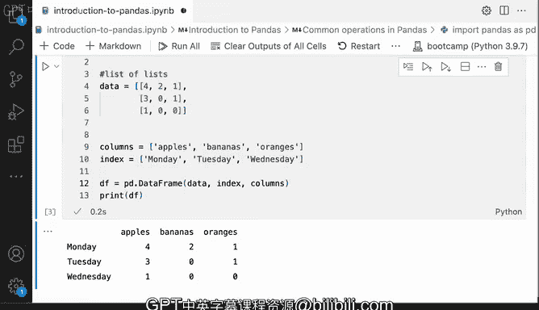

# 55：Pandas 简介 🐼


在本节课中，我们将要学习一个名为 Pandas 的强大 Python 库。Pandas 是数据科学和机器学习领域的基础工具，它可以帮助我们轻松地加载、查看、清理和操作数据集。

---

## 什么是 Pandas？📊

Pandas 是一个用于数据分析和操作的 Python 库。它功能强大，应用广泛，提供了各种不同的辅助工具和实用程序来处理数据。

Pandas 不随 Python 自带，因此需要单独安装。

---

## 如何安装 Pandas？🔧

上一节我们介绍了 Pandas 是什么，本节中我们来看看如何安装它。

以下是安装步骤：

1.  创建一个虚拟环境（推荐）。
2.  激活该虚拟环境。
3.  使用 pip 安装 pandas 包。

一个典型的安装命令序列如下（在命令行中执行）：

```bash
# 创建并激活名为‘venv’的虚拟环境（名称可自定义）
python3 -m venv venv
source venv/bin/activate  # 在 Windows 上是 venv\Scripts\activate

# 在激活的虚拟环境中安装 pandas
pip install pandas
```

请确保为你的项目维护一个 `requirements.txt` 文件或类似的文件来声明依赖项，以便于后续管理和复现环境。

> 提示：如果在安装过程中遇到问题，或需要在不同系统上安装，请参考 [Pandas 官方安装文档](https://pandas.pydata.org/docs/getting_started/install.html)。

在 Jupyter Notebook 中使用时，请确保已选择正确的内核（即已安装 pandas 的虚拟环境）。

---

## 开始使用 Pandas 🚀

你已经安装了 Pandas，并且 Jupyter Notebook 正在使用正确的内核和依赖项运行。现在，让我们开始使用它。

首先，我们需要导入 Pandas 库。一个非常常见的做法是使用别名 `pd` 来导入它。

```python
import pandas as pd
```

这种 `import ... as ...` 的语法被称为“导入别名”。几乎所有教程，包括 Pandas 官方文档，都使用 `pd` 作为别名。

---

## 核心概念：DataFrame 📈

上一节我们导入了 Pandas，本节中我们来看看它的核心数据结构——DataFrame。

你可以将 DataFrame 理解为一个多维数组，或者更直观地，想象成一个电子表格。它包含行、列以及单元格中的数据。

让我们通过一个例子来创建第一个 DataFrame。

假设我们记录了从周一到周三拥有的苹果、香蕉和橙子的数量。

以下是创建此 DataFrame 的步骤：

1.  准备数据（一个列表的列表）。
2.  定义列名。
3.  定义行索引（即行标签）。

```python
# 准备数据：一个列表的列表，每个子列表代表一行
data = [
    [1, 2, 3],   # 星期一的数量
    [4, 5, 6],   # 星期二的数量
    [7, 8, 9]    # 星期三的数量
]

# 定义列名
columns = ['apples', 'bananas', 'oranges']

# 定义行索引（行标签）
index = ['Monday', 'Tuesday', 'Wednesday']

# 使用 pd.DataFrame() 创建 DataFrame
df = pd.DataFrame(data=data, columns=columns, index=index)

# 打印查看 DataFrame
print(df)
```

运行以上代码，你将看到一个整洁的表格输出：

```
          apples  bananas  oranges
Monday         1        2        3
Tuesday        4        5        6
Wednesday      7        8        9
```

Pandas 将我们原始的、不易阅读的列表数据，转换成了一个结构清晰、像电子表格一样的表格。这就是 Pandas 的主要作用：**加载数据，并以一种有意义、易于查看和操作的方式呈现它**。

DataFrame 是 Pandas 中你将主要操作的对象。Pandas 还有其他数据结构（如 Series），但在本入门教程中，我们将主要关注 DataFrame。

---

## 总结 🎯

本节课中我们一起学习了：
1.  **Pandas 是什么**：一个用于数据操作和分析的 Python 库。
2.  **如何安装 Pandas**：通过 pip 在虚拟环境中安装。
3.  **如何导入 Pandas**：使用 `import pandas as pd` 是标准做法。
4.  **核心数据结构 DataFrame**：它类似于电子表格，是存储和操作数据的主要载体。我们通过一个水果库存的例子创建了第一个 DataFrame。



Pandas 的功能远不止于此，它还能帮助你清理数据、转换数据、进行计算分析甚至绘图。在接下来的课程中，我们将深入探索这个强大库的更多优秀特性。