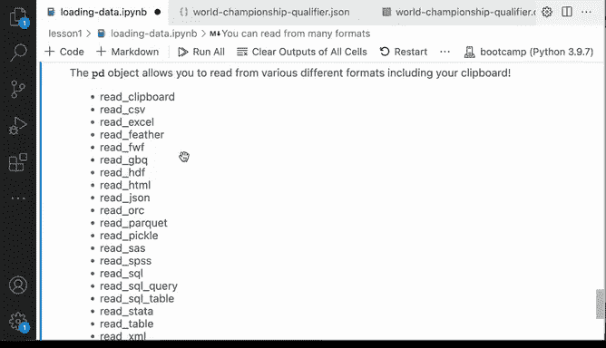

# 56：将数据加载到 Pandas 📊


在本节课中，我们将学习如何将数据加载到 Pandas 库中。Pandas 提供了多种灵活的数据加载方式，能够处理来自不同来源的数据，包括远程 URL、本地文件以及多种数据格式。

---

## 概述

Pandas 是一个非常灵活的库，其设计者为其内置了多种数据加载功能。本节将介绍几种将数据加载到 Pandas 的主要方法，涵盖从远程 GitHub 仓库加载 CSV 文件、从本地文件系统加载 CSV 和 JSON 文件，以及处理其他格式如 Excel 等。

---

## 从远程 URL 加载数据

上一节我们介绍了 Pandas 的灵活性，本节中我们来看看如何从远程 URL（例如 GitHub 仓库）加载数据。这在数据存储于在线仓库时非常有用。

以下是具体步骤：

1.  在 GitHub 上找到目标数据文件（例如一个 CSV 文件）。
2.  点击“Raw”按钮以获取文件的原始内容 URL。
3.  确保 URL 指向的是原始内容（通常域名包含 `raw.githubusercontent.com`），而不是 GitHub 的预览页面。
4.  使用 `pd.read_csv()` 函数并传入该 URL。

```python
import pandas as pd

# 使用从 GitHub 复制的原始文件 URL
url = "https://raw.githubusercontent.com/用户名/仓库名/分支名/wine_ratings.csv"
df = pd.read_csv(url, index_col=0) # index_col=0 指定第一列为索引
print(df.head(10))
```

执行上述代码后，数据将被成功加载为一个 Pandas DataFrame，并显示前 10 行。DataFrame 通常缩写为 `df`，但你可以使用更具描述性的变量名，例如 `wine_ratings`。

---

## 从本地文件加载数据

除了远程源，Pandas 也能轻松加载本地存储的数据文件。这是最常见的数据处理场景之一。

以下是加载本地 CSV 文件的示例：

```python
# 假设 CSV 文件与笔记本在同一目录下
df_local = pd.read_csv('world_championship_qualifier.csv')
print(df_local)
# 或者使用 .head() 方法查看前几行
print(df_local.head())
```

代码会读取名为 `world_championship_qualifier.csv` 的本地文件，并将其内容加载到 DataFrame 中。你可以看到列名（如 rank, name, nationality）和数据都被正确解析。

---

## 加载其他格式的数据

Pandas 的强大之处在于它能处理多种数据格式。读取不同格式的文件，通常只需更换对应的读取函数。

以下是加载本地 JSON 文件的示例：

```python
# 读取本地 JSON 文件
df_json = pd.read_json('data.json')
print(df_json.head())
```

即使数据源是 JSON 格式，Pandas 在幕后也会将其转换为标准的行列结构进行展示，因此其显示形式与 CSV 数据类似。

此外，Pandas 还支持从多种其他格式加载数据，例如：

*   **Excel 文件**：使用 `pd.read_excel('file.xlsx')`。
*   **剪贴板**：使用 `pd.read_clipboard()` 可以直接从剪贴板读取表格数据。
*   **XML/HTML**：Pandas 也能解析网页表格。

这体现了 Pandas 库处理数据源的强大能力和灵活性。

---

## 总结



本节课中我们一起学习了将数据加载到 Pandas 的几种核心方法。我们掌握了如何从远程 GitHub URL 加载 CSV 数据，如何读取本地的 CSV 和 JSON 文件，并了解到 Pandas 支持包括 Excel、剪贴板在内的多种数据格式。关键在于根据数据源的位置和格式，选择合适的 `pd.read_*()` 函数。