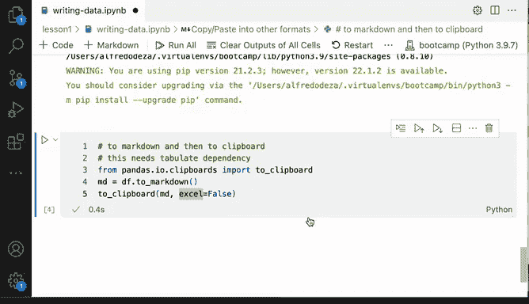

# 57：从Pandas数据框写入数据 📤


在本节课中，我们将学习如何将Pandas数据框中的数据写入到不同的文件格式和目的地。我们将涵盖写入CSV、HTML、Markdown以及剪贴板等常用方法。

---

上一节我们介绍了如何将数据加载到Pandas数据框中。本节中，我们来看看如何将数据框中的数据写入到其他目的地。

我们从Pandas库本身加载数据。当我们从Pandas写入数据时，操作对象是数据框。

我们将从一个数据框开始操作。这里使用一个本地的CSV文件，内容是1996年世界田径锦标赛资格赛的结果。首先导入Pandas。

```python
import pandas as pd
```

接着，创建数据框并查看其内容。

```python
df = pd.read_csv('world_championship_qualifier.csv')
print(df)
```

数据已成功加载为数据框对象。现在可以对其进行操作。

你可能会想知道如何将数据写入其他文件或目的地。

与加载数据类似，你可以将数据写入不同的目的地，例如剪贴板、CSV文件、Python字典、Excel电子表格，甚至是Parquet格式（一种存储大型数据的强大方式）。所有这些选项都可用。

我想向你展示如何将数据框写入HTML格式并查看效果。

运行以下代码将数据框转换为HTML。

```python
df.to_html('output.html')
```

HTML文件已生成。它创建了一个包含表头、表体和行列数据的HTML表格。在浏览器中本地打开此文件，可以完美加载。

如果你在处理HTML，并希望将数据从一处转换到另一处，`to_html`方法非常有效。

这只是众多数据导出方式中的一种。现在，我想展示如何将数据复制粘贴到其他格式，特别是Markdown。

你可能会遇到一个关于`tabulate`依赖项的报错。确保已安装此依赖。

从Pandas的`io.clipboards`模块导入`to_clipboard`函数。这意味着对象将被粘贴到系统剪贴板上。

```python
from pandas.io.clipboards import to_clipboard
```

告诉数据框需要以Markdown格式导出，并调用`to_clipboard`方法。

```python
df.to_markdown()
to_clipboard(df.to_markdown(), excel=False)
```

数据框现在已复制到剪贴板。创建一个新单元格并粘贴，即可看到Markdown格式的数据。

点击检查按钮，可以看到Markdown已成功创建。这是一种非常实用的方法，因为Pandas在数据导出方面非常灵活。

---



本节课中我们一起学习了如何将Pandas数据框中的数据写入多种格式，包括HTML和Markdown，以及如何利用剪贴板进行快速数据转移。Pandas提供了灵活多样的数据导出选项，方便我们在不同场景下使用。