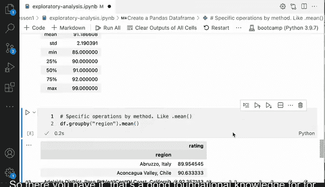

# 58：使用 Pandas 进行探索性数据分析 📊


在本节课中，我们将学习如何使用 Pandas 库对数据进行探索性分析。我们将涵盖如何加载数据、查看数据概览、排序、筛选以及进行分组计算等基本操作。

---

## 数据加载与初步查看

首先，我们需要创建一个 Pandas DataFrame 并加载数据集。我们将从一个之前展示过的 GitHub 仓库中读取数据。

```python
import pandas as pd

# 加载数据集，指定第一列为索引
df = pd.read_csv('wine_data.csv', index_col=0)
```

加载数据后，最常见的操作之一是使用 `.head()` 方法查看数据的前几行。你可以传入一个可选参数来指定要查看的行数。

```python
# 查看前15行数据
df.head(15)
```

运行上述代码，你将看到数据的前15行，索引从0开始。如果不传入参数，默认会显示前5行。

数据集中包含以下列：`name`（酒名）、`grape`（葡萄品种）、`region`（产区）、`variety`（类型，如红葡萄酒或白葡萄酒）、`rating`（评分）和 `notes`（备注）。这是一个葡萄酒数据集。

---

## 数据描述与信息概览

接下来，我们可以使用 `.describe()` 方法来获取数据的统计描述。

```python
# 获取数据的统计描述
df.describe()
```

执行后，你会看到一些有用的统计数字。例如，`rating` 列的最小值是85，最大值是99，平均值约为91，75%分位数是92。这有助于我们了解数据的分布情况。

此外，我们还可以使用 `.info()` 方法来获取数据集的更多信息。

```python
# 获取数据集的详细信息
df.info()
```

`.info()` 方法会显示数据集的条目数、索引范围、列数、每列的数据类型以及内存使用情况。例如，它可能显示有3200个条目，索引从0到3199，共有6列，其中包含浮点数和对象类型，内存使用量约为1.8 MB。

---

## 数据排序与筛选

在探索性分析中，我们经常需要根据特定条件对数据进行排序。例如，我们可以按评分降序排列数据。

```python
# 按评分降序排序
df.sort_values(by='rating', ascending=False)
```

执行上述代码后，数据将按评分从高到低排列。你可以看到评分最高的葡萄酒，例如来自法国和西班牙的葡萄酒，评分为99分。

---

## 处理缺失值与删除列

在数据集中，我们注意到 `grape` 列存在缺失值（用 `NaN` 表示）。我们可以删除这一列。

```python
# 删除 ‘grape’ 列
df.drop('grape', axis=1, inplace=True)
```

`axis=1` 表示删除列，`inplace=True` 表示直接在原 DataFrame 上进行修改，而不创建新的副本。删除后，再次使用 `.describe()` 方法查看数据，你会发现 `grape` 列已不存在。

---

## 分组计算与聚合分析

最后，我们可以进行分组计算，例如计算每个产区的平均评分。

```python
# 按产区分组并计算平均评分
df.groupby('region')['rating'].mean()
```

执行上述代码，你将看到每个产区的平均评分。例如，意大利产区的平均评分约为90分，而纳帕谷和帕罗斯产区的平均评分分别为93分和92分，这些都是著名的葡萄酒产区。

---

## 总结



在本节课中，我们一起学习了如何使用 Pandas 进行探索性数据分析。我们涵盖了数据加载、初步查看、统计描述、排序、处理缺失值以及分组计算等核心操作。这些技能是数据分析和机器学习工作流中的重要基础，能帮助你快速理解数据集的特征和分布。