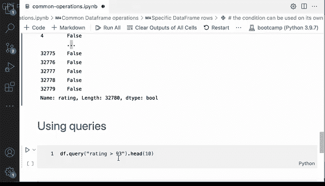

# 61：常见数据框操作 📊


在本节课中，我们将要学习使用 `pandas` 库进行数据框（DataFrame）的常见操作。我们将涵盖如何选择特定列、筛选特定行、使用条件查询以及进行字符串匹配等核心技能。

---

## 数据框列操作 🔧

上一节我们介绍了数据框的基本概念，本节中我们来看看如何操作数据框的列。

要处理数据框中的特定列，可以使用方括号 `[]` 并指定列名。例如，`notes` 列包含葡萄酒的描述文本。通过以下方式可以获取该列：

```python
df['notes']
```

此操作将返回一个包含所有行 `notes` 值的序列（Series），并附带索引。

如果你想同时处理多个列，例如 `name` 和 `rating` 列，可以这样做：

```python
name_ratings = df[['name', 'rating']]
```

以下是操作数据框列的关键步骤：
*   使用方括号 `[]` 和列名来获取单列。
*   使用包含列名的列表 `[['col1', 'col2']]` 来获取多列。
*   可以将结果赋值给一个新变量，从而创建一个只包含所需列的新数据框子集。

这个新的数据框子集可以用于后续分析，也可以像之前课程介绍的那样，导出为不同格式的文件。

---

## 数据框行筛选 🎯

在掌握了列操作之后，我们来看看如何根据条件筛选数据框的特定行。

假设我们想从之前创建的 `name_ratings` 数据框中，找出评分（`rating`）高于 96 的葡萄酒。可以使用条件语句进行筛选：

```python
top_rated = name_ratings[name_ratings['rating'] > 96]
```

运行此代码后，`top_rated` 数据框将只包含评分高于 96 的行。

条件本身也可以独立使用。例如，`df['rating'] > 96` 会对数据框的每一行进行评估，返回一个布尔值序列（True/False），指示哪些行满足条件。

---

## 使用 `query` 方法进行查询 🔍

除了直接使用方括号进行条件筛选，`pandas` 还提供了一个更强大的 `query` 方法。

`query` 方法可以直接在数据框上调用。例如，要筛选评分高于 93 的所有行：



```python
df.query('rating > 93').head()
```

此操作将返回整个数据框中评分高于 93 的前几行数据，而不仅仅是特定的列。

你还可以组合多个查询条件。例如，查找评分高于 94 **并且** 产区（`region`）为西班牙著名产区 “Ribera del Duero” 的葡萄酒：

```python
df.query('rating > 94 and region == "Ribera del Duero"').head(10)
```

以下是使用 `query` 方法的核心要点：
*   使用 `df.query('条件')` 的语法。
*   在查询字符串中，列名可以直接使用。
*   使用 `and`、`or` 等关键字组合多个条件。
*   可以使用 `.head(n)` 来限制显示的行数，以便预览查询结果。

---

## 字符串匹配查询 📝

最后，我们来看一个非常实用的技巧：如何在查询中进行灵活的字符串匹配。

假设我们想找出评分高于 95 的葡萄酒，并且其产区名称中包含 “Robles”。这时，我们可以结合 `query` 方法和字符串函数。

```python
top_wines = df.query('rating > 95')
paso_robles = top_wines.query('region.str.contains("Robles", na=False)', engine='python')
paso_robles.head()
```

以下是此操作的关键解释：
*   `region.str.contains("Robles")`：检查 `region` 列中的字符串是否包含子串 “Robles”。
*   `na=False`：忽略值为 `NaN`（非数字/空值）的条目。
*   `engine='python'`：指定使用 Python 引擎来解析和执行查询字符串，这对于字符串操作通常是必要的。

运行后，结果将显示所有评分高于 95 且产区名称包含 “Robles” 的葡萄酒。

---

## 总结 📚

本节课中我们一起学习了 `pandas` 数据框的几种核心操作：
1.  **列选择**：使用 `df['col']` 或 `df[['col1', 'col2']]` 来选取单列或多列。
2.  **行筛选**：使用布尔条件 `df[df['col'] > value]` 来筛选满足条件的行。
3.  **高级查询**：使用 `df.query()` 方法进行更清晰、更强大的条件查询，并支持多条件组合。
4.  **字符串匹配**：在 `query` 方法中结合 `.str.contains()` 等字符串函数进行灵活的文本搜索。

这些操作是数据清洗、探索和分析的基础，熟练掌握它们将为后续的机器学习工作流运维打下坚实的基础。