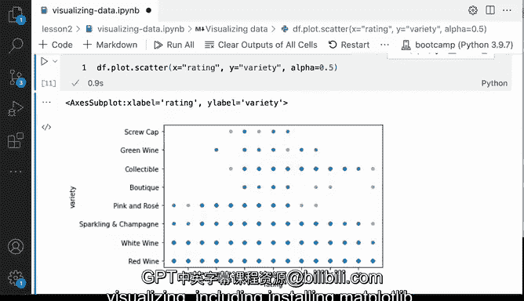

# 64：使用pandas可视化数据 📊


在本节课中，我们将要学习如何使用Pandas库进行基本的数据可视化。Pandas不仅是一个强大的数据分析工具，还内置了基于Matplotlib的绘图功能，能够帮助我们快速、直观地探索和理解数据。

---

## 数据准备与清理 🧹

上一节我们介绍了Pandas的数据处理能力，本节中我们来看看如何为可视化准备数据。在开始绘图前，确保数据干净、格式正确至关重要，特别是处理缺失值（NaN）。

首先，我们加载数据框。如果数据集中存在非数值或NaN值，可能会在可视化时遇到问题。

```python
# 加载数据框并清理缺失值
df = pd.read_csv('your_data.csv')
# 删除包含特定问题值（如‘grape’）的行
df.drop(df[df['column_name'] == 'grape'].index, inplace=True)
# 删除所有包含NaN值的行
df = df.dropna()
# 查看清理后的数据前几行
print(df.head())
```

通过以上步骤，我们移除了可能导致绘图错误的非数值和缺失数据。

---

## 安装Matplotlib 📦

为了使用Pandas的绘图功能，通常需要确保Matplotlib库已安装。虽然Pandas内置了绘图方法，但Matplotlib是其底层引擎。

以下是安装Matplotlib的方法：

```bash
pip install matplotlib
```

如果系统已安装，终端会显示“Requirement already satisfied”。如果遇到错误，此命令可帮助你完成安装。

---

## 基础绘图 📈

安装好环境后，我们可以开始基础绘图。Pandas的`.plot()`方法能直接从数据框生成图表。

### 绘制整个数据框

无需额外参数，我们可以快速绘制数据框中所有数值列的折线图，以初步观察数据趋势。

```python
df.plot()
```

此命令会生成一个图表，例如，可以立即看到“rating”评分数据的大致分布，有些值高达98分。

### 绘制单列数据

我们也可以选择只绘制特定的数值列。以下是绘制“rating”列的示例：

```python
df['rating'].plot()
```

默认情况下，Pandas会为数值列生成折线图。这种方法简单直接，适合快速查看单一变量的分布。

---

## 处理非数值数据与散点图 🔍

并非所有列都适合直接绘图。如果尝试绘制非数值列（如文本类型的“variety”），Pandas会提示错误，因为它需要数值数据来生成坐标。

以下是尝试绘制非数值列会遇到的问题：

```python
# 此操作可能不会成功，因为‘variety’不是数值列
df['variety'].plot()
```

### 创建散点图

为了可视化两个变量之间的关系，我们可以使用散点图。例如，我们可以探索“rating”和“variety”之间的关系，但需要确保至少一个轴是数值型。

实际上，更常见的做法是绘制两个数值列。假设我们想查看价格与评分的关系：

```python
df.plot.scatter(x='price', y='rating')
```

散点图能帮助我们直观地发现数据中的模式、集群或异常值。例如，你可能发现某些葡萄酒品种的评分集中在一个较高的区间。

---

## 总结 ✨

本节课中我们一起学习了使用Pandas进行数据可视化的基本步骤。

我们首先强调了数据清理的重要性，特别是处理NaN值。接着，我们介绍了如何安装必要的Matplotlib库。然后，我们实践了直接从数据框绘图以及绘制特定数值列的方法。最后，我们探讨了数据类型的限制，并介绍了散点图的使用场景，它可以帮助我们洞察两个数值变量之间的关系。



通过Pandas内置的可视化功能，我们可以快速、有效地对数据进行初步探索，这是机器学习工作流中理解数据的关键一步。