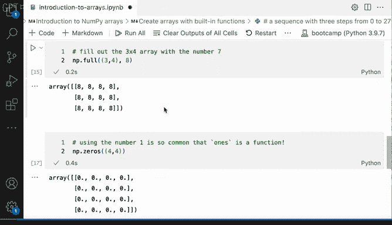

# 67：NumPy 数组简介 🧮


在本节课中，我们将学习 NumPy 的基础知识。NumPy 是 Python 中用于科学计算的核心库，它提供了高性能的多维数组对象以及处理这些数组的工具。我们将介绍如何安装 NumPy、导入库、创建数组以及使用一些基本的内置函数。

---

## 什么是 NumPy？🤔

NumPy 代表 Numerical Python。它是一个库，Pandas 等高级数据处理库在底层也使用 NumPy 来执行各种复杂操作。与常规的 Python 数据结构相比，NumPy 拥有多项优化，因此处理速度更快。

在开始使用 NumPy 之前，你需要安装它。安装方式是通过 pip 命令：`pip install numpy`。建议始终在激活的虚拟环境中安装，并确保依赖项已正确安装在该环境中。

---

## 导入 NumPy 📥

导入 NumPy 的常见方式与导入 Pandas 类似，通常使用别名以简化代码。

以下是导入 NumPy 的标准方式：
```python
import numpy as np
```
此后，在整个代码中都可以使用 `np` 来引用 NumPy 库。这是一种广泛遵循的约定，有助于阅读文档和示例代码。

---

## NumPy 数组的特点

NumPy 的核心是 **数组（array）**。这些数组是**同质的**，意味着数组中的所有元素必须是相同的数据类型。如果你尝试创建包含不同数据类型的数组，NumPy 会在后台强制转换数据类型，以使所有元素类型一致，这有时可能导致意外结果。

---

## 创建数组 🛠️

上一节我们介绍了 NumPy 的基本概念和导入方式，本节中我们来看看如何创建 NumPy 数组。有多种方法可以创建数组，从简单的列表转换到使用内置函数。

### 从列表创建数组

这是创建数组最直接的方法。你可以将一个 Python 列表传递给 NumPy 来创建数组。

```python
import numpy as np

# 从一维列表创建数组
arr_1d = np.array([1, 2, 3, 4, 5])
print(arr_1d)
# 输出: [1 2 3 4 5]
print(type(arr_1d))
# 输出: <class 'numpy.ndarray'>
```

从二维列表（嵌套列表）可以创建二维数组。

```python
# 从二维列表（嵌套列表）创建数组
arr_2d = np.array([[1, 2], [3, 4]])
print(arr_2d)
# 输出:
# [[1 2]
#  [3 4]]
print(arr_2d.shape)
# 输出: (2, 2)  # 表示一个2行2列的数组
```

### 使用内置函数创建数组

除了从列表创建，NumPy 还提供了许多方便的函数来快速生成特定模式的数组。

以下是几种常用的创建数组的函数：

*   **`np.random.rand`**: 创建一个指定形状的数组，并用 0 到 1 之间的随机浮点数填充。
    ```python
    random_arr = np.random.rand(2, 2)  # 创建一个2x2的随机数组
    print(random_arr)
    ```
*   **`np.full`**: 创建一个指定形状的数组，并用给定的固定值填充所有元素。
    ```python
    full_arr = np.full((3, 4), 8)  # 创建一个3行4列，所有元素都为8的数组
    print(full_arr)
    ```
*   **`np.ones`**: 创建一个指定形状的数组，并用 1 填充。
    ```python
    ones_arr = np.ones((4, 4))  # 创建一个4x4的全1数组
    print(ones_arr)
    ```
*   **`np.zeros`**: 创建一个指定形状的数组，并用 0 填充。
    ```python
    zeros_arr = np.zeros((4, 4))  # 创建一个4x4的全0数组
    print(zeros_arr)
    ```
*   **`np.arange`**: 类似于 Python 的 `range` 函数，但返回一个 NumPy 数组。它可以生成一个具有特定起始值、结束值和步长的序列。
    ```python
    seq_arr = np.arange(0, 5)  # 生成从0到4（不包括5）的序列
    print(seq_arr)  # 输出: [0 1 2 3 4]

    step_arr = np.arange(0, 27, 3)  # 生成从0到27，步长为3的序列
    print(step_arr)  # 输出: [ 0  3  6  9 12 15 18 21 24]
    ```

---

## 总结 📝



本节课中我们一起学习了 NumPy 的基础知识。我们了解了 NumPy 是一个用于高效数值计算的 Python 库，学会了如何安装和导入它。我们重点探讨了 NumPy 数组的同质性特点，并掌握了多种创建数组的方法：包括从列表转换，以及使用 `np.random.rand`、`np.full`、`np.ones`、`np.zeros` 和 `np.arange` 等内置函数。这些是开始使用 NumPy 进行数据操作和科学计算的重要第一步。