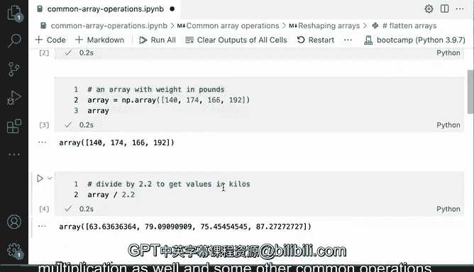

# 68：NumPy常见数组操作教程 🧮


在本节课中，我们将要学习NumPy库中一些常见的数组操作。这些操作是数据处理和科学计算的基础，包括对数组进行数学运算、改变形状以及展平数组等。

---

上一节我们介绍了NumPy数组的创建，本节中我们来看看如何对数组进行一些基础但重要的操作。

首先，我们需要导入NumPy库。在大多数教程和文档中，你会看到这样的导入方式：

```python
import numpy as np
```

接下来，我们将创建一个数组。这里用一个列表来初始化它，列表中的数字代表以磅为单位的体重。

```python
weights_lbs = np.array([140, 174, 166, 192])
```

运行这段代码会创建一个数组。这个过程非常直接。

现在，我们来进行一个数学运算：将这个数组除以2.2。你可能会觉得这有点奇怪，因为数组中有多个元素。但在幕后，NumPy会将这个除法运算应用到数组中的每一个元素上。这里的2.2是磅与公斤的换算系数（1公斤约等于2.2磅）。

```python
weights_kgs = weights_lbs / 2.2
```

运行后，你会得到一个新的数组，其中的数值代表以公斤为单位的体重。

---

除了数学运算，你还会经常遇到重塑数组形状的操作。

以下是重塑数组时需要注意的几个要点：

首先，我们创建一个3行4列、元素全为1的数组。

```python
arr = np.ones((3, 4))
```

现在，我们可以使用`reshape`函数来改变它的形状。例如，我想把它变成4行3列。

```python
reshaped_arr = arr.reshape(4, 3)
```

这里有一个关键点必须注意：重塑前后的数组，其元素总数必须保持一致。例如，一个形状为(3,4)的数组有12个元素。你可以把它重塑为(4,3)、(2,6)、(12,1)或(1,12)，因为这些形状对应的元素总数也是12。

但是，你不能把它重塑为(4,4)，因为那需要16个元素。如果尝试这样做，程序会报错。

```python
# 这会引发错误，因为元素总数不匹配
# invalid_arr = arr.reshape(4, 4)
```

---

另一种常见的操作是展平数组，即将多维数组转换为一维数组。

我们继续使用上面那个3行4列的数组。你可以使用`flatten`函数轻松地将其展平。

```python
flattened_arr = arr.flatten()
```

展平后的数组将包含所有原始元素，但排列在一个维度上。

---



本节课中我们一起学习了NumPy中几种常见的数组操作。我们看到了如何对数组进行基础的数学运算（如除法），也学习了如何重塑数组的形状，并理解了重塑时必须保持元素总数不变的原则。最后，我们还了解了如何将多维数组展平为一维数组。这些操作是使用NumPy进行高效数据处理的基石。