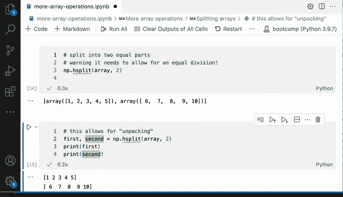

# 69：更多NumPy数组操作 🧮


在本节课中，我们将学习NumPy库中更多实用的数组操作。我们将探索如何扩展数组、应用条件筛选、进行切片、堆叠以及分割数组。这些操作是高效处理数值数据的基础。

## 导入NumPy库

首先，我们需要导入NumPy库。这是使用其所有功能的前提。

```python
import numpy as np
```

## 扩展数组维度

上一节我们导入了NumPy，本节中我们来看看如何扩展数组的维度。这通常用于调整数据的形状以适应不同的计算需求。

以下是使用 `np.newaxis` 扩展数组的步骤：

*   创建一个一维数组。
*   使用 `np.newaxis` 为其添加一个新的行维度。
*   检查扩展前后数组的形状变化。

```python
# 创建一个包含4个元素的一维数组
arr = np.ones(4)
print("原始数组:", arr)
print("原始形状:", arr.shape)

# 使用np.newaxis扩展维度（添加一个行维度）
expanded_arr = arr[np.newaxis, :]
print("扩展后数组:", expanded_arr)
print("扩展后形状:", expanded_arr.shape)
```

## 条件筛选数组

接下来，我们将学习如何根据条件筛选数组中的元素。NumPy允许我们将条件直接应用于整个数组，并返回布尔值或匹配的值。

以下是进行条件筛选的两种方式：

*   创建一个二维数组。
*   应用条件（如小于20）并获取布尔掩码。
*   使用布尔掩码获取所有匹配条件的实际值。

```python
# 创建一个二维数组
arr_2d = np.array([[12, 1211], [45, 2211], [56, 15], [22, 33]])
print("原始数组:\n", arr_2d)

# 获取布尔掩码：哪些元素小于20？
mask = arr_2d < 20
print("条件掩码 (arr < 20):\n", mask)

# 获取所有小于20的元素值
matching_values = arr_2d[arr_2d < 20]
print("匹配值 (arr < 20):", matching_values)
```

## 数组切片操作

现在，我们来看看数组的切片操作。这与Python列表的切片非常相似，是获取数组子集的有效方法。

```python
# 创建一个从0到5的一维数组
arr_slice = np.arange(6)
print("原始数组:", arr_slice)

# 进行切片操作
print("前三个元素:", arr_slice[:3])
print("第二到第四个元素:", arr_slice[1:4])
print("最后两个元素:", arr_slice[-2:])
```

## 数组堆叠操作

数组堆叠是将多个数组合并成一个新数组的常用操作。NumPy提供了水平和垂直两种堆叠方式。

以下是水平堆叠 (`hstack`) 的示例：

*   创建两个具有相同行数的二维数组。
*   使用 `np.hstack` 将它们水平连接。

```python
# 创建第一个数组
arr1 = np.array([[1, 2], [3, 4]])
print("数组1:\n", arr1)

# 创建第二个数组
arr2 = np.array([[5, 6], [7, 8]])
print("数组2:\n", arr2)

# 水平堆叠
h_stacked = np.hstack((arr1, arr2))
print("水平堆叠结果:\n", h_stacked)
print("新形状:", h_stacked.shape)
```

以下是垂直堆叠 (`vstack`) 的示例：

*   创建两个具有相同列数的二维数组。
*   使用 `np.vstack` 将它们垂直连接。

```python
# 创建两个数组
arr_a = np.ones((3, 3))
arr_b = np.full((3, 3), 2)
print("数组A:\n", arr_a)
print("数组B:\n", arr_b)

# 垂直堆叠
v_stacked = np.vstack((arr_a, arr_b))
print("垂直堆叠结果:\n", v_stacked)
print("新形状:", v_stacked.shape)
```

## 数组分割操作

最后，我们来学习如何将数组分割成多个子数组。`np.split` 函数要求分割后的各部分大小相等。

以下是分割数组的示例：

*   创建一个一维数组。
*   使用 `np.split` 将其分割成指定数量的等份。
*   注意：数组长度必须能被分割数整除，否则会报错。

```python
# 创建一个包含11个元素的一维数组
arr_to_split = np.arange(11)
print("待分割数组:", arr_to_split)

# 尝试分割成2等份（可行，因为11不能被2整除？这里原描述有误，实际应为不可行）
# 正确示例：创建一个可被整除的数组
arr_even = np.arange(10)
print("新数组:", arr_even)

# 分割成2等份
split_result = np.split(arr_even, 2)
print("分割结果 (2等份):")
for i, part in enumerate(split_result):
    print(f"  部分{i+1}: {part}")

# 使用解包赋值接收分割结果
first_part, second_part = np.split(arr_even, 2)
print("解包-第一部分:", first_part)
print("解包-第二部分:", second_part)
```



本节课中我们一起学习了NumPy库中几种重要的数组操作：扩展维度、条件筛选、切片、堆叠和分割。掌握这些操作能让你更灵活地处理和准备数据，为后续的机器学习工作流打下坚实基础。NumPy的功能远不止于此，但这些核心操作是高效使用该库的关键。