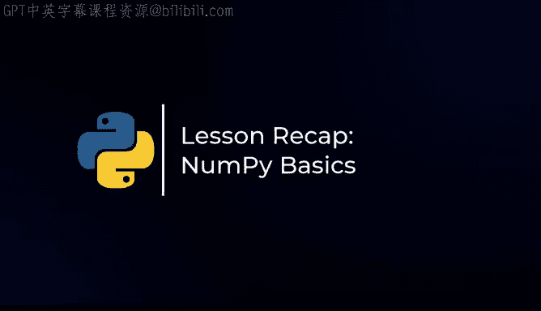

# 70：NumPy基础回顾 🧮

在本节课中，我们将回顾NumPy库的基础知识。NumPy是Python中进行科学计算的核心库，它提供了高性能的多维数组对象以及处理这些数组的工具。我们将从创建数组开始，逐步学习如何使用内置函数，并对数组进行重塑、分割和切片等操作。

## 创建数组



首先，我们来看看如何创建NumPy数组。NumPy数组是存储同类型数据的网格，可以通过多种方式创建。

以下是创建数组的几种常用方法：

*   **从Python列表创建**：使用 `np.array()` 函数，将Python列表转换为NumPy数组。
    ```python
    import numpy as np
    arr = np.array([1, 2, 3, 4, 5])
    ```
*   **创建特殊数组**：NumPy提供了一些函数来快速创建具有特定结构的数组。
    *   `np.zeros(shape)`：创建指定形状的全零数组。
    *   `np.ones(shape)`：创建指定形状的全一数组。
    *   `np.arange(start, stop, step)`：创建等差序列数组。
    *   `np.linspace(start, stop, num)`：在指定区间内创建均匀间隔的数值数组。

## 使用内置函数

上一节我们介绍了如何创建数组，本节中我们来看看NumPy提供的一些强大内置函数。这些函数可以对整个数组执行数学运算，而无需编写循环，这大大提升了计算效率。

以下是几个常用的内置函数示例：

*   **数学运算**：`np.sqrt(arr)` 计算平方根，`np.exp(arr)` 计算指数，`np.sin(arr)` 计算正弦值。
*   **统计函数**：`np.mean(arr)` 计算平均值，`np.std(arr)` 计算标准差，`np.sum(arr)` 计算所有元素的和。
*   **随机数生成**：`np.random.rand(shape)` 生成指定形状的[0,1)区间均匀分布随机数。

## 数组操作：重塑、分割与切片

掌握了创建和基本运算后，我们进入更灵活的部分：操作数组的形状和内容。这些操作对于数据预处理和模型输入准备至关重要。

以下是核心的数组操作方法：


*   **重塑数组**：使用 `arr.reshape(new_shape)` 方法可以改变数组的维度，而不改变其数据。例如，将一个一维数组重塑为二维矩阵。
*   **分割数组**：使用 `np.split(arr, indices)` 可以将一个数组分割成多个子数组。
*   **数组切片**：与Python列表类似，NumPy数组支持切片操作以获取部分数据，语法为 `arr[start:stop:step]`。对于多维数组，可以沿每个轴分别切片，例如 `arr[行切片, 列切片]`。

本节课中我们一起学习了NumPy的基础知识。我们从创建数组开始，探索了其便捷的内置数学与统计函数，最后学习了如何通过重塑、分割和切片来灵活地操作数组结构。掌握这些基础是后续进行高效数据分析和机器学习建模的重要一步。