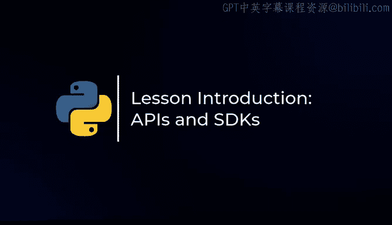

# 71：API与SDK介绍 🚀

在本节课中，我们将要学习API（应用程序编程接口）与SDK（软件开发工具包）的基本概念。它们是构建自动化流程、与云服务交互以及整合机器学习运维环境的核心工具。

## 概述

API和SDK是开发者在构建自动化系统、与云平台交互时最可能接触到的工具。它们能帮助你将所有组件整合在一起，构建出可重用、自动化的机器学习运维环境。使用这些工具不仅能增强你对系统稳定性的信心，还能通过编写脚本提升效率，让工作流程运行得更快。


上一节我们介绍了机器学习运维的基础环境，本节中我们来看看如何利用API和SDK来增强和自动化这个环境。

## 核心概念解析



### 什么是API？

API，即应用程序编程接口，是一组明确定义的规则和协议，允许不同的软件应用程序相互通信。你可以将其视为一个“服务菜单”或“契约”，你的代码通过它来请求另一个服务执行特定操作或获取数据。

一个简单的类比是餐厅：你（客户端）通过菜单（API文档）点餐，厨房（服务器）接收订单并准备食物，最后由服务员将食物（响应）送给你。你无需知道厨房如何运作，只需遵循点餐协议即可。

在代码中，调用一个API通常意味着向一个特定的URL（端点）发送HTTP请求。例如，使用Python的`requests`库调用一个天气API：

```python
import requests

response = requests.get('https://api.weather.com/v1/forecast?city=Beijing')
weather_data = response.json()
print(weather_data)
```

### 什么是SDK？

SDK，即软件开发工具包，是一套工具、库、文档和代码示例的集合，旨在帮助开发者更轻松地为特定平台、框架或服务构建应用程序。SDK通常包含了对底层API的封装，提供了更友好、更符合特定编程语言习惯的接口。

如果说API是餐厅的菜单，那么SDK就像是为你提供了餐具、点餐平板以及标准操作流程，让你用餐（开发）体验更顺畅。

例如，使用云服务提供商（如AWS、Google Cloud）的Python SDK来操作存储服务，会比直接发送原始的HTTP请求简单得多：

```python
# 使用AWS的Boto3 SDK上传文件到S3
import boto3

s3_client = boto3.client('s3')
s3_client.upload_file('local_file.txt', 'my-bucket', 'remote_file.txt')
```

## API与SDK在MLOps中的作用

在机器学习运维中，API和SDK是实现自动化和集成的关键。以下是它们的一些常见用途：

以下是API与SDK在MLOps工作流中的几个关键应用场景：

*   **模型部署与服务化**：将训练好的模型封装为REST API（例如使用FastAPI或Flask），供其他应用程序调用。
*   **流水线自动化**：使用云服务商的SDK（如AWS Step Functions SDK、Kubeflow Pipelines SDK）来编排和自动化从数据准备到模型监控的整个ML流程。
*   **基础设施即代码**：通过SDK（如Terraform的提供商SDK、AWS CDK）以编程方式定义和配置云资源（虚拟机、容器集群、存储桶等）。
*   **监控与日志**：调用监控平台的API（如Prometheus API、Datadog API）来获取模型性能指标和系统日志，实现自动告警。
*   **数据获取与存储**：从内部数据库或外部数据源通过API获取训练数据，并使用存储服务的SDK将处理后的数据和模型版本保存起来。

## 如何选择：API还是SDK？

选择直接使用API还是SDK，取决于你的具体需求：

以下是帮助你做出选择的一些考量因素：

*   **追求灵活性与控制力**：如果你需要高度定制化的请求，或使用的服务仅提供基础的HTTP API，那么直接调用API是合适的选择。
*   **追求开发效率与易用性**：如果你希望快速集成，避免处理底层的HTTP连接、认证和错误重试等细节，那么使用官方SDK通常是更高效的方式。SDK往往集成了最佳实践。
*   **考虑语言与生态**：选择与你团队技术栈匹配的SDK。主流云服务商都为Python、Java、Go等语言提供了完善的SDK支持。
*   **评估功能完整性**：有时SDK可能未及时包含API的所有最新功能。如果必须使用新功能，可能需要直接调用底层API或等待SDK更新。

## 总结

本节课中我们一起学习了API与SDK的核心概念及其在MLOps中的重要性。API定义了软件组件间的通信契约，而SDK则提供了实现这些交互的便捷工具包。它们是构建自动化、可重用且高效的机器学习运维体系的基石。理解并熟练运用这些工具，将极大地提升你整合系统、实现持续交付与运维的能力。