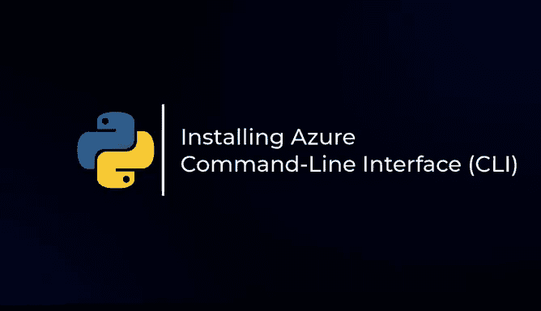
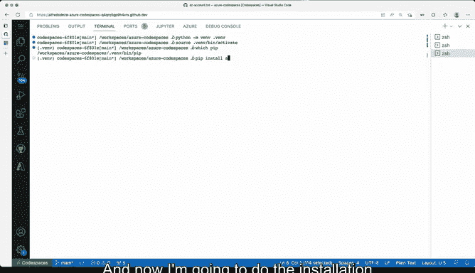

# 72：安装Azure命令行界面(CLI) 🛠️



在本节课中，我们将学习如何安装和配置Azure命令行界面（CLI）以及Python Azure SDK。这是构建机器学习运维（MLOps）自动化流程的基础步骤。

---

## 安装Azure命令行界面（CLI）概述

Azure命令行界面（CLI）是一个强大的工具，它允许我们通过命令行与Azure服务进行交互。安装它并学习如何使用和认证，对于构建自动化流程非常有价值。

安装过程具有很高的灵活性，支持多种操作系统。这使得无论是在本地开发环境，还是在如Github Actions、Jenkins或CodeBuild等CI/CD系统中，都能轻松部署。

---

## 安装Azure CLI

以下是安装Azure CLI的步骤。

1.  **访问安装页面**：首先，访问Azure CLI的官方安装概述页面，根据你的操作系统（如Windows、macOS或Linux）选择对应的安装方法。
2.  **选择安装方式**：例如，在Windows上，你可以下载MSI（Microsoft安装程序）文件，并通过命令行或图形界面进行安装。
3.  **验证安装**：安装完成后，打开一个新的终端窗口，输入以下命令来验证安装是否成功：
    ```bash
    az --version
    ```
    这个命令会显示已安装的Azure CLI版本信息，并提示是否有可用更新。

---

## 安装Azure CLI扩展

上一节我们安装了Azure CLI的核心功能，本节中我们来看看如何为其添加扩展以增强功能。扩展类似于插件，可以为CLI添加特定服务（如Azure机器学习）的管理能力。

以下是安装机器学习（ML）扩展的步骤。

1.  **添加ML扩展**：在终端中运行以下命令来添加Azure机器学习扩展：
    ```bash
    az extension add --name ml --yes
    ```
    参数 `--yes` 表示自动确认安装。
2.  **验证扩展安装**：安装完成后，使用以下命令列出所有已安装的扩展，确认 `ml` 扩展已存在：
    ```bash
    az extension list
    ```
3.  **使用ML扩展**：现在，你可以使用 `az ml --help` 命令来查看所有可用的机器学习相关命令。这些命令允许你管理工作区、在线端点、批量部署等几乎所有在Azure机器学习工作室中可用的功能。

---

## 认证与账户管理

安装好工具后，下一步是与你的Azure账户进行认证和连接。

以下是进行认证和查看账户信息的步骤。

1.  **交互式登录**：运行以下命令进行交互式登录。这通常会打开你的默认浏览器，引导你完成认证流程：
    ```bash
    az login
    ```
    成功登录后，终端会以JSON格式输出你账户的详细信息，包括租户ID、订阅ID等敏感信息，请注意保护。
2.  **查看账户列表**：登录后，你可以使用以下命令以表格形式清晰地查看所有订阅账户：
    ```bash
    az account list --output table
    ```
    输出会显示账户名称、云环境名称和订阅ID等信息，其中标有 `True` 的为默认账户。

---

## 安装Azure机器学习Python SDK

为了能在Python代码中操作Azure机器学习服务，我们需要安装对应的Python SDK。

以下是安装Python SDK的步骤。

1.  **创建虚拟环境**：首先，创建一个独立的Python虚拟环境以管理依赖。在终端中运行：
    ```bash
    python -m venv .venv
    ```
2.  **激活虚拟环境**：
    -   **Windows**:
        ```bash
        .venv\Scripts\activate
        ```
    -   **macOS/Linux**:
        ```bash
        source .venv/bin/activate
        ```
3.  **安装SDK包**：在激活的虚拟环境中，运行以下命令安装Azure机器学习核心库：
    ```bash
    pip install azureml-core
    ```
    这个命令会安装所有必要的依赖库。
4.  **验证安装**：安装完成后，启动Python解释器并尝试导入库，以验证安装是否成功：
    ```python
    import azureml
    ```
    你可以通过 `print(azureml.__file__)` 来确认模块是从刚创建的虚拟环境中导入的。

---

## 总结 🎯

本节课中我们一起学习了构建MLOps自动化基础的关键步骤。



我们首先安装了Azure命令行界面（CLI），并为其添加了机器学习扩展以增强功能。接着，我们学习了如何通过 `az login` 进行账户认证和管理订阅。最后，我们创建了一个Python虚拟环境，并安装了 `azureml-core` SDK，从而为后续使用Python代码自动化管理Azure机器学习资源做好了准备。

掌握这些工具的安装与基本操作，是迈向高效机器学习运维的重要第一步。