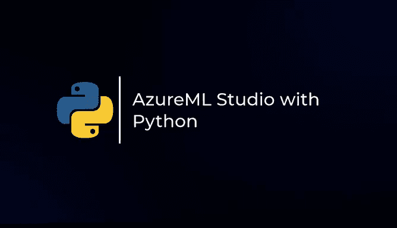
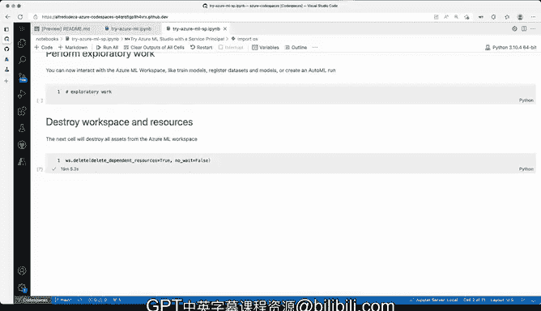

# 73：使用 Python 操作 Azure ML Studio 🚀



在本节课中，我们将学习如何使用 Azure ML 核心 Python SDK 与 Azure Machine Learning Studio 进行交互。我们将涵盖从身份验证、创建工作区、创建计算集群，到最后清理资源以避免额外费用的完整流程。

---

## 准备工作

上一节我们介绍了 Azure ML SDK 的安装，本节中我们来看看如何配置环境以开始使用。

首先，你需要准备好以下信息。以下是所需的关键信息列表：

*   **订阅 ID**：你的 Azure 订阅标识。
*   **服务主体信息**（可选但推荐）：
    *   租户 ID
    *   应用（客户端）ID
    *   客户端密码

如果你创建了服务主体，这些信息将非常有用。否则，你也可以仅使用订阅 ID 进行交互式登录认证。

一种安全存储这些机密信息的方法是使用类似 GitHub Codespaces 的环境变量或机密管理功能。

## 身份验证与初始化

现在，我们将在 Jupyter Notebook 中开始编写代码。首先需要导入必要的模块并进行身份验证。

```python
from azureml.core import Workspace
from azureml.core.authentication import ServicePrincipalAuthentication

# 使用服务主体进行身份验证
svc_pr = ServicePrincipalAuthentication(
    tenant_id="your-tenant-id",
    service_principal_id="your-app-id",
    service_principal_password="your-password"
)
```

运行以上代码后，身份验证即告完成。

## 创建工作区

身份验证成功后，下一步是创建一个 Azure Machine Learning 工作区。这个工作区将在 Azure 门户中显示，是所有机器学习活动的中心。

```python
# 创建工作区
ws = Workspace.create(name='demo-try-azure-ml',
                      subscription_id='your-subscription-id',
                      resource_group='demo-try-azure-ml',
                      create_resource_group=True,
                      location='eastus2',
                      auth=svc_pr)
```

运行此代码将触发一系列 Azure 资源的部署，包括存储账户、密钥库和应用洞察等。这个过程可能需要一些时间。

创建完成后，你可以在 Azure 门户中刷新并看到新创建的工作区“demo-try-azure-ml”。

## 创建计算集群

有了工作区之后，我们通常需要计算资源来运行任务。接下来，我们将以编程方式创建一个计算集群。

以下是创建计算集群的步骤：

1.  指定计算集群的名称和配置。
2.  设置虚拟机类型和最大最小节点数。
3.  定义空闲缩容时间以优化成本。

```python
from azureml.core.compute import ComputeTarget, AmlCompute
from azureml.core.compute_target import ComputeTargetException

# 计算集群配置
compute_config = AmlCompute.provisioning_configuration(vm_size='STANDARD_DS3_V2',
                                                         min_nodes=0,
                                                         max_nodes=4,
                                                         idle_seconds_before_scaledown=1800)

# 创建集群
cpu_cluster = ComputeTarget.create(ws, 'cpu-cluster', compute_config)
cpu_cluster.wait_for_completion(show_output=True)
```

代码中的 `wait_for_completion(show_output=True)` 会阻塞执行，直到集群创建完毕。创建成功后，你可以在 Azure ML Studio 的“计算”->“计算集群”部分看到名为“cpu-cluster”的集群。

## 清理资源：删除工作区

完成所有实验和计算后，为了避免产生不必要的费用，彻底清理资源至关重要。我们将删除整个工作区及其关联的所有资源。

```python
# 删除工作区及其所有资源
ws.delete(delete_dependent_resources=True)
```

**注意**：此操作可能需要几分钟到更长时间（在极少数情况下可能更长），并且不可逆。执行后，工作区、计算集群、存储账户等所有相关资源都将被永久删除。

操作完成后，刷新 Azure 门户，对应的资源组和工作区将消失。

---

## 总结



本节课中我们一起学习了如何使用 Azure ML Python SDK 进行端到端操作。我们完成了从设置身份验证、创建 Azure ML 工作区、配置计算集群，到最后安全删除所有资源以避免费用产生的全过程。通过编程方式管理这些资源，可以实现自动化、可重复的机器学习运维流程。