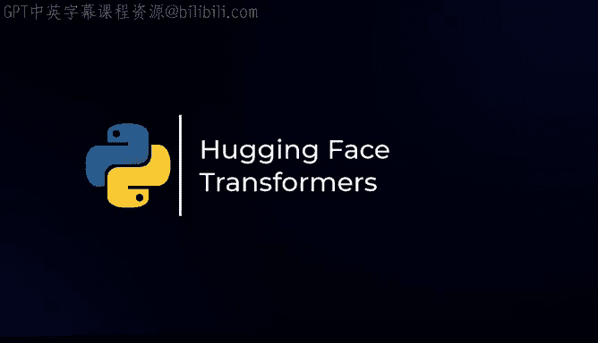
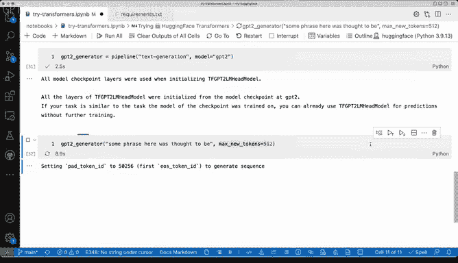

# 74：使用 Hugging Face Transformers 进行机器学习探索 🚀



在本节课中，我们将学习如何使用 Hugging Face 的 Transformers 库进行机器学习探索。Hugging Face 是一家提供众多人工智能工具和软件包的公司，其 Transformers 库允许我们处理文本、图像、音频等多种任务。我们将从安装依赖开始，逐步学习如何加载模型并使用其进行文本生成、情感分析、问答和翻译等操作。

---

## 概述

Hugging Face 是一家专注于构建机器学习工具和软件包的公司。本节课我们将重点介绍其 Transformers 库，这是一个功能强大的工具，支持文本、图像、音频等多种机器学习任务。我们将通过安装依赖、加载模型并进行实际交互，来探索其基本用法。

---

## 安装依赖

首先，我们需要安装必要的依赖包。以下是使用 pip 安装 Transformers 库的步骤，建议在虚拟环境中进行安装。

以下是 `requirements.txt` 文件的内容示例：

```txt
transformers==4.21.1
ipywidgets
ipykernel
```

其中，`ipywidgets` 和 `ipykernel` 是用于 Jupyter Notebook 的可选依赖。如果你不使用 Jupyter Notebook，可以忽略这些依赖。

---

## 导入 Pipeline 助手

安装完成后，我们可以在 Jupyter Notebook 中开始使用 Transformers 库。首先，导入 `pipeline` 助手，它可以帮助我们与模型进行交互。

```python
from transformers import pipeline
```

如果 Transformers 库安装成功，上述导入语句将不会报错。

---

## 使用文本到文本模型

接下来，我们将使用一个文本到文本模型进行自然语言处理任务。通过 `pipeline` 助手，我们可以指定模型类型并加载它。

以下是加载模型的代码：

```python
generator = pipeline("text2text-generation", model="t5-small")
```

运行上述代码后，模型将被动态加载到内存中。这意味着我们无需提前下载或保存模型文件，非常适合快速探索和实验。

---

## 模型功能探索

加载模型后，我们可以使用它执行多种任务。以下是几个示例：

### 文本摘要
我们可以使用模型对一段文本进行摘要生成。

```python
text = "Machine learning is a key to a successful production environment. It is a foundational process for many applications."
summary = generator("summarize: " + text)
print(summary)
```

模型将生成摘要，例如：“Machine learning is a key to a successful production environment.”

### 情感分析
模型还可以进行情感分析，判断文本的情感倾向。

```python
sentiment = generator("sentiment: Automation takes hard work but allows you to have solid deployment.")
print(sentiment)
```

输出可能是“positive”，表示文本情感为积极。

### 问答任务
模型可以回答基于文本的问题。

```python
answer = generator("question: Is deploying models into production hard? context: Deploying models requires careful planning and automation.")
print(answer)
```

模型将生成答案，例如：“It requires careful planning.”

### 翻译任务
模型还支持翻译功能，例如将英语翻译成法语。

```python
translation = generator("translate English to French: Hello, how are you?")
print(translation)
```

输出可能是：“Bonjour, comment allez-vous?”

---

## 使用 GPT-2 进行文本生成

除了文本到文本模型，我们还可以使用其他模型，例如 GPT-2 进行文本生成。以下是加载 GPT-2 模型的示例：

```python
gpt2_generator = pipeline("text-generation", model="gpt2")
```

加载模型后，我们可以基于初始短语生成文本。

```python
initial_phrase = "The history of religion"
generated_text = gpt2_generator(initial_phrase, max_new_tokens=50)
print(generated_text)
```

模型将根据初始短语生成一段文本，例如：“The history of religion is thought to be deeply intertwined with the development of human societies...”

---

## 总结

本节课中，我们一起学习了如何使用 Hugging Face 的 Transformers 库进行机器学习探索。我们从安装依赖开始，逐步学习了如何加载模型、使用 `pipeline` 助手执行文本摘要、情感分析、问答和翻译等任务。此外，我们还探索了如何使用 GPT-2 模型进行文本生成。通过这些基础操作，你可以进一步探索更多模型和任务，为后续构建机器学习 API 打下坚实基础。



---