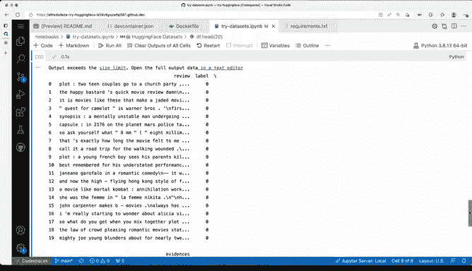

# 75：Hugging Face Datasets 库介绍 🧠


在本节课中，我们将要学习 Hugging Face 生态系统的另一个核心组件：`datasets` 库。这是一个用于动态加载数据集的库，其功能类似于其他动态加载库，如 `ash` 或 `open data`。我们将了解如何利用它来检索存储在 Hugging Face Hub 上的海量数据集。

## 概述

Hugging Face `datasets` 库允许你动态检索 Hugging Face 平台上的任何数据集。所有数据集都存储在 **Hugging Face Hub** 上。你可以将 Hugging Face Hub 理解为数据科学领域的 GitHub，它是分享数据集、机器学习模型以及进行模型微调等任务的中心平台。

## 环境准备与库导入

上一节我们介绍了 `datasets` 库的基本概念，本节中我们来看看如何在代码中使用它。首先，我们需要确保环境配置正确。

以下是在 Jupyter Notebook 中开始使用 `datasets` 库的初始步骤。核心是导入 `load_dataset` 和 `list_datasets` 这两个函数。

```python
from datasets import load_dataset, list_datasets
```

## 探索可用数据集

在加载特定数据集之前，我们可以先查看 Hugging Face Hub 上有哪些数据集可用。`list_datasets` 函数可以帮助我们做到这一点。

以下是获取所有可用数据集列表的代码：

```python
all_datasets = list_datasets()
print(f"可用数据集总数: {len(all_datasets)}")
```

执行上述代码后，你会发现有超过 **9000** 个数据集可用。这些数据集来源广泛，其中一部分由 Hugging Face 官方提供（名称中不包含斜杠 `/`），另一部分则由社区用户上传（名称中包含用户名，如 `username/dataset_name`）。

为了聚焦于官方数据集，我们可以进行筛选：

```python
# 筛选出来自 Hugging Face 官方的数据集（名称中不包含‘/’）
hf_datasets = [ds for ds in all_datasets if '/' not in ds]
print(f"官方数据集示例（前10个）: {hf_datasets[:10]}")
```

你会看到诸如 `amazon_polarity`、`amazon_reviews_multi` 等大型知名数据集。

## 加载特定数据集

了解了数据集的概况后，现在我们来学习如何加载一个特定的数据集。这个过程非常直接，只需使用 `load_dataset` 函数并传入数据集的名称字符串即可。

例如，我们要加载名为 `"movie_rationales"` 的数据集：

```python
dataset = load_dataset("movie_rationales")
```

首次运行此代码时，它会从网上下载数据集。下载完成后，数据集会被**缓存**到本地（通常位于 `~/.cache/huggingface/datasets` 目录下）。这意味着再次加载同一数据集时速度会极快，无需重复下载。这对于处理大型数据集非常有用。

## 理解数据集结构

数据集加载后，我们需要理解其结构。`datasets` 库加载的对象并非直接的 Pandas DataFrame，而是一个具有特定结构的字典式对象。

运行以下代码查看数据集结构：

```python
print(dataset)
```

你会发现输出中通常包含 `train`、`validation` 和 `test` 三个键。这表示数据集已经预先划分好了训练集、验证集和测试集。每个部分都显示了行数（`num_rows`）和包含的特征（`features`），例如 `review`、`label`、`evidence` 等。

## 转换为 Pandas DataFrame 进行分析

虽然 `datasets` 对象有其优势，但为了利用熟悉的工具进行数据分析，我们经常需要将其转换为 Pandas DataFrame。

以下是选择训练集并将其转换为 DataFrame 的步骤：

```python
# 选择训练集
train_data = dataset['train']

# 转换为 Pandas DataFrame
df = train_data.to_pandas()

# 查看数据框的基本信息和前几行
print(f"数据形状: {df.shape}")
print(df.head())
```

现在，你可以使用所有熟悉的 Pandas 方法（如 `df.describe()`、`df.info()`）来探索和分析这个数据集了。

## 使用自定义或用户上传的数据集

`datasets` 库的强大之处不仅在于访问官方数据集，还在于能够加载用户上传的自定义数据集。

加载用户数据集的方法类似，只需在数据集名称前加上用户名即可：

```python
# 假设用户 'username' 上传了一个名为 'my_dataset' 的数据集
user_dataset = load_dataset("username/my_dataset")
```

## 为何使用 Hugging Face Datasets？

你可能会问，为什么要使用这个库而不是直接管理数据文件？主要有以下几个原因：

以下是使用 `datasets` 库的主要优势：
1.  **动态加载与存储分离**：你无需将大型数据集文件包含在项目代码仓库中，避免了仓库体积膨胀和 Git 托管限制。
2.  **便捷的数据集发现**：轻松访问和尝试数千个预处理好的数据集，无需自己寻找和下载。
3.  **内置预处理与版本控制**：许多数据集提供了清洗后的版本，且 Hub 支持数据集版本管理。
4.  **无缝的框架集成**：`datasets` 对象可以轻松与 PyTorch、TensorFlow 以及 Hugging Face `transformers` 库配合使用。

## 总结



本节课中我们一起学习了 Hugging Face `datasets` 库的核心用法。我们了解了如何列出和筛选 Hub 上的海量数据集，如何加载特定数据集并利用缓存机制提升效率，以及如何将加载的数据转换为 Pandas DataFrame 以便进行深入分析。此外，我们还探讨了使用该库管理数据在团队协作和项目维护上的优势。掌握这个工具将极大简化你在机器学习项目中的数据准备阶段。