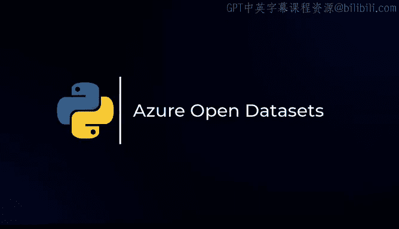
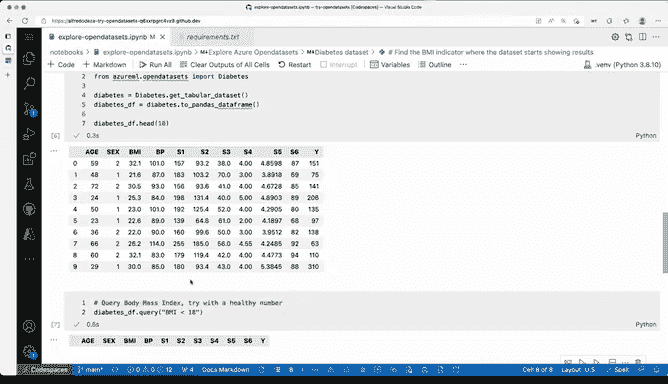

# 76：Azure 开放数据集 🗃️



在本节课中，我们将要学习如何使用 Azure 开放数据集。这是一个类似于 Hugging Face 数据集的平台，它允许我们通过安装库来动态加载数据，从而无需在代码仓库中存储庞大的数据文件。

## 概述

上一节我们介绍了其他数据源，本节中我们来看看 Azure 开放数据集。它提供了经过整理和准备的数据集，我们可以像使用 Hugging Face 一样动态加载它们。此外，其文档中还包含了大量示例，方便我们进行交互和探索。

## 开始使用 Azure 开放数据集

要开始使用 Azure 开放数据集，首先需要安装相应的 Python 库。

以下是安装所需的包和版本信息：

*   **包名称**：`azureml-opendatasets`
*   **版本**：`1.44.0`

你可以通过以下命令安装：
```bash
pip install azureml-opendatasets==1.44.0
```

## 探索数据集：公共假期

现在，让我们通过一个 Jupyter Notebook 示例来探索数据。我们将首先加载“公共假期”数据集。

首先，我们需要导入必要的模块并获取数据。处理日期数据有时会比较棘手，因此我们会使用 Python 的 `datetime` 和 `dateutil` 库来辅助。

```python
# 导入必要的库
from azureml.opendatasets import PublicHolidays
from datetime import datetime, date
from dateutil.relativedelta import relativedelta
import pandas as pd

# 定义日期范围：从去年今天到今日
today = datetime.today()
last_year = today - relativedelta(months=12)

# 加载公共假期数据集
holidays = PublicHolidays(start_date=last_year, end_date=today)
holidays_df = holidays.to_pandas_dataframe()
```

代码运行后，数据会被加载到一个 Pandas DataFrame 中。这样，我们就可以利用 Pandas 强大的功能进行数据探索。

以下是使用 Pandas 查看数据基本信息和前几行的方法：

```python
# 查看数据集的统计摘要
print(holidays_df.describe())

# 查看前10行数据
print(holidays_df.head(10))
```

执行上述代码，我们可以看到数据包含国家/地区、假期名称等列，并且数据已经过一定程度的规范化处理。

## 探索数据集：糖尿病数据

除了公共假期，Azure 开放数据集还包含许多其他数据集，例如糖尿病数据集。其使用方法保持一致，非常方便。

以下是加载并查看糖尿病数据集前几行数据的代码：

```python
# 假设已从 azureml.opendatasets 导入 Diabetes 数据集
# from azureml.opendatasets import Diabetes
diabetes_df = diabetes.to_pandas_dataframe()

# 查看前10行数据，而不是描述性统计
print(diabetes_df.head(10))
```

数据集中可能包含如 `HbA1c`（糖化血红蛋白）、`BMI`（身体质量指数）、`BloodPressure`（血压）等字段。

我们可以利用 Pandas 的查询功能来探索数据。例如，我们可以查询 `BMI` 小于 18（偏瘦）的样本：

```python
# 查询 BMI 小于 18 的数据
healthy_bmi = diabetes_df[diabetes_df[‘BMI’] < 18]
print(healthy_bmi)
```

如果提高 `BMI` 的阈值，例如查询 `BMI` 小于 30 的数据，返回的条目数会显著增加。这让我们能够快速地对数据分布有一个直观了解。

## 总结



本节课中我们一起学习了 Azure 开放数据集的基本用法。我们了解到它是一个提供高质量、可动态加载数据集的平台。通过安装 `azureml-opendatasets` 库，我们可以轻松地将数据加载为 Pandas DataFrame，并利用熟悉的工具进行数据探索和分析。这种方法避免了本地存储大型数据文件的麻烦，为机器学习项目的数据准备阶段提供了便利。