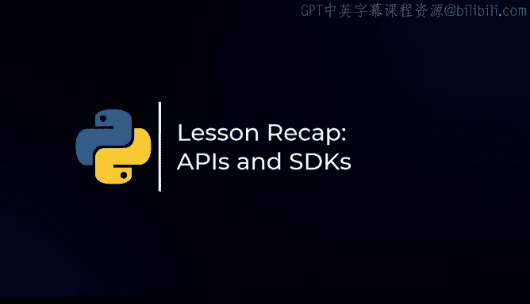

# 77：API与SDK回顾 🧠

在本节课中，我们将回顾在机器学习运维日常工作中可能接触到的几种API和SDK。我们将学习如何动态加载数据、与Hugging Face API交互，以及使用Azure开放数据和Azure CLI。这些工具对于处理大规模数据和构建自动化流程至关重要。

---


## 动态加载数据 📂



上一节我们介绍了课程概述，本节中我们来看看动态加载数据的概念。动态加载数据至关重要，因为它允许你与海量数据进行交互，而这些数据通常无法直接包含在GitHub等代码仓库中。这为你提供了在流程中交互、处理和调整数据的能力，从而基于此构建自动化。

**核心概念**：动态加载通常意味着数据不存储在代码库中，而是在运行时从外部源（如数据库、API或云存储）获取。一个简单的伪代码示例如下：

```python
# 示例：从远程URL动态加载数据
import pandas as pd
data_url = "https://example.com/large_dataset.csv"
df = pd.read_csv(data_url)
```

---

## Hugging Face API 🤗

接下来，我们了解了一下Hugging Face API，并与它的库进行了一些交互。我们理解了如何安装它并使用它。

以下是使用Hugging Face `transformers` 库的基本步骤：

1.  **安装库**：使用pip安装必要的包。
    ```bash
    pip install transformers
    ```
2.  **加载预训练模型**：使用库提供的API加载模型和分词器。
    ```python
    from transformers import pipeline
    classifier = pipeline('sentiment-analysis')
    ```
3.  **进行预测**：使用加载的模型对新数据进行推理。
    ```python
    result = classifier("I love this course!")
    print(result)
    ```

---

## Azure开放数据与Azure CLI ☁️

与Hugging Face类似，我们还接触了Azure开放数据和Azure CLI。

以下是开始使用Azure CLI的简要步骤：

1.  **安装Azure CLI**：根据你的操作系统，从微软官方文档下载并安装。
2.  **登录账户**：在终端中使用命令登录你的Azure账户。
    ```bash
    az login
    ```
3.  **访问开放数据集**：使用CLI命令或SDK（如Python的 `azure-storage-blob` 库）来列出或下载Azure上托管的开放数据集。
    ```bash
    # 示例：列出存储容器（需先配置好上下文）
    az storage container list --account-name <your_account_name>
    ```

---

## 总结 📝

本节课中我们一起学习了机器学习运维中关键的API与SDK工具。我们探讨了动态加载数据的重要性，它使我们能够处理超出本地存储限制的大型数据集。我们实践了如何与Hugging Face API交互，利用其丰富的预训练模型。最后，我们介绍了Azure开放数据平台以及通过Azure CLI管理云资源的基本方法。掌握这些工具将极大地提升你构建高效、可扩展的机器学习管道的能力。