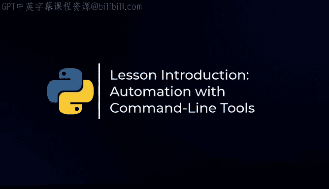

# 78：使用Python构建命令行工具 🛠️

在本节课中，我们将学习如何使用Python构建强大的命令行工具。这将帮助你将自动化能力提升到一个新的水平。


我们将探讨几种不同的实现策略，从简单的单文件脚本到更高级的、包含依赖声明和打包分发的完整工具。最后，我们会将这些概念应用于解决一个实际的机器学习问题。



---

## 构建Python命令行工具的策略 📋

上一节我们介绍了本课程的目标，本节中我们来看看构建命令行工具的具体策略。

Python提供了多种方式来创建命令行工具，你可以根据项目的复杂度和分发需求来选择。

以下是几种主要的构建策略：

*   **单文件脚本**：这是最简单的方式，适合快速、一次性的任务。你只需在一个Python文件中编写逻辑，并通过`sys.argv`或`argparse`库来处理命令行参数。
*   **声明依赖的进阶工具**：对于更复杂的工具，你可能需要依赖外部库。这时，你需要使用如`requirements.txt`或`pyproject.toml`文件来管理依赖，确保工具可以在不同环境中运行。
*   **打包与分发**：如果你希望将工具分享给他人或在其他系统上安装，你需要学习如何打包你的Python项目。这通常涉及创建`setup.py`或使用现代工具如`setuptools`和`pip`进行打包。

---

## 应用于机器学习问题 🤖

前面我们讨论了构建命令行工具的一般方法，现在让我们看看如何将这些概念应用于解决实际的机器学习问题。

一个典型的应用场景是创建一个命令行工具来自动化机器学习工作流中的某个环节，例如数据预处理、模型训练或结果评估。

以下是构建此类工具的核心步骤：

1.  **定义问题与接口**：明确你的工具要解决什么机器学习任务，并设计清晰的命令行参数。例如，一个工具可能需要接收数据路径、模型类型和输出目录作为参数。
    *   **代码示例**：使用`argparse`定义参数
        ```python
        import argparse
        parser = argparse.ArgumentParser(description='训练一个分类模型。')
        parser.add_argument('--data_path', type=str, required=True, help='训练数据文件路径')
        parser.add_argument('--model_type', type=str, default='logistic', help='要使用的模型类型')
        parser.add_argument('--output_dir', type=str, default='./results', help='结果输出目录')
        args = parser.parse_args()
        ```
2.  **实现核心逻辑**：在工具中编写完成机器学习任务的代码，例如加载数据、训练模型和保存结果。
3.  **处理依赖与打包**：确保所有必需的库（如`scikit-learn`, `pandas`, `numpy`）都在配置文件中声明，并将整个项目打包，使其易于安装和运行。
    *   **公式/概念**：依赖管理文件 `requirements.txt`
        ```
        scikit-learn>=1.0
        pandas>=1.4
        numpy>=1.21
        ```
4.  **测试与分发**：在不同环境下测试你的命令行工具，确保其稳定运行，然后通过PyPI或私有仓库进行分发。

---

本节课中我们一起学习了使用Python构建命令行工具的多种策略，从简单的脚本到可打包分发的完整应用，并探讨了如何将这些技术应用于自动化机器学习任务。掌握这些技能能显著提升你的工作效率和代码复用能力。