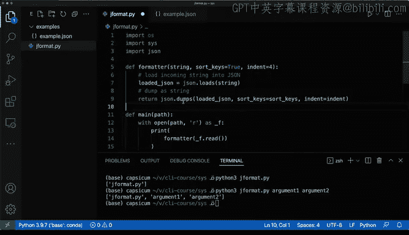
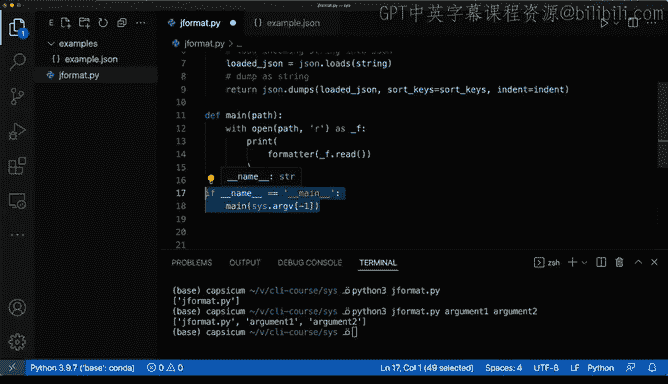
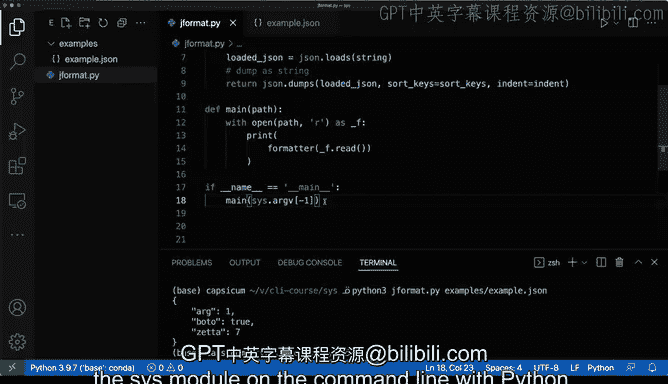

# 79：创建单文件脚本 📄


在本节课中，我们将学习如何创建一个简单的单文件Python脚本，该脚本能够从命令行接收参数，并利用Python内置模块处理JSON文件的格式化。我们将重点介绍如何使用 `sys` 模块来解析命令行参数，以及如何通过条件判断 `if __name__ == "__main__"` 来确保脚本既能作为独立程序运行，也能作为模块被安全导入。

---

## 脚本基础结构

我们从一个非常小的脚本开始。它包含一个 `main` 函数和一个名为 `formatter` 的辅助函数。`formatter` 函数的功能是接受一个来自命令行的参数，这个参数是一个文件路径。脚本会打开该路径下的文件并读取内容，然后进行格式化。它期望处理一个类JSON文件。

以下是一个示例文件，其内容非常紧凑，我们将使用Python将其格式化得更加美观。

```python
import json
import sys

def formatter(path):
    """读取并格式化JSON文件。"""
    with open(path, 'r') as file:
        data = json.load(file)
    formatted_json = json.dumps(data, indent=4, sort_keys=True)
    print(formatted_json)

def main(path):
    """主函数，调用格式化器。"""
    formatter(path)

if __name__ == "__main__":
    # 使用sys.argv获取命令行参数
    main(sys.argv[-1])
```

## 解析命令行参数

上一节我们介绍了脚本的基本结构，本节中我们来看看如何让脚本从命令行接收参数。我们将使用Python内置的 `sys` 模块来实现这一功能。

`sys.argv` 是一个列表，它包含了从命令行传递给Python脚本的所有参数。列表的第一个元素 `sys.argv[0]` 是脚本的名称，后续元素是用户提供的参数。

例如，如果我们这样执行脚本：
```bash
python script.py argument1 argument2
```
那么 `sys.argv` 将是：
```python
['script.py', 'argument1', 'argument2']
```

创建一个简单的命令行工具的第一个技巧就是使用 `sys.argv` 模块。我们将用它来传递参数。

在本例中，我们只希望处理一个参数。我们将看到如何实现这一点。

## 实现命令行交互

我们将使用Python中一个非常实用的结构，它允许我们将脚本转换为能在终端处理输入的工具。这个结构就是 `if __name__ == "__main__":`。

这个条件判断允许我们将参数传递给 `main` 函数。我们将使用 `sys.argv`，并选择该列表中的最后一个参数传递给 `main` 函数。

这意味着我们不关心命令行中传递了多少个参数，我们只选择最后一个。例如，如果传递了 `argument1` 和 `argument2`，那么 `argument2` 将被选中。

这样，选中的参数（例如 `argument2`）将被传递到第11行的 `main` 函数中。`main` 函数随后会调用 `formatter` 来读取并格式化我们提供的示例JSON文件。

你可以看到，这里使用了 `json.dumps`，它允许你使用所有功能来漂亮地重新格式化JSON。

再次强调，你需要使用 `if __name__ == "__main__":` 这个条件。这样，只有当脚本在终端作为命令行工具运行时，才会触发相应的代码逻辑，从而避免副作用。如果你是在导入这段代码，你可以安全地导入 `formatter` 甚至 `main` 函数而不会产生任何副作用。但如果你在命令行运行此脚本，这个条件就会被触发。



## 运行示例



现在，我们将在终端中使用Python 3运行 `jformat.py` 脚本，并传入示例JSON文件。

```bash
python3 jformat.py examples/example.json
```

运行后，脚本会格式化我们的参数。具体过程是：命令行中传递的最后一个参数（在本例中是 `examples/example.json`）被作为路径传递给 `main` 函数。然后脚本读取该文件，并打印出经过JSON模块美化格式化的结果。

我们的原始示例JSON文件看起来非常紧凑，经过处理后变得结构清晰、易于阅读。这就是使用Python的 `sys` 模块在命令行中解析单个参数的方法。

---



本节课中我们一起学习了如何创建一个单文件Python命令行脚本。我们掌握了使用 `sys.argv` 来获取命令行输入，利用 `if __name__ == "__main__":` 来区分脚本的运行模式，以及使用 `json` 模块来格式化JSON文件。这些是构建更复杂命令行工具和自动化脚本的基础。