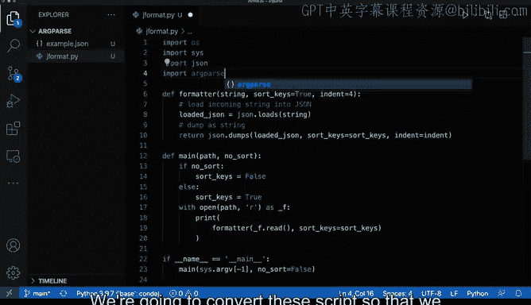
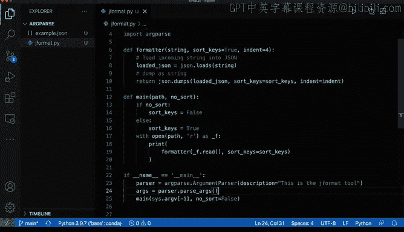
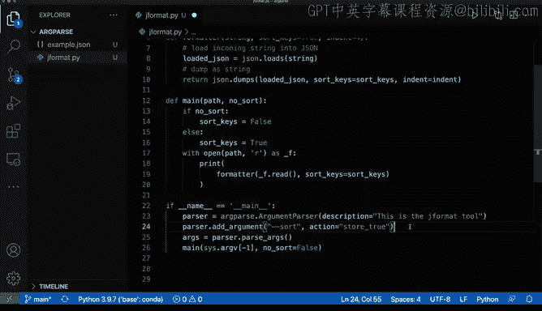
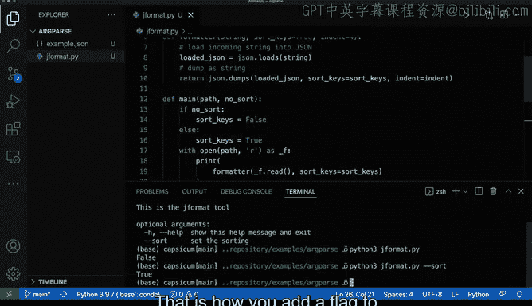
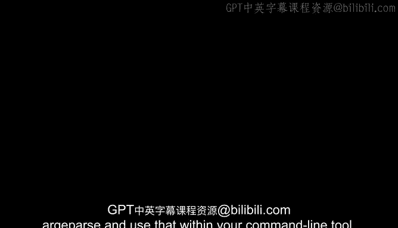

# 80：使用argparse框架 🛠️


在本节课中，我们将学习如何使用Python的`argparse`库来为命令行脚本添加参数解析功能。我们将以一个JSON格式化脚本为例，逐步演示如何初始化解析器、添加标志参数，并理解其工作机制。

---

## 导入与初始化ArgumentParser



上一节我们介绍了命令行工具的基本概念，本节中我们来看看如何开始使用`argparse`。

首先，我们需要导入`argparse`模块。然后，我们将初始化一个`ArgumentParser`类的实例。这个实例将作为我们参数解析的核心对象。

```python
import argparse

parser = argparse.ArgumentParser(description="J format tool")
args = parser.parse_args()
```




初始化`ArgumentParser`时，可以提供一个简短的描述。这个描述是可选的，但它能为我们自动生成帮助菜单。`parse_args()`方法会处理命令行传入的参数。

---

## 测试基础帮助菜单

初始化完成后，我们就可以在终端中测试脚本了。

以下是测试步骤：

1.  打开终端。
2.  运行命令 `python3 j_format.py -h`。
3.  `argparse`会自动识别 `-h` 参数并显示帮助信息。

帮助菜单会显示我们之前提供的描述信息“J format tool”，以及默认的帮助选项说明。仅用这两行代码，我们就获得了一个功能完整的帮助菜单。

---

## 添加标志参数（Flag）

现在我们已经有了解析器实例，接下来可以为其添加具体的参数。首先，我们添加一个控制排序功能的标志参数。

在我们的原始脚本中，有一个控制是否对输出键进行排序的布尔变量。我们将利用`argparse`将其转换为一个命令行标志。

```python
parser.add_argument('--sort', action='store_true', help='set the sorting')
```



`add_argument`方法用于添加参数。对于标志参数，我们使用`action='store_true'`。这意味着当在命令行中使用`--sort`时，该参数的值将被设为`True`；如果不使用，则其值为`False`。


---

## 验证标志参数的功能

添加参数后，我们可以再次运行脚本来验证其效果。

以下是验证过程：

1.  再次运行 `python3 j_format.py -h`，可以看到帮助菜单中已经列出了`--sort`标志及其说明。
2.  为了查看参数的实际值，我们可以在脚本中打印`args.sort`。
3.  运行 `python3 j_format.py`（不带参数），`args.sort`的值是`False`。
4.  运行 `python3 j_format.py --sort`（带参数），`args.sort`的值变为`True`。

通过这种方式，我们成功地将一个布尔开关转换为了命令行标志，无需在代码中手动设置`True`或`False`。

---

## 总结





本节课中我们一起学习了`argparse`框架的基础用法。我们首先导入了模块并初始化了参数解析器，然后测试了自动生成的帮助菜单。接着，我们学习了如何添加一个标志参数，并使用`action='store_true'`来将其定义为布尔开关。最后，我们验证了该参数能够根据命令行输入正确切换`True`和`False`值。这为构建更复杂的命令行工具打下了基础。