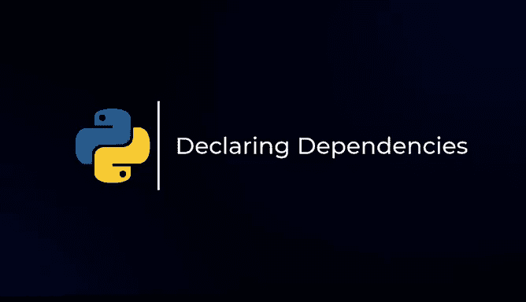
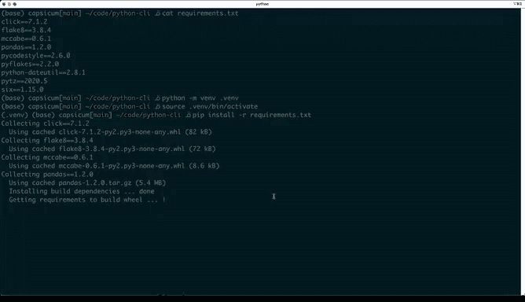
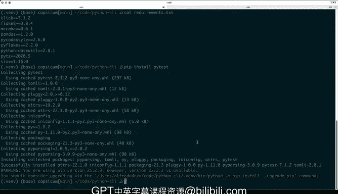

# 81：声明依赖项 📦



在本节课中，我们将要学习如何在Python项目中清晰地声明和管理依赖项。这是确保你的代码能在任何环境中稳定运行的关键一步。

---

## 声明依赖项的常见方式

在命令行工具中，清晰地声明依赖项可以通过几种不同的方式实现。其中最常见的一种是使用 `requirements.txt` 文件。

以下是一个Python项目的示例，它包含了许多不同的文件，但最重要的是位于此处的 `requirements.txt` 文件。

```
ls
```

通过列出文件，你可以看到 `requirements.txt` 文件就在这里。你可能已经见过它了，让我们快速浏览一下它的内容。

---

## 理解 `requirements.txt` 文件

`requirements.txt` 文件的内容通常如下所示：

```
package_name==1.2.3
another_package>=4.5.6
some_package
```

它包含**包名**和**版本号**。例如，使用两个等号 `==` 意味着该包被“锁定”到了一个特定的版本。文件中可以使用各种不同的修饰符来指定版本范围。如果你不指定版本，例如只写 `some_package`，那么它将安装该包的最新版本。

---

## 创建虚拟环境并安装依赖

与所有Python项目一样，你首先需要创建一个Python虚拟环境来隔离依赖。

```
python -m venv .venv
```

这条命令会在当前工作目录下创建一个名为 `.venv` 的隐藏子目录作为虚拟环境。接着，我们需要激活这个虚拟环境。

```
source .venv/bin/activate
```

激活后，命令行提示符通常会发生变化，表示你现在已处于虚拟环境中。

---

## 使用 `pip` 安装依赖

现在，我们可以使用 `pip` 工具来安装 `requirements.txt` 中列出的所有依赖。`pip` 是Python的包安装工具。

```
pip install -r requirements.txt
```

执行此命令后，`pip` 会逐行读取 `requirements.txt` 文件，开始收集每个指定的包及其依赖项，然后依次安装它们。这个过程可能需要一些时间。

---

## 验证安装结果



安装完成后，我们可以验证这些包是否已成功安装并可用。

启动Python解释器：

```
python
```

在Python交互式环境中，尝试导入一个我们知道已安装的包，例如 `pytest`：

```python
import pytest
```

如果导入成功且没有报错，则证明依赖项已正确安装。

---

## 锁定版本与非锁定版本的区别

让我们再次查看 `requirements.txt` 文件，以理解锁定版本和未锁定版本的区别。

如果你在文件中只写：

```
pytest
```

这表示未锁定版本，`pip` 会安装 `pytest` 的最新可用版本。

如果你想锁定版本，则需要明确指定：

```
pytest==7.1.2
```

这样就会强制安装该特定版本。在之前的示例中，未指定版本时安装的就是当时最新的 7.1.2 版本。

---

## 总结



本节课中，我们一起学习了在Python项目中声明依赖项的核心方法。我们介绍了如何使用 `requirements.txt` 文件来列出项目依赖，探讨了锁定特定版本与使用最新版本的区别，并完整演示了创建虚拟环境、使用 `pip install -r requirements.txt` 安装依赖以及验证安装结果的流程。虽然管理Python依赖还有其他方式，但 `requirements.txt` 是最常见和基础的一种。掌握它，是构建可复现的Python项目环境的第一步。