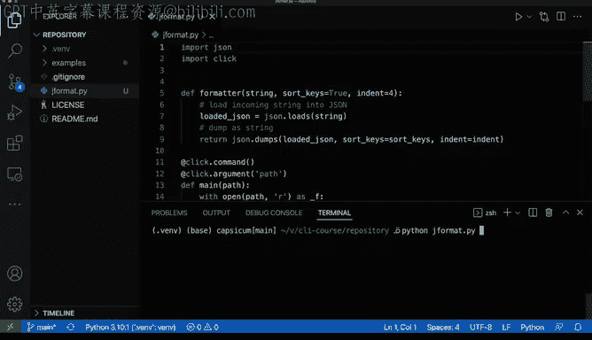
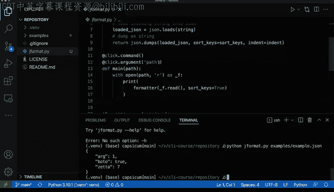
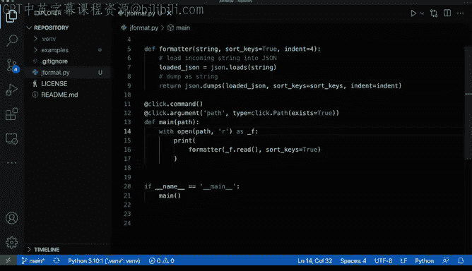
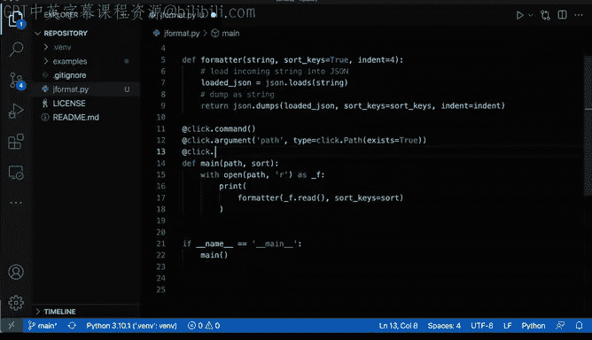
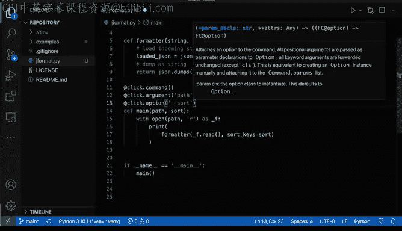
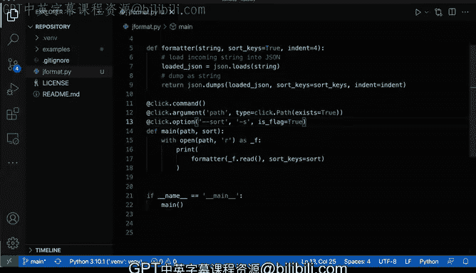

# 82：使用 Click 框架构建命令行工具 🛠️


在本节课中，我们将学习如何使用 Python 的 Click 框架，将一个简单的 JSON 格式化工具从使用 `argparse` 迁移到 Click。我们将重点学习如何定义命令、添加位置参数以及创建布尔标志。

---

## 概述

我们将改造一个名为 `j_format` 的 JSON 格式化命令行工具。该工具最初使用 Python 内置的 `argparse` 模块，现在我们将使用 Click 框架重构它，使其更简洁、功能更强大。

---

## 导入 Click 并设置基础命令

首先，我们需要导入 Click 库。请确保已通过虚拟环境安装了 Click（例如版本 8.x）。

```python
import click
```

接下来，我们使用装饰器将主函数声明为一个 Click 命令。这是 Click 框架的核心模式。

```python
@click.command()
def main():
    pass
```

---



## 添加位置参数

上一节我们介绍了如何创建一个基础的 Click 命令。本节中，我们来看看如何为其添加一个位置参数。

我们使用 `@click.argument()` 装饰器来添加一个名为 `path` 的位置参数。这个参数将被传递给主函数。

```python
@click.command()
@click.argument('path')
def main(path):
    # 主函数逻辑将在这里处理 path 参数
    pass
```

此时，如果在终端运行命令时不提供 `path` 参数，Click 会自动显示帮助信息并提示缺少该参数。

---



## 增强参数：指定类型和验证

仅仅接受一个字符串参数还不够健壮。我们可以通过指定参数类型来增加验证功能。

以下是增强 `path` 参数的方法，我们指定它必须是一个存在的文件路径。

```python
@click.command()
@click.argument('path', type=click.Path(exists=True))
def main(path):
    # 现在 path 参数会被验证是否存在
    pass
```

这样配置后，如果用户提供了一个不存在的文件路径，Click 会自动报错，提示路径不存在，这使我们的工具更加可靠。

---

## 添加布尔标志选项

现在我们的工具可以接受文件路径了。接下来，我们为其添加一个功能开关：一个用于控制是否对 JSON 键进行排序的布尔标志。

在 Click 中，我们使用 `@click.option()` 装饰器来添加标志或选项。这与位置参数 `argument` 不同。





以下是添加 `--sort` 标志的方法：



```python
@click.command()
@click.argument('path', type=click.Path(exists=True))
@click.option('--sort', is_flag=True, help='Sort the JSON keys alphabetically.')
def main(path, sort):
    # sort 参数是一个布尔值，当使用 --sort 标志时为 True
    if sort:
        # 执行排序逻辑
        pass
    else:
        # 不执行排序
        pass
```

关键点在于 `is_flag=True` 参数，它告诉 Click 这是一个开关标志，不需要额外的值。当用户在命令行中输入 `--sort` 时，`sort` 变量将被设置为 `True`。

---

## 测试工具功能

让我们在终端中测试工具的功能。

1.  **获取帮助**：运行 `python j_format.py --help`，现在可以看到 `--sort` 选项出现在帮助信息中。
2.  **不使用排序**：运行 `python j_format.py examples/example.json`，JSON 输出将保持原始键的顺序。
3.  **启用排序**：运行 `python j_format.py examples/example.json --sort`，JSON 输出的键将按字母顺序排列。

通过这个简单的例子，可以看到 Click 极大地简化了命令行参数和标志的处理逻辑。

---

## 总结

本节课中我们一起学习了使用 Click 框架构建 Python 命令行工具的基础知识：

1.  我们使用 `@click.command()` 装饰器将函数声明为命令。
2.  我们使用 `@click.argument()` 添加了位置参数，并通过 `type=click.Path(exists=True)` 增强了其验证功能。
3.  我们使用 `@click.option()` 并设置 `is_flag=True` 添加了一个布尔标志（`--sort`），用于控制工具的行为。



Click 通过装饰器提供了清晰、简洁的 API，使得创建功能丰富且用户友好的命令行工具变得非常简单。