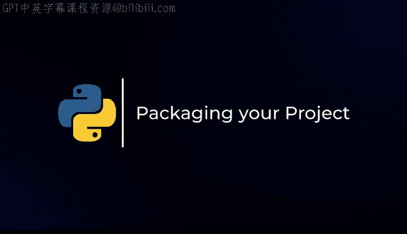
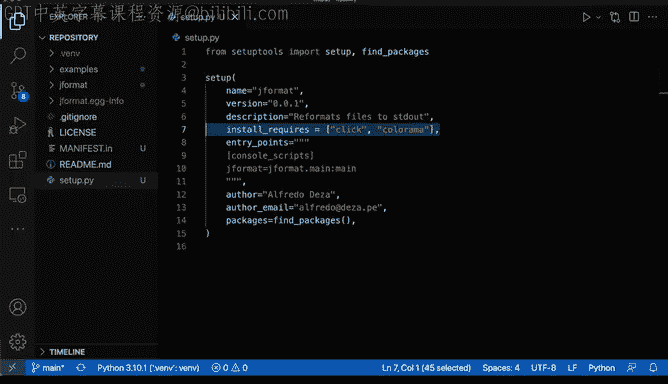

# 83：打包项目 📦

在本节课中，我们将学习如何将一个Python项目打包成可分发和安装的命令行工具。我们将重点介绍如何定义项目依赖以及如何通过配置入口点来创建可执行脚本。

---

现在我们已经准备好开始打包我们的项目。我们有一个非常基础的 `setup.py` 文件，但它并不完整，因为它缺少一些关键信息。

我们之前安装了 `click` 和 `colorama` 这两个库。如果我想将项目分享给其他人，就会遇到问题，因为这些依赖关系没有被声明。

我们需要在 `setup.py` 文件中定义这些依赖。定义依赖的方法是添加一个新参数。

我们将在 `setup.py` 中添加一个名为 `install_requires` 的新行。`install_requires` 接受一个列表。我们将在这个列表中填入 `click` 和 `colorama`。

你还可以在这里指定特定的版本号，例如 `click==8.0.0`。目前，我们暂时不固定版本号，但这是定义依赖的方式。你可能会问，这和 `requirements.txt` 文件有什么区别？如果你要分发项目，通常会使用 `install_requires` 来定义。有些人喜欢额外添加一行代码，从 `requirements.txt` 文件中读取依赖列表，然后传递给 `install_requires`，这也是完全可行的。但在本例中，我们没有使用 `requirements.txt`，所以我们直接在 `setup.py` 中定义。

接下来一个重要的问题是：我们有一个包含文件的目录，现在它算是一个命令行工具吗？我们通过定义入口点来实现这一点。

我们将定义入口点。入口点需要一个 `console_scripts` 部分，它负责从一个特定的路径、文件和函数创建可执行文件。

在本例中，我们希望 `jformat` 成为我们可执行文件的名称。我们将它设置为等于 `jformat` 模块中的 `main.py` 文件里的 `main` 函数。

保存文件后，我们打开终端。如果我们输入 `which jformat`，会发现它不可用，因为它还没有安装到我们的系统路径中。

为了开发目的，我们将在虚拟环境中运行 `python setup.py develop` 命令。这将在我们的虚拟环境中安装这个工具。

你可以看到整个安装路径，并且它发现我们声明了一些依赖，并将 `jformat` 脚本添加到了仓库中。这非常完美。

现在，如果我们输入 `jformat`，它已经存在了。输入 `jformat --help`，就会显示我们想要打包和分发的工具。这就是你如何用几个简单的选项（如入口点和在 `setup` 函数的 `install_requires` 参数中定义依赖）来打包一个工具。

再次说明，你完全可以使用 `requirements.txt` 文件，但这不是必须的，它是可选的。在本例中，`setup.py` 工作得很好。

---

本节课中我们一起学习了如何打包Python项目。我们介绍了如何在 `setup.py` 文件中声明项目依赖，以及如何通过配置 `console_scripts` 入口点来创建可执行命令行工具。这使得我们的项目可以被轻松地分发和安装。