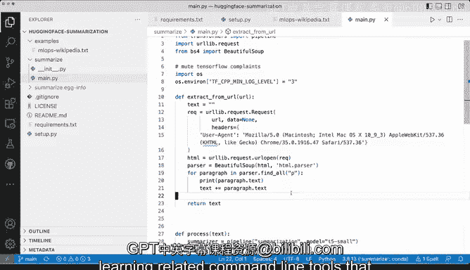

# 84：使用CLI工具解决机器学习问题 📝


在本节课中，我们将应用之前学到的命令行工具和API知识，构建一个实用的机器学习工具。具体来说，我们将创建一个命令行工具，它能更好地与Hugging Face库和外部API协同工作，以实现文本摘要功能。

---

## 概述

我们将构建一个名为 `summarize` 的Python命令行工具。该工具能够从指定的URL或本地文件中读取文本，并利用预训练的机器学习模型自动生成摘要。通过这个过程，你将学习如何将机器学习模型集成到命令行应用中。

---

## 环境与依赖设置

首先，我们需要安装必要的Python库。我们将使用 `transformers` 库来调用Hugging Face的模型，使用 `click` 框架来构建易用的命令行界面，并使用 `TensorFlow` 来支持模型的推理过程。

以下是安装依赖的步骤：

1.  创建一个新的Python虚拟环境。
2.  使用 `pip` 安装以下包：
    ```bash
    pip install transformers click tensorflow requests beautifulsoup4
    ```

---

## 工具设计与核心代码

上一节我们介绍了工具的目标和所需环境，本节中我们来看看工具的核心代码是如何设计的。

主要的逻辑集中在 `main.py` 文件中。我们首先导入必要的库。

```python
import click
from transformers import pipeline
import requests
from bs4 import BeautifulSoup
import warnings
warnings.filterwarnings(‘ignore’)
```

接下来，我们定义两个辅助函数。第一个函数 `extract_from_url` 负责从给定的URL中抓取并提取文本内容。

```python
def extract_from_url(url):
    response = requests.get(url)
    soup = BeautifulSoup(response.content, ‘html.parser’)
    paragraphs = soup.find_all(‘p’)
    text = ‘ ‘.join([p.get_text() for p in paragraphs])
    return text
```

第二个函数 `process` 是工具的核心，它负责加载摘要模型并对输入的文本进行处理。

```python
def process(text):
    summarizer = pipeline(“summarization”, model=“t5-small”, max_length=180)
    result = summarizer(text)
    return result[0][‘summary_text’]
```

最后，我们使用 `click` 框架来定义命令行接口。它接受两个参数：`--url` 或 `--file`。

```python
@click.command()
@click.option(‘--url’, default=None, help=‘URL of the webpage to summarize.’)
@click.option(‘--file’, default=None, help=‘Path to the text file to summarize.’)
def main(url, file):
    if url:
        input_text = extract_from_url(url)
    elif file:
        with open(file, ‘r’) as f:
            input_text = f.read()
    else:
        click.echo(‘Please provide either a --url or a --file.’)
        return

    summary = process(input_text)
    click.echo(summary)
```

---

## 安装与使用工具

代码编写完成后，我们需要将其安装为系统可用的命令行工具。

在项目根目录下，运行以下命令进行本地安装：
```bash
python setup.py develop
```

安装成功后，你就可以在终端中使用 `summarize` 命令了。首先，可以通过帮助菜单查看用法。

以下是该工具的基本命令选项：
*   `--help`：查看工具的使用说明和参数列表。
*   `--url <网页地址>`：指定一个需要摘要的网页URL。
*   `--file <文件路径>`：指定一个需要摘要的本地文本文件。

---

## 实践演示

现在，让我们用两个例子来演示工具的实际效果。

首先，我们尝试对一个关于MLOps的微软官方文档网页进行摘要。在终端中执行：
```bash
summarize --url https://docs.microsoft.com/en-us/azure/machine-learning/concept-mlops
```
工具会先抓取网页内容，提取段落文本，然后调用T5模型生成摘要。你会看到模型输出的摘要，概括了MLOps的核心原则和实践。

接下来，我们尝试对一个本地文件进行摘要。假设我们有一个名为 `mlops_wikipedia.txt` 的文件，其中包含了维基百科上关于MLOps的定义。

执行以下命令：
```bash
summarize --file ./examples/mlops_wikipedia.txt
```
工具会读取文件内容，并生成一个简洁的摘要，例如：“MLOps是一套旨在可靠且高效地将机器学习模型部署到生产环境的实践，是机器学习与DevOps持续开发实践的复合词。”

---

## 总结

本节课中我们一起学习了如何构建一个机器学习命令行工具。我们整合了Hugging Face的预训练模型、网页抓取技术和`click`命令行框架，创建了一个能够从URL或文件生成文本摘要的实用工具。

这个工具只是一个起点。你可以进一步优化它，例如：
*   改进模型配置以减少警告信息。
*   增强网页文本提取的准确性。
*   添加更多功能选项，如指定摘要长度、选择不同模型等。



希望这个项目能为你打下坚实基础，启发你构建出更多属于自己的、功能强大的机器学习相关工具。