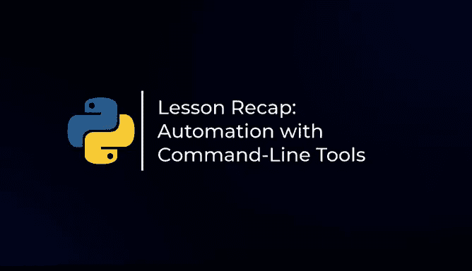

# 85：命令行工具自动化策略回顾 🛠️


在本节课中，我们将回顾构建命令行工具时可应用的不同策略。我们将从最简单的单文件脚本开始，逐步探讨更复杂的、需要外部依赖的工具构建方法。



---

上一节我们介绍了命令行工具的重要性，本节中我们来看看构建这些工具的具体策略。

构建命令行工具时，可以根据项目的复杂度和需求选择不同的策略。以下是几种常见的策略：

1.  **单文件脚本**
    这是最简单直接的方式。所有代码逻辑都写在一个Python文件中，通过 `if __name__ == "__main__":` 块来执行。它适合快速原型或简单的自动化任务。

2.  **使用 `argparse` 模块**
    对于需要处理命令行参数的工具，Python内置的 `argparse` 模块是标准选择。它可以轻松定义位置参数、可选参数，并自动生成帮助信息。
    ```python
    import argparse
    parser = argparse.ArgumentParser(description='描述你的工具')
    parser.add_argument('filename', help='输入文件名')
    args = parser.parse_args()
    ```

3.  **利用 `setuptools` 打包**
    当工具变得复杂，或需要分发给他人使用时，可以使用 `setuptools` 进行打包。通过在 `setup.py` 文件中定义入口点，可以将工具安装为系统命令。
    ```python
    # setup.py 示例
    from setuptools import setup
    setup(
        name='my_tool',
        entry_points={
            'console_scripts': [
                'my-command=my_tool.cli:main',
            ],
        },
    )
    ```

4.  **管理外部依赖**
    对于需要与外部API（例如Hugging Face的API或SDK）交互的复杂工具，必须声明和管理外部依赖。这通常在 `requirements.txt` 文件或 `setup.py` 的 `install_requires` 部分完成，以确保使用特定版本的库。

---

本节课中我们一起学习了构建Python命令行工具的多种策略。你现已掌握从选择单文件脚本到管理复杂外部依赖的方法，能够根据项目需求选择最佳策略，从而构建强大的命令行工具，并将自动化流程提升到新的水平。