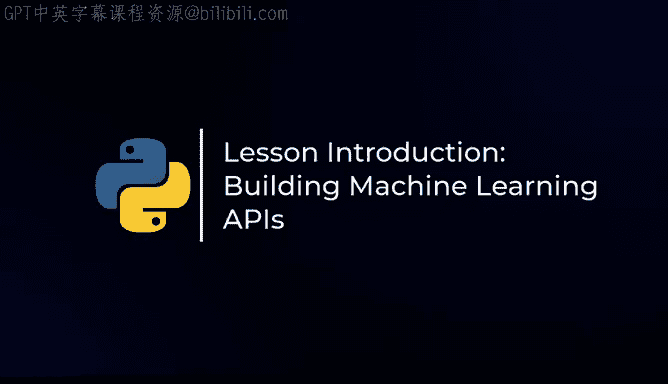

# 86：构建机器学习API 🚀

在本节课中，我们将学习如何构建强大的HTTP API。我们将简要对比两个非常流行的Python Web框架：Flask和FastAPI。它们非常相似，但也存在一些细微差别。我们将看到使用这些框架构建强大API的便利性，并探讨如何将机器学习模型集成到其中，从而将它们作为HTTP API对外提供服务。

## 框架对比：Flask 与 FastAPI


上一节我们介绍了构建机器学习API的目标，本节中我们来看看两个核心工具：Flask和FastAPI。

这两个框架都是用于构建Web应用和API的流行选择。它们都基于Python，但设计哲学和特性集有所不同。



以下是它们的一些主要特点：

*   **Flask**：一个轻量级的“微框架”，以其简洁和灵活性著称。它提供了构建Web应用所需的核心功能，其他高级功能可以通过扩展添加。
*   **FastAPI**：一个现代、快速（高性能）的Web框架，专为构建API而设计。它内置了对OpenAPI和JSON Schema的支持，能自动生成交互式API文档。

## 构建与集成API

了解了基础框架后，我们现在来看看如何使用它们构建API，并集成机器学习模型。

我们将看到，利用这些框架可以非常便捷地搭建API服务。关键在于定义路由（URL端点）和处理函数，这些函数接收请求并返回响应。

以下是将机器学习模型暴露为HTTP API的基本步骤：

1.  **加载模型**：在应用启动时，将训练好的机器学习模型（例如一个`pickle`文件或`joblib`文件）加载到内存中。
2.  **定义预测端点**：创建一个API端点（例如`/predict`），它通过HTTP POST请求接收输入数据。
3.  **处理请求与推理**：在端点的处理函数中，解析请求中的数据，将其转换为模型所需的格式，然后调用模型进行预测。
4.  **返回结果**：将模型的预测结果封装成JSON格式，并通过HTTP响应返回给客户端。

例如，一个简单的FastAPI预测端点可能如下所示：

```python
from fastapi import FastAPI
from pydantic import BaseModel
import joblib

# 加载模型
model = joblib.load("model.pkl")

app = FastAPI()

# 定义输入数据的结构
class PredictionInput(BaseModel):
    feature1: float
    feature2: float

# 定义预测端点
@app.post("/predict")
def predict(input_data: PredictionInput):
    # 将输入数据转换为模型所需的格式（如numpy数组）
    features = [[input_data.feature1, input_data.feature2]]
    # 进行预测
    prediction = model.predict(features)
    # 返回预测结果
    return {"prediction": prediction.tolist()}
```

本节课中我们一起学习了如何构建用于机器学习的HTTP API。我们比较了Flask和FastAPI这两个Python Web框架的特点，并概述了将机器学习模型集成到API中的基本流程。通过这种方式，我们可以让模型通过网络提供服务，便于其他系统调用和集成。