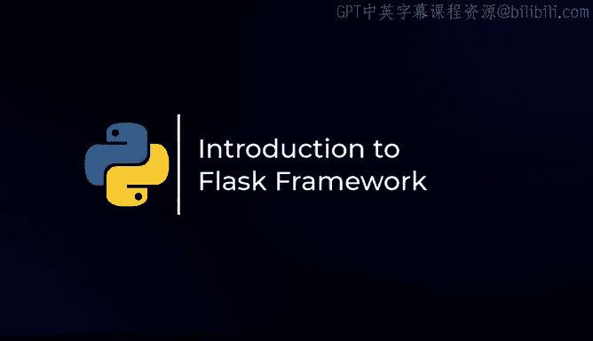
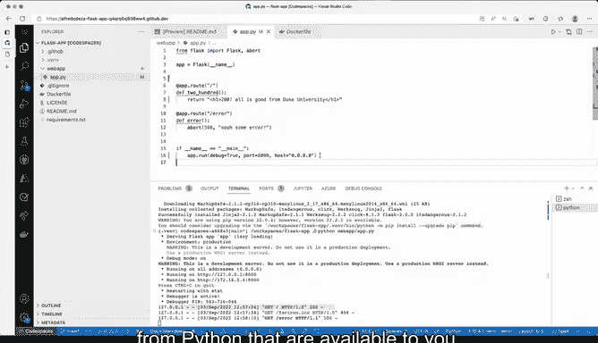

# 87：Flask 框架简介 🚀



在本节课中，我们将学习 Flask 框架的基础知识。Flask 是一个轻量级的 Python Web 框架，用于快速构建 Web 应用程序和 API。我们将通过一个简单的示例，了解如何初始化 Flask 应用、定义路由、处理请求以及运行服务器。

---

## Flask 应用的基本结构

首先，我们来看一个非常简单的 Flask 应用程序。它没有复杂的打包，仅包含一个 Docker 文件和一个容器化流程。这个示例展示了使用 Flask 构建应用的基本形态。

要使用 Flask，首先需要安装它。安装完成后，你可以导入 Flask 并开始通过定义特定的路由来暴露函数。

### 初始化 Flask 应用

以下代码展示了如何初始化一个 Flask 应用：

```python
from flask import Flask

app = Flask(__name__)
```

这里，我们导入了 Flask 模块，并创建了一个 Flask 应用实例。`__name__` 是一个常用的参数，它告诉 Flask 当前模块的名称。你也可以将这个实例命名为其他名称，例如 `my_flask_app`，但使用 `app` 是社区常见的做法。

### 定义路由与处理函数

创建了 `app` 对象后，你就可以使用它提供的装饰器来定义路由。装饰器是一种特殊的语法，用于修改函数的行为。

以下是定义路由的示例：

```python
@app.route('/')
def home():
    return '<h1>Hello, World!</h1>'
```

这个 `@app.route('/')` 装饰器意味着，当用户访问网站的根路径（例如 `example.com/`）时，Flask 将调用 `home` 函数来处理该请求。函数返回的字符串可以是纯文本，也可以是简单的 HTML，浏览器会将其渲染出来。

### 处理错误

除了正常的路由，Flask 也允许你定义错误处理。例如，你可以强制触发一个错误，并返回自定义的错误信息。

以下是如何定义一个返回错误的路由：

```python
from flask import abort

@app.route('/error')
def trigger_error():
    abort(500, description="Some error text")
```

这里，我们使用了 Flask 的 `abort` 辅助函数。它可以接受任何 HTTP 状态码和可选的错误描述信息。当用户访问 `/error` 路径时，服务器将返回一个 500 内部服务器错误，并显示“Some error text”。

---

## 运行 Flask 应用

定义了应用后，下一步就是运行它。在开发环境中，我们可以直接使用 Python 运行 Flask 应用。

### 配置与运行服务器

在 Flask 应用的末尾，我们通常会有以下代码来启动服务器：

```python
if __name__ == '__main__':
    app.run(debug=True, host='0.0.0.0', port=8000)
```

这段代码的含义是：
*   `debug=True`：启用调试模式。**注意：切勿在生产环境中使用此设置，因为它不安全。** 但在本地开发时，它非常有用，可以自动重载代码并显示详细的错误信息。
*   `host='0.0.0.0'`：使服务器监听所有可用的网络接口。
*   `port=8000`：指定服务器运行的端口号为 8000。选择 80 端口（HTTP默认端口）在本地调试时可能会有权限问题，因此使用 8000 等端口更为方便。

### 实际运行步骤

上一节我们介绍了代码结构，本节中我们来看看如何实际运行它。运行一个 Flask 应用通常遵循以下步骤：

1.  **创建虚拟环境**：这是一个隔离的 Python 环境，用于管理项目依赖。
    ```bash
    python -m venv .venv
    ```
2.  **激活虚拟环境**：
    *   在 Windows 上：`.venv\Scripts\activate`
    *   在 macOS/Linux 上：`source .venv/bin/activate`
3.  **安装依赖**：项目通常会有一个 `requirements.txt` 文件列出所有需要的包。
    ```bash
    pip install -r requirements.txt
    ```
4.  **运行应用**：执行主 Python 文件。
    ```bash
    python web_app.py
    ```

执行后，终端会显示警告信息，提醒你不要在生产环境使用调试模式，同时会输出服务器运行的地址（例如 `http://127.0.0.1:8000`）。

### 测试应用

服务器运行后，你可以在浏览器中打开相应的地址进行测试：
*   访问根路径 `/`，你会看到 “Hello, World!” 的标题。
*   访问一个未定义的路径（如 `/fake`），Flask 会自动返回一个 404 错误页面。
*   访问 `/error` 路径，则会触发我们定义的 500 错误，并显示“Some error text”。

---

## 生产环境部署说明

我们目前使用 `app.run()` 的方式运行服务器，这只适用于开发和测试。对于更高级的 Flask 应用或生产环境，建议使用专业的 WSGI HTTP 服务器，例如：
*   Gunicorn
*   uWSGI
*   或者通过 Apache、Nginx 等 Web 服务器进行反向代理

这些服务器能提供更好的性能、稳定性和安全性。具体选择哪种方式，取决于你的项目需求和部署环境。

---

## 总结 🎯



本节课中，我们一起学习了 Flask 框架的基础知识。我们了解了如何通过几行代码初始化一个 Flask 应用，如何使用 `@app.route()` 装饰器来定义路由和处理函数，以及如何利用 `abort()` 函数返回 HTTP 错误。最后，我们演示了如何在开发环境中配置并运行 Flask 服务器，并简要提及了生产环境的部署选项。这为你使用 Flask 构建 Web 应用打下了坚实的基础。