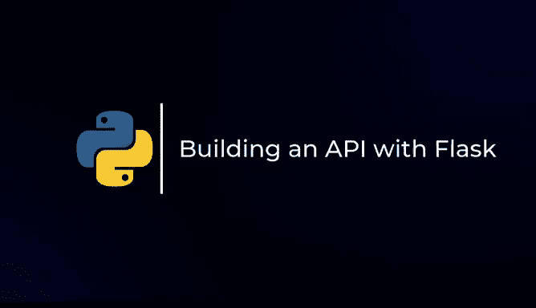
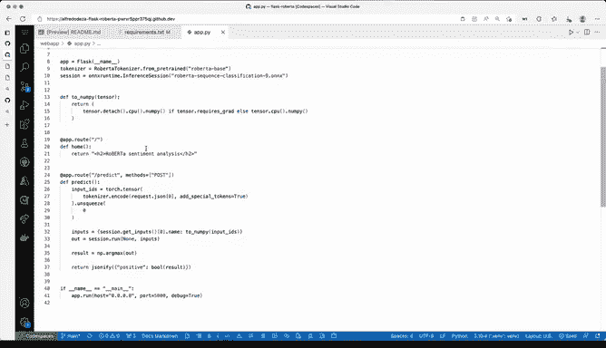

# 88：使用 Flask 构建 API 🚀



在本节课中，我们将学习如何使用 Flask 框架构建一个简单的机器学习 API。我们将创建一个能够接收文本输入并返回情感分析预测结果的端点。

---

## 概述

我们将使用 Flask 创建一个 Web API，该 API 会加载一个预训练的 RoBERTa 序列分类模型，并通过一个 `/predict` 路由来接收 POST 请求，对传入的文本进行情感分析。

---

## 初始化 Flask 应用

首先，我们需要初始化 Flask 应用。这是构建任何 Flask 应用的起点。

```python
from flask import Flask, request, jsonify
app = Flask(__name__)
```

`app = Flask(__name__)` 这行代码创建了 Flask 应用的一个实例。`__name__` 参数帮助 Flask 确定应用的位置。

---

## 加载 ONNX 运行时与模型

上一节我们介绍了如何初始化应用，本节中我们来看看如何加载模型。我们将使用 ONNX 运行时来处理模型推理。

```python
import onnxruntime as ort
session = ort.InferenceSession(‘roberta-sequence-classification-9.onnx’)
```

这里，我们导入了 ONNX 运行时库，并创建了一个推理会话，用于加载名为 `roberta-sequence-classification-9.onnx` 的预训练模型。这个模型文件需要预先下载并放在项目目录中。

---

## 创建辅助函数

在加载模型之后，我们需要一个辅助函数来帮助处理输入数据。

以下是 `to_numpy` 辅助函数，它将输入数据转换为模型所需的 NumPy 数组格式。

```python
import numpy as np
def to_numpy(tensor):
    return tensor.detach().cpu().numpy() if tensor.requires_grad else tensor.cpu().numpy()
```

这个函数检查张量是否需要梯度计算，并将其转换为 NumPy 数组，以便 ONNX 运行时能够处理。

---

## 定义主页路由

接下来，我们定义一个简单的路由作为应用的主页。

```python
@app.route(‘/’)
def home():
    return ‘<h1>Roberta Sentiment Analysis</h1>’
```

当用户访问根路径 `/` 时，应用会返回一个简单的 HTML 标题，显示“Roberta Sentiment Analysis”。

---

## 构建预测路由

现在，我们来构建核心的预测路由。这是 API 接收数据并返回预测结果的地方。

以下是 `/predict` 路由的定义，它只接受 POST 方法。

```python
@app.route(‘/predict’, methods=[‘POST’])
def predict():
    # 预测逻辑将在这里实现
    pass
```

我们使用 `@app.route` 装饰器将 `/predict` 路径映射到 `predict` 函数，并指定它只响应 POST 请求。

---

## 处理请求数据

在预测函数内部，我们需要从请求中提取并处理数据。

以下是处理传入 JSON 请求数据的代码。

```python
    data = request.get_json()
    input_text = data[0]
```

这段代码从 POST 请求的 JSON 主体中获取数据。我们假设数据是一个列表，并取出其中的第一个元素作为要分析的文本。

---

## 执行模型推理

获取文本后，我们需要将其传递给模型进行推理。

以下是调用 ONNX 模型进行情感分析的代码。

```python
    # 此处应有将文本转换为模型输入格式的代码（例如，分词）
    # input_ids = tokenizer(input_text, ...)
    # inputs = {‘input_ids’: to_numpy(input_ids)}
    # outputs = session.run(None, inputs)
    # logits = outputs[0]
    # prediction = np.argmax(logits, axis=-1)
    # is_positive = bool(prediction)
```

由于原始代码片段未展示完整的分词和模型输入准备过程，此处用注释概述了典型步骤：将文本分词、转换为模型输入格式、运行会话并获得输出 logits，最后通过 argmax 得到预测类别（例如，正面或负面情感）。

---

## 返回 JSON 响应

最后，我们需要将预测结果以 JSON 格式返回给客户端。

以下是使用 Flask 的 `jsonify` 助手函数返回响应的代码。

```python
    return jsonify({‘positive’: is_positive})
```

`jsonify` 函数将 Python 字典转换为 JSON 格式的 HTTP 响应。

---

## 运行 Flask 应用

所有功能定义完成后，我们需要添加代码来运行应用服务器。

以下是启动 Flask 开发服务器的代码。

```python
if __name__ == ‘__main__’:
    app.run(host=‘0.0.0.0’, port=45000, debug=True)
```

这行代码确保当脚本直接运行时（而不是被导入时），会启动 Flask 开发服务器。它监听所有网络接口（`0.0.0.0`）的 45000 端口，并开启调试模式。

---

## 通过 cURL 测试 API

应用运行后，我们可以使用命令行工具如 cURL 来测试 API。

以下是使用 cURL 发送 POST 请求到 `/predict` 端点的命令示例。

```bash
curl -X POST -H “Content-Type: application/json” --data ‘[“Flask is a very useful framework.”]’ http://localhost:45000/predict
```

这个命令向 `http://localhost:45000/predict` 发送一个 POST 请求，请求体是一个包含待分析文本的 JSON 数组。服务器应返回类似 `{“positive”: true}` 的 JSON 响应。

---

## 总结



本节课中我们一起学习了如何使用 Flask 构建一个完整的机器学习 API。我们从初始化应用、加载 ONNX 模型开始，逐步定义了主页路由和核心的预测路由，并实现了请求处理、模型推理和 JSON 响应返回的全过程。最后，我们还演示了如何使用 cURL 命令行工具来测试这个 API。通过这个流程，你可以将训练好的模型部署为 Web 服务，供其他应用调用。