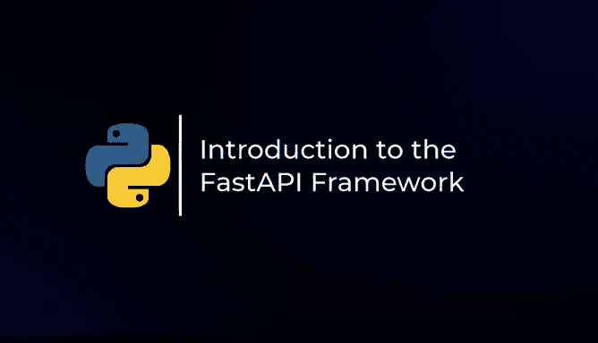
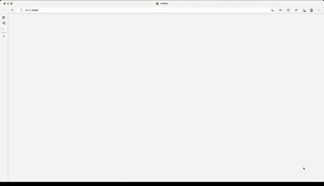
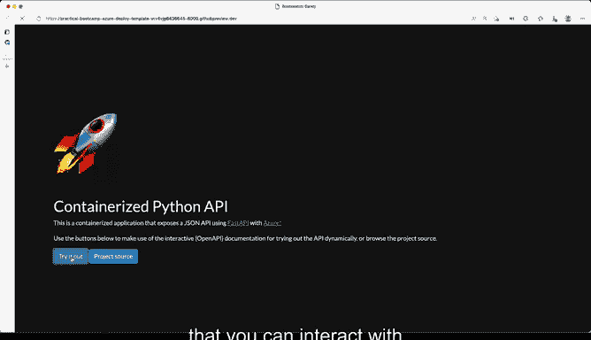
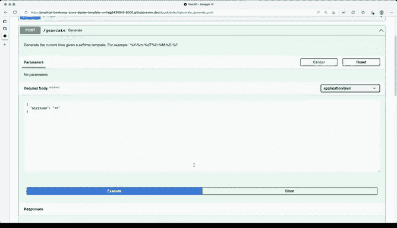
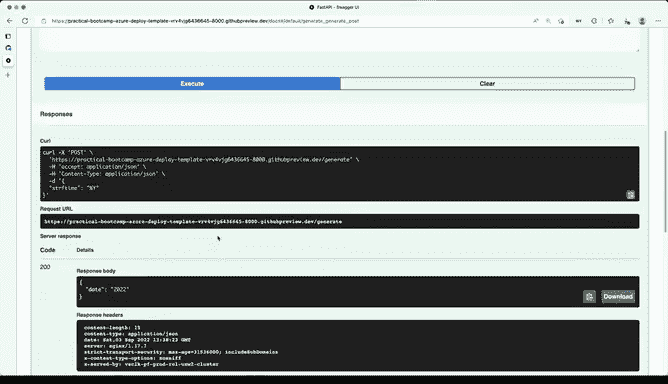
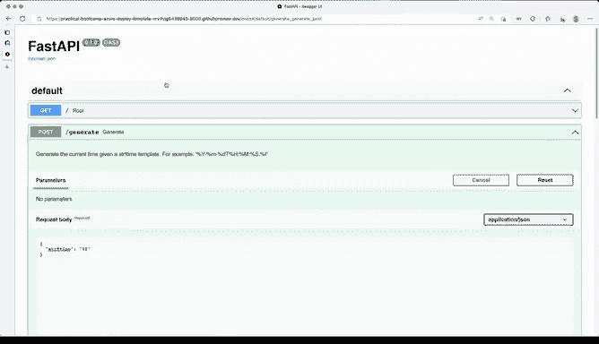

# 89：FastAPI框架简介 🚀



在本节课中，我们将要学习FastAPI框架的基础知识。FastAPI是一个用于构建API的现代、快速（高性能）的Web框架，它基于Python类型提示，并自动生成交互式API文档。我们将了解其基本结构、如何定义路由和处理请求，并运行一个简单的示例应用。

---

## FastAPI框架概述

FastAPI框架与Flask框架非常相似，但两者之间存在一些细微差别，这些差别决定了在不同场景下选择使用哪一个框架更为合适。我个人非常喜欢FastAPI，我们将在接下来的课程中快速了解它的样子。

让我们从一个已经准备好的代码仓库开始，它告诉我们运行此应用需要用到一些不同的工具。

## 运行应用所需组件

以下是运行此FastAPI应用所需的关键组件：

*   **Uvicorn**：一个ASGI服务器，用于运行Python Web应用。它是一个可执行文件，本质上是一个允许我们运行Python应用的Python Web框架。
*   **主机（Host）**：Uvicorn需要知道在哪个主机地址上运行服务。
*   **Python模块**：Uvicorn需要知道要运行的Python应用入口点。在本例中，入口点是`main.py`模块中的`app`对象。

## 项目结构解析

现在，让我们快速查看一下主要的应用文件。

我们打开`main.py`文件。这里有几个不同的文件，但我们现在不需要关注`README`，可以先关闭它。

在`main.py`中，我们可以看到以下几点：

1.  **实例化FastAPI应用**：代码通过`app = FastAPI()`实例化了一个FastAPI应用对象，这与Flask的做法非常相似。
2.  **定义路由**：与Flask一样，我们通过装饰器来暴露路由（即API端点）。
    *   `@app.get("/")`：这个装饰器将下面的`root`函数暴露为处理根路径（`/`）的GET请求的处理器。
    *   `@app.post("/generate")`：这个装饰器将`generate`函数暴露为仅处理`/generate`路径的POST请求。
3.  **请求体模型**：代码中有一个有趣的部分是第18行定义的`Body`类。它继承自`BaseModel`，用于定义对传入请求体的期望。这里，它期望一个JSON请求体中包含一个名为`strf_time`、类型为字符串（`str`）的字段。
4.  **函数参数**：在`generate`函数中，`body`是一个必需的参数，其类型被指定为上面定义的`Body`对象。这使得FastAPI能够自动验证请求数据。

我们看到了一个非常基础的API，它允许你定义函数、指定如何暴露它们（路由和方法）。

## 一个关键区别：文件响应

这里的一个关键区别是，在根路由（`/`）的处理函数中，我们使用了`FileResponse`来返回一个HTML文件。如果我们查看`static`目录，会发现一个`index.html`文件。这表明FastAPI也可以用来提供静态内容。

## 如何运行应用

了解如何运行应用总是有用的。让我们查看一下`Dockerfile`来了解其运行方式。它使用Uvicorn，指定主机为`0.0.0.0`（绑定到所有网络接口），并运行`main:app`（即`main.py`模块中的`app`对象）。

接下来，我们快速创建一个终端，按照`Dockerfile`中的模式来运行这个应用，以此完成对FastAPI的介绍。

运行命令如下：
```bash
uvicorn main:app --host 0.0.0.0
```
*   `main:app`：表示运行`main.py`模块中的`app`对象（即第14行创建的`FastAPI()`实例）。
*   `--host 0.0.0.0`：指定服务器监听所有可用的网络接口。

运行该命令后，服务器启动。我们可以打开浏览器访问 `http://localhost:8000`。

## 交互式API文档

访问根路径（`/`）会看到HTML页面。但FastAPI的一个优点是它提供了动态生成的交互式API文档，这个文档通常位于 `/docs` 路径。





虽然在我们查看的`main.py`代码中，并没有显式地暴露一个`/docs`路由，但FastAPI框架默认提供了这个功能。

访问 `http://localhost:8000/docs`，你会看到自动生成的OpenAPI文档。在这里，你可以看到已定义的`/generate`端点。点击它，然后点击“Try it out”按钮。

你会发现，文档界面已经根据我们函数定义中的类型提示（如`Body`模型），自动生成了参数输入框。例如，它知道需要一个`strf_time`字符串参数，并给出了示例`%Y-%m-%d`。

我们来尝试一下，在输入框中填入`%Y`，然后点击“Execute”。

## 查看请求与响应

执行后，滚动到“Responses”部分查看结果。



1.  **响应体（Response body）**：你会看到响应体是“2022”。这是因为`%Y`在Python的`strftime`格式中代表完整的年份。
2.  **cURL命令（curl command）**：文档还提供了完整的cURL命令，方便你在其他地方测试这个API。
3.  **请求URL（Request URL）**：显示了实际调用的URL。
4.  **响应头（Response headers）**：展示了服务器返回的响应头信息。

这些信息非常有用。FastAPI内置了OpenAPI规范支持，允许你动态地与正在运行的API进行交互。

---

## 总结





本节课中，我们一起学习了FastAPI框架的入门知识。我们了解了如何通过`FastAPI()`创建应用实例，如何使用`@app.get()`和`@app.post()`装饰器定义路由，以及如何利用Pydantic模型来定义和验证请求体的数据结构。我们还成功运行了应用，并体验了FastAPI自动生成的、功能强大的交互式API文档（`/docs`）。这为后续集成机器学习模型并构建其API接口打下了坚实的基础。下一节，我们将探索如何将机器学习模型引入到这个框架中。