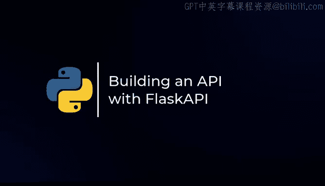
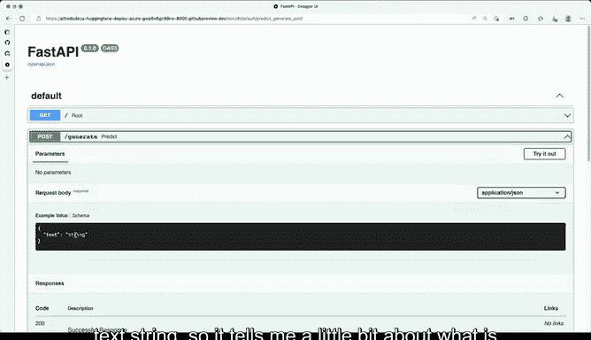
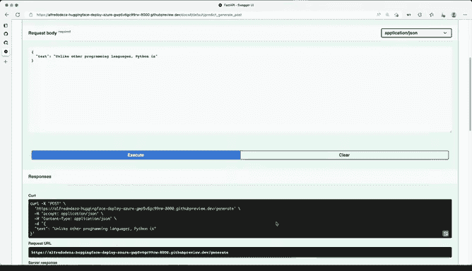
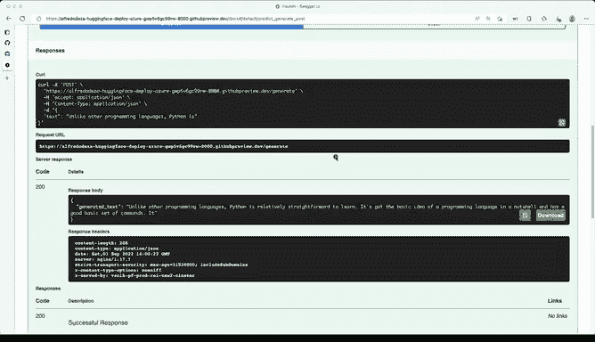
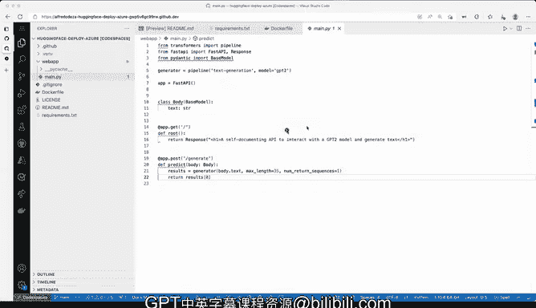

# 90：使用 FastAPI 构建机器学习 API 🚀



在本节课中，我们将学习如何使用 FastAPI 构建一个真实的机器学习 API。我们将结合 Hugging Face Transformers 库加载一个文本生成模型，并通过 API 端点提供服务。

---

## 概述

我们将使用 FastAPI、Hugging Face Transformers、TensorFlow 和 Uvicorn 来构建一个文本生成 API。与需要将模型预先存储在文件系统中的方式不同，本例将动态加载模型。

---

## 项目依赖与设置

以下是构建此 API 所需的核心库：

*   `fastapi`: 用于构建 Web API 框架。
*   `uvicorn`: 用于运行 FastAPI 应用的 ASGI 服务器。
*   `transformers`: Hugging Face 提供的库，用于加载和使用预训练模型。
*   `tensorflow`: 作为模型运行的后端之一。

主要 API 逻辑定义在 `main.py` 文件中。

---

## 核心代码解析

上一节我们介绍了项目所需的工具，本节中我们来看看 `main.py` 文件的具体实现。

首先，我们导入必要的模块并初始化文本生成管道。

```python
from fastapi import FastAPI
from pydantic import BaseModel
from transformers import pipeline

# 使用 Hugging Face 的 pipeline 工具加载文本生成模型
generator = pipeline("text-generation", model="gpt2")
```

接下来，我们创建 FastAPI 应用实例并定义数据模型。

```python
app = FastAPI()

# 定义请求体的数据模型
class TextRequest(BaseModel):
    text: str
```

然后，我们定义 API 端点。根路径 `/` 返回一个简单的 HTML 页面。

```python
@app.get("/")
def read_root():
    return {"message": "Go to /docs for the API documentation"}
```

核心的文本生成端点定义在 `/generate` 路径下，它接收 `TextRequest` 作为请求体。

```python
@app.post("/generate")
def predict(body: TextRequest):
    # 使用模型生成文本
    result = generator(body.text, max_length=50, num_return_sequences=1)
    # 返回生成结果
    return result
```

---

## 运行与测试应用



代码编写完成后，我们需要运行服务器并进行测试。

使用以下命令通过 Uvicorn 启动应用：

```bash
uvicorn main:app --host 0.0.0.0 --port 8000
```



启动时，Hugging Face 会自动下载指定的 `gpt2` 模型。启动成功后，FastAPI 会自动生成交互式 API 文档。

访问 `http://localhost:8000/docs` 即可看到文档页面。以下是测试步骤：

1.  在文档页面找到 `/generate` 端点。
2.  点击 “Try it out” 按钮。
3.  在请求体的 `text` 字段中输入提示文本，例如：`"Unlike other programming languages, Python is"`
4.  点击 “Execute” 按钮发送请求。

服务器将调用模型进行推理，并返回生成的文本。响应中会包含生成的完整文本、使用的 curl 命令示例以及 HTTP 状态码。

---

## 总结



本节课中我们一起学习了如何使用 FastAPI 构建一个完整的机器学习 API。我们实现了以下关键步骤：

1.  **初始化模型**：利用 Hugging Face Transformers 的 `pipeline` 动态加载 GPT-2 模型。
2.  **定义 API 结构**：使用 Pydantic 模型定义请求体，并使用 FastAPI 装饰器创建端点。
3.  **处理请求与响应**：在 `/generate` 端点中接收用户输入，调用模型生成文本，并返回结果。
4.  **运行与交互**：通过 Uvicorn 运行应用，并利用 FastAPI 自动生成的交互式文档进行测试。



整个过程展示了 FastAPI 在快速构建和部署机器学习服务方面的简洁性与强大功能。