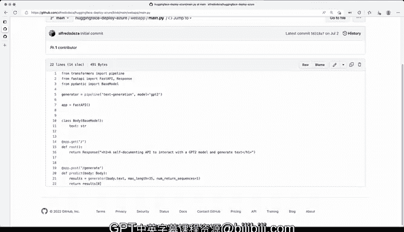

# 91：API最佳实践 🚀


在本节课中，我们将学习构建API时应遵循的一些核心最佳实践。我们将重点探讨HTTP状态码的正确使用、不同HTTP请求方法（如GET、POST、PUT、HEAD）的适用场景，以及编写良好API文档的重要性。

---

## HTTP状态码的最佳实践 🔢

上一节我们介绍了API的基本概念，本节中我们来看看如何通过HTTP状态码清晰地传达API的行为和错误信息。正确使用状态码对于定义与特定行为相关的错误至关重要。

以下是几种常见且重要的HTTP状态码及其使用场景：

*   **400 Bad Request**：当请求的格式或内容不符合预期时使用，例如客户端发送了一个字符串，但API期望一个整数。
*   **401 Unauthorized**：当访问某个资源需要授权，而客户端未提供有效凭证时使用。
*   **404 Not Found**：表示请求的资源不存在。一个值得注意的实践是，有时为了安全，可以对未授权的资源访问也返回404，而不是401。这可以防止恶意用户探测系统中是否存在特定资源（例如，通过尝试不同用户名来确认其是否存在）。

---

## HTTP请求方法：GET， POST， PUT， HEAD 📤

了解了状态码后，我们来看看客户端与服务器交互的不同方式，即HTTP请求方法。每种方法都有其特定的语义和用途。

以下是四种核心HTTP请求方法的说明：

*   **GET**：用于**只读**请求。客户端请求获取一个已存在的资源（如数据），服务器不会创建新资源。这通常映射到数据库的读取操作。
    *   **代码示例**：`GET /api/users/123`
*   **POST**：用于**创建**新资源。例如，提交数据以创建一个新用户或新地址。
    *   **代码示例**：`POST /api/users` （请求体中包含新用户数据）
*   **PUT**：用于**更新**已存在的资源。例如，一个用户更改了住址，就需要使用PUT来更新该用户的地址信息。
    *   **代码示例**：`PUT /api/users/123` （请求体中包含更新后的用户数据）
*   **HEAD**：其行为与GET类似，但服务器**只返回响应头，不返回响应体**。它常用于检查某个资源是否存在，或获取资源的元信息（如最后修改时间），而对客户端和服务器造成的开销最小。

为了更直观地理解HEAD请求，请看以下对比示例。假设我们有一个获取二进制数据的接口：

```python
# HEAD 请求示例：只检查资源是否存在，返回空响应体
def head(self):
    # 向数据库查询资源
    if not resource_exists:
        return 404  # 返回状态码，无响应体
    return {}       # 返回空字典（通常转为空JSON对象），表示资源存在

# GET 请求示例：获取资源的完整信息
def get(self):
    # 向数据库查询资源
    data = fetch_complete_resource_data()
    return data     # 返回包含完整资源信息的响应体
```

---

## 文档化你的API 📖

最后，我们来探讨一个至关重要但常被忽视的实践：API文档化。清晰的文档能极大提升API的易用性。

我们之前看到的Hugging Face部署示例存在一个典型问题：**缺乏文档**。如果API端点没有文档，使用者就必须通过阅读源代码来猜测如何调用。例如，他们需要找到 `/generate` 端点，然后逐行查看代码才能知道请求体需要一个名为 `text` 的字符串，并且不清楚应该提供什么样格式的示例文本。

> **核心要点**：如果你在开发生产级应用程序，务必确保为所有API端点编写文档，并提供清晰的调用示例。

---



本节课中我们一起学习了构建稳健API的关键最佳实践：正确使用HTTP状态码来传达请求结果、根据操作意图（读、写、更新、检查）选择合适的HTTP方法，以及通过完善的文档来提升API的可用性和可维护性。遵循这些实践将帮助你构建出更专业、更易于使用的服务接口。